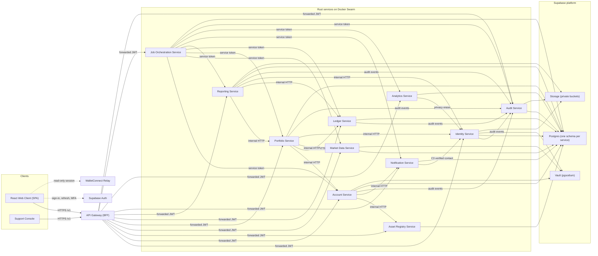
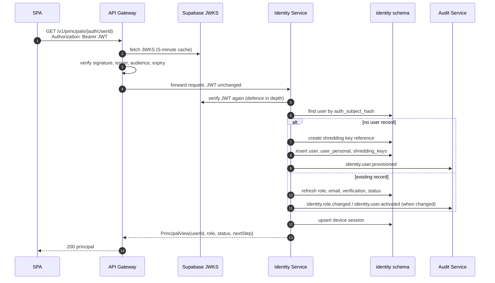
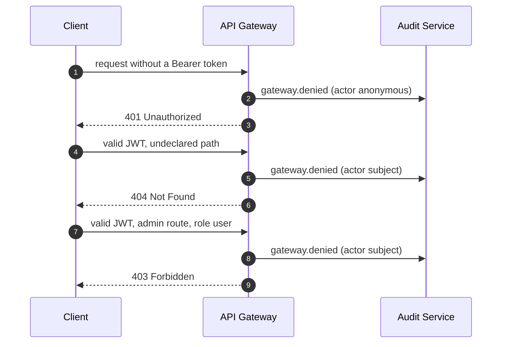
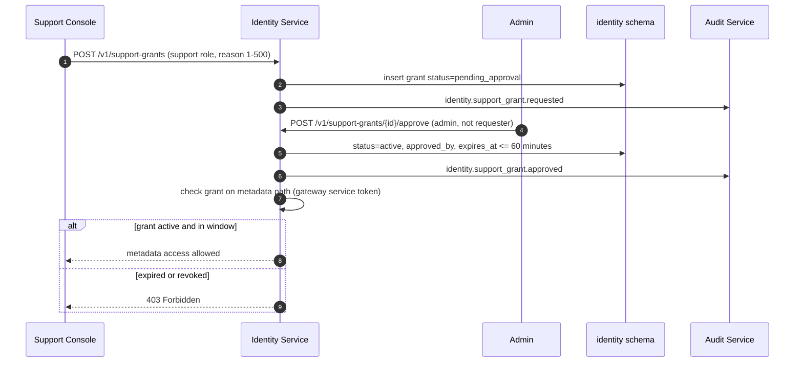
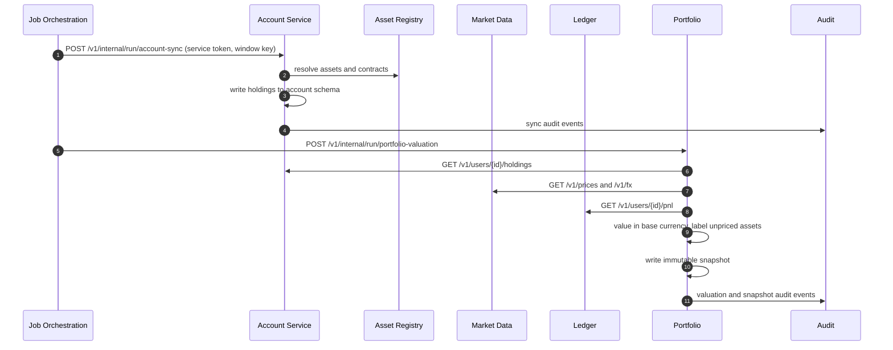
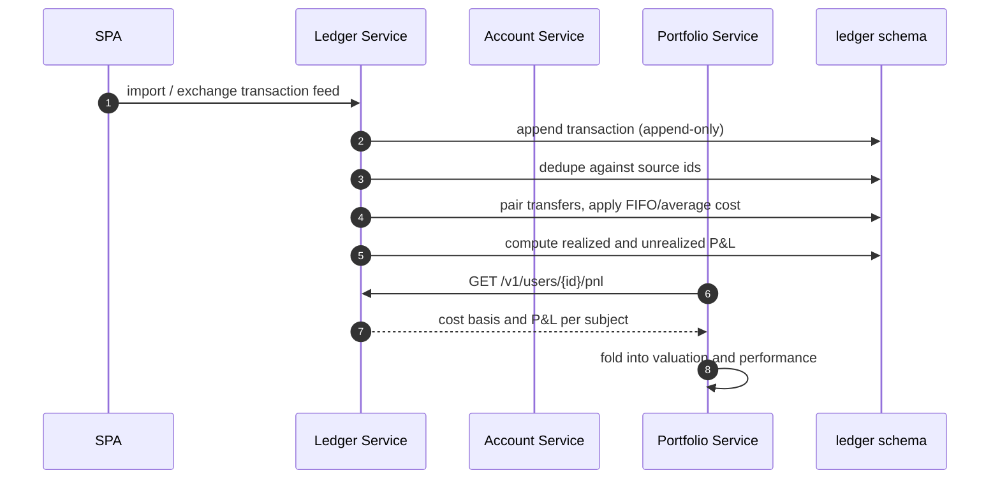

# Architecture — Crypto Pocket Butler

## System Overview

Crypto Pocket Butler is a **service-oriented, synchronous-HTTP system** deployed on Docker Swarm. A React SPA and a separate React support console call a single API Gateway. The gateway validates the user's Supabase JWT, applies a deny-by-default route table, and forwards the JWT unchanged to the owning service over the private network. Each backend service is a Rust Clean Architecture Cargo workspace (`domain`, `application`, `infrastructure`, `http`) that owns exactly one Supabase Postgres schema and one Postgres role. There are no message queues. Supabase supplies Auth (JWT/JWKS/MFA), Postgres, Storage and Vault; everything else runs on the Swarm cluster, including a self-hosted observability stack.

The architecture model of record is `docs/architecture/workspace.dsl`; this document describes the implemented code.

## Architectural Style

**Microservices with a Backend-for-Frontend gateway, per-service data ownership, and Clean Architecture inside each service.**

Evidence:

- 12 service packages under `services/` plus the gateway, each with four crates (`Cargo.toml` workspace members).
- One router and one `AppState` per service (`services/<svc>/http/src/{routes,state}.rs`), each with its own `/healthz`, `/readyz`, `/metrics`.
- One migration pair per service schema (`services/<svc>/migrations/000N_*.{up,down}.sql`), one schema per service (`infra/sql/*-schema.sql`).
- Dependencies point inward only, enforced mechanically by `scripts/check-boundaries.sh`.
- Synchronous internal HTTP with bounded retries and idempotency keys; no queue, no outbox (`docs/architecture/README.md` §6).

## Component Relationships

Documented target wiring. In the implemented code the gateway's deny-by-default route table currently declares only Asset Registry paths (`services/gateway/domain/src/route.rs:68-90`); the other edges are the intended wiring described in `docs/architecture/README.md` §6 and are reachable today only on each service's published port.

Text fallback: the SPA and support console call only the gateway, plus Supabase Auth and WalletConnect directly. The gateway forwards the JWT unchanged to the owning service. Services read each other only over internal HTTP; the Job Orchestration Service invokes run endpoints with a service token; every service writes audit events and its own Postgres schema; secrets come from Vault; exports and PDFs go to private Storage buckets.

## Data Flow

1. **Authentication** — the SPA signs in with Supabase Auth (PKCE); the access token is held in memory only.
2. **Edge** — every request carries `Authorization: Bearer <jwt>`; the gateway validates signature/issuer/audience/expiry against a cached JWKS, matches a declared route, checks the admin gate, adds `x-correlation-id` and — for non-idempotent methods — an `idempotency-key`, then forwards.
3. **Service** — each service re-validates the JWT (defence in depth), maps the validated claims to an internal `Caller`/principal, enforces ownership, runs the use case behind port traits, and maps errors to RFC 7807 problems.
4. **Persistence** — sqlx repositories read/write only the service's own schema; cross-service data comes from that service's HTTP API.
5. **Audit** — security-relevant events are written to the Audit service; domain events are best-effort with local logging fallback.
6. **Scheduling** — the Job Orchestration Service holds a single lease row, ticks, and calls each service's `/v1/internal/run/<job>` with a per-window idempotency key.

## Key Design Decisions

| Decision | Implementation evidence | Cost accepted |
| --- | --- | --- |
| Four-crate Clean Architecture per service | `Cargo.toml`, `services/<svc>/{domain,application,infrastructure,http}`; `scripts/check-boundaries.sh` | More crates and boilerplate per service |
| Forwarded Supabase JWT, validated in every service | `services/*/infrastructure/src/auth.rs` JWKS validators; `require_jwt` middleware | Every service needs JWKS access and clock-skew tolerance |
| Deny-by-default gateway route table | `services/gateway/domain/src/route.rs`; `AuthorizeAndRoute::execute` | Every new endpoint must be declared centrally |
| One schema and role per service, no cross-schema grants | `infra/sql/*-schema.sql`; migration role blocks | Cross-service reads need HTTP and a contract |
| No message queues; bounded retry + reconciliation | `services/*/infrastructure/src/http_retry.rs`; scheduler run records | Each path re-implements retry; eventual consistency repaired by jobs |
| Append-only audit via insert-only role and triggers | `services/audit/migrations/0001_init.up.sql:399-403`; trigger guards | No cryptographic chaining; tamper evidence is grant-based |
| pgsodium crypto-shredding for erasure | `identity.shredding_keys`, `user_personal`; Vault key references | Per-subject keys must exist before the data they protect |
| Secret files, never env values, for credentials | `services/*/src/config.rs` (`secret(...)` reads `*_FILE`) | Operators must materialise Docker secrets from Vault |
| In-memory gateway rate limits and caches | `services/gateway/http/src/rate_limit.rs`; JWKS `RwLock` cache | Per-replica state; horizontal scaling changes limits |
| Rust decimal arithmetic | `rust_decimal` in `[workspace.dependencies]` | No floats; explicit rounding policy per domain |

## Improvement Opportunities

- Declare the non-registry routes in the gateway route table, or the SPA cannot reach Identity, Portfolio, Account and the rest through the documented single entry point.
- Add the Billing service (or mark BRD-016 out of scope) — the C4 model and gateway narrative currently promise entitlements that no code enforces.
- Add principal resolution and entitlement checks to the gateway if §6 of the architecture README is to remain true.
- Add a CI workflow; the documented gates are currently manual.
- Normalise the service runnable-unit convention (`src/main.rs` vs `src/bin/api.rs` vs `src/bin/{api,worker,migrate}.rs`).
- Represent BRD-002's `disabled` and `pending_deletion` statuses, or record the narrower implemented enum as a deliberate decision.

## Interaction Diagrams

### 1. First authenticated request — principal resolution and provisioning (BRD-002 FR-USR-01, AC-USR-01)

Text fallback: the gateway validates the JWT and forwards it unchanged; Identity validates it again, finds or creates exactly one internal user keyed by the hashed Auth subject, records audit events for provisioning/role change/activation, records the device session, and returns the principal with the required next step (`none`, `verify_email`, `enrol_mfa`).

### 2. Deny-by-default request (BRD-002 BR-USR-03, FR-USR-05, AC-USR-03)

Text fallback: a missing, invalid or expired token is 401; a path with no declared route is 404 and denied; an admin-declared route with a non-admin role is 403. Every denial writes a `gateway.denied` audit event carrying actor, action, target, outcome and correlation id.

### 3. Support access grant (BRD-002 FR-USR-11, BR-USR-09, AC-USR-07)

Text fallback: a support agent requests a grant with a reason; a different admin approves it; Identity sets an expiry of at most 60 minutes and writes audit events. The metadata path checks the grant through a gateway-only internal route; an expired or revoked grant is refused.

### 4. Account sync to valuation and snapshot (business transaction across Account, Registry, Market Data, Portfolio, Ledger)

Text fallback: the scheduler triggers account sync with a service token; Account resolves asset identity through the registry, stores holdings, and audits. The scheduler then triggers portfolio valuation; Portfolio reads holdings from Account, prices and FX from Market Data, and P&L from Ledger, values in the user's base currency, labels unpriced or unmapped assets as excluded rather than zero, and writes an immutable snapshot with audit events.

### 5. Transaction import to P&L (Ledger + Portfolio)

Text fallback: transactions are appended, deduplicated, transfer-paired and cost-based in the Ledger schema; Portfolio reads P&L over internal HTTP and folds it into valuation, performance and snapshots. Ledger is the system of record for cost basis; Portfolio never stores transaction rows.
