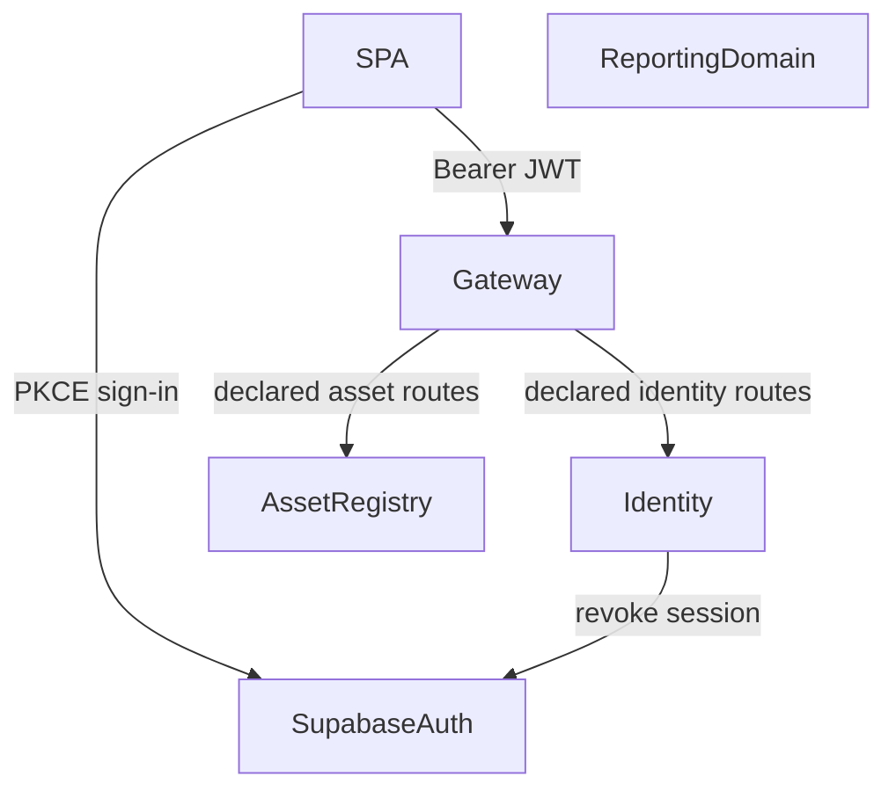
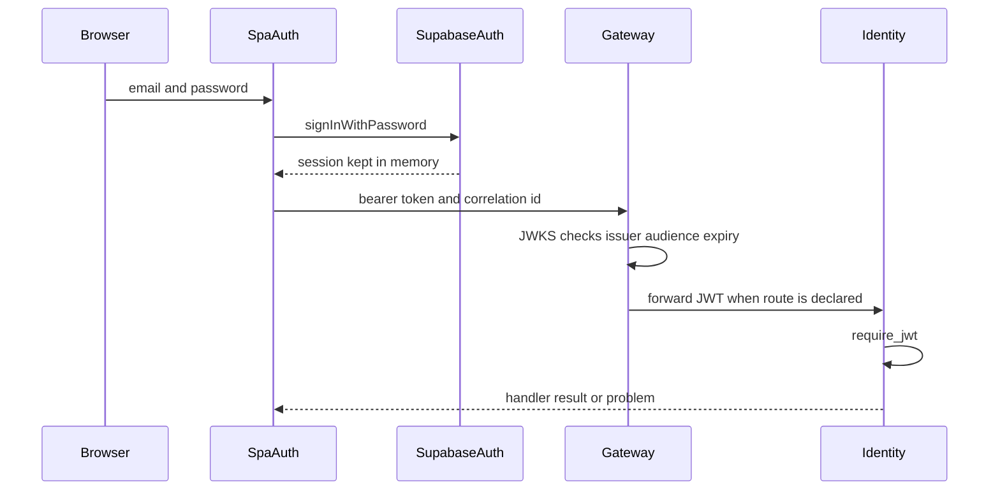
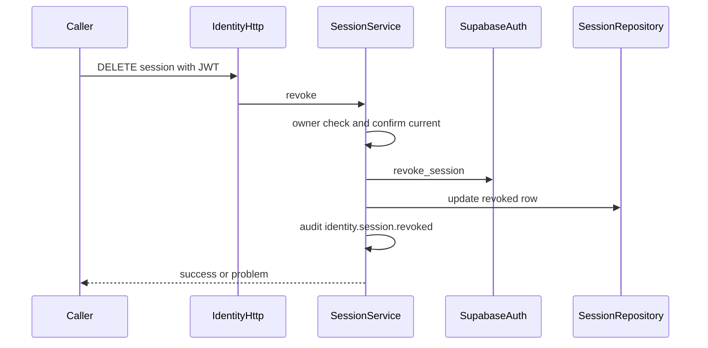

# Architecture

## Architecture Analysis

### System Overview

The repository is a Cargo workspace of independently packaged Rust services plus two Yarn front ends (`Cargo.toml` members; `web/package.json`). Each service confirmed in Identity uses a composition root over four crates: domain, application, infrastructure, and http (`services/identity/Cargo.toml`). The SPA does not call those services directly for API data. It calls Supabase Auth for sign-in and the API gateway for `/v1` calls.

The focused reporting scan examined `services/reporting/domain/`, a Rust domain crate. Its manifest declares unused `serde` and `serde_json`; the scanned domain source has no use of either, and the repository's mechanical boundary script prohibits these dependencies for domain crates.

This run read the authentication path deeply and skimmed other areas recorded in the scope block. It is not a whole-repository architecture proof.

### Architectural Style

Hybrid of independently packaged services and hexagonal (clean) layering inside a service.

Evidence:

- Workspace members are separate service packages, not one binary (`Cargo.toml`).
- Identity's composition package depends on its four crates (`services/identity/Cargo.toml`).
- The gateway route table is an explicit allowlist. Undeclared routes are denied by the table's own comment (`services/gateway/domain/src/route.rs`).
- The reporting focused scan confirms a `domain` crate manifest with no package-to-package dependencies declared; the two unused serialization dependencies violate the stated domain boundary policy.
- The read service-map states service-to-service calls are synchronous HTTP and that there is no message queue. That statement was read as project knowledge, not re-verified in every service.

Not observed in the files read: serverless functions, a shared database grant across services, or a broker.

### Component Relationships

Text fallback: The SPA talks to Supabase Auth for sign-in and to the gateway with a bearer JWT. The gateway forwards only declared routes to Asset Registry or Identity. Identity calls Supabase Auth when it revokes a device session. Reporting Domain is a separate domain crate in the Rust workspace; this diagram does not imply a runtime call to it.

### Data Flow

1. `createClient` keeps the session in the memory adapter. `sessionStorage` holds only the PKCE verifier so a full-page callback can finish (`web/src/auth/storage.ts`, `web/src/auth/client.ts`).
2. `GatewayClient` reads the access token and sets `Authorization` and `x-correlation-id` (`web/src/api/client.ts`).
3. The gateway validates the JWT against cached JWKS and checks signature, issuer, audience, and expiry (`services/gateway/infrastructure/src/auth.rs`).
4. Identity `require_jwt` accepts the forwarded bearer token and returns appropriate boundary errors (`services/identity/http/src/middleware.rs`).
5. `SessionService::revoke` checks owner or admin, requires `confirm_current` for the caller's current session, calls `AuthAdmin::revoke_session`, then updates the row and records an audit event (`services/identity/application/src/sessions.rs`).
6. Reporting domain behavior resides in the `reporting-domain` library; its scanned source depends on chrono, rust_decimal, thiserror, and uuid, while manifest-only serde dependencies are unused. No network or persistence flow was in the scan scope.

### Key Design Decisions

- Passwords stay in Supabase Auth. The SPA calls sign-in and sign-up APIs; it does not hash or store a password (`web/src/auth/session.ts`).
- Tokens are not written to `localStorage`. The storage adapter enforces the in-memory token rule, with a narrow PKCE exception.
- The gateway denies routes that are not in `default_registry_routes`.
- Identity separates public routes, user-JWT routes, and service-token routes (`services/identity/http/src/routes.rs`).
- Device-session revocation is ordered: provider revoke, then local update, then audit.
- The reporting domain crate should remain framework-free; unused serialization dependencies in its manifest conflict with the domain boundary check and have no analyzed-source usage.

### Improvement Opportunities

- `default_registry_routes` does not declare `POST /v1/signup-gate` or `GET`/`DELETE /v1/users/{userId}/sessions...`, although Identity serves those routes.
- Sign-up on `SignInPage` hard-codes jurisdiction and age confirmation. BR-AUTH-12 and FR-AUTH-19 expect those to be real user choices.
- The 503 branch forwards upstream `detail` to the client; whether that string can reveal provider internals was not fully traced.
- BRD-003 still asks for OAuth, MFA, passkeys, recovery, and login alerts. The page that was read implements email and password only.
- `services/reporting/domain/Cargo.toml` declares `serde` and `serde_json` without use in the analyzed source, although `scripts/check-boundaries.sh` forbids them in domain crates.

## Interaction Diagrams

### Sign-in and a protected call

Text fallback: The browser submits email and password to the SPA. The SPA signs in with Supabase and keeps the session in memory. Later API calls send the access token to the gateway. The gateway checks the JWT and, only for a declared route, forwards it. Identity checks the bearer token again and returns the handler result or a problem response.

### Revoke a device session

Text fallback: A caller with a user JWT asks Identity to delete one session. The use case checks ownership, refuses the current session unless confirmed, revokes it at Supabase Auth, marks the local row revoked, and records an audit event. The focused reporting-domain scan identified manifest-only dependency declarations and no runtime interaction.
