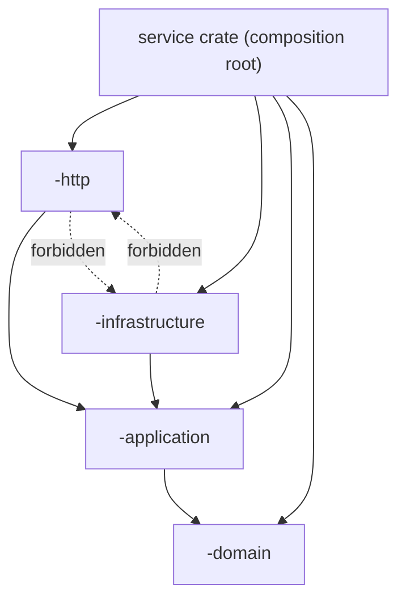

# Code Structure — Crypto Pocket Butler

## Repository Layout

```
/
├── Cargo.toml                 # root Cargo workspace (12 service packages + 4 crates each)
├── Cargo.lock                 # resolved Rust dependency graph
├── clippy.toml, rustfmt.toml  # Rust lint/format configuration
├── package.json               # Yarn 4.18.1 marker (no root JS dependencies)
├── scripts/check-boundaries.sh# mechanical Clean Architecture gate
├── tools/preview-architecture.sh
├── services/<service>/        # one Rust Clean Architecture workspace per service (12)
│   ├── domain/                # entities, value types, business rules (no framework)
│   ├── application/           # use cases behind port traits
│   ├── infrastructure/        # sqlx repositories, Vault, provider clients, JWKS
│   ├── http/                  # Axum router, middleware, DTOs, RFC 7807 problems
│   ├── migrations/            # versioned `<NNNN>_<name>.{up,down}.sql` pairs
│   ├── src/                   # composition root: config + binaries
│   └── tests/                 # service-level integration suites
├── web/                       # React SPA (Vite, TypeScript, Tailwind v4, TanStack Query)
├── support-console/           # React support console (Vite, TypeScript, Tailwind v4)
├── design-system/             # Parchment Ledger tokens and reference pages
├── deployment/localhost/      # Docker Compose: self-hosted Supabase + every service
├── infra/                     # Docker Swarm stack, schema bootstraps, Prometheus rules
├── supabase/config.toml       # local Supabase CLI configuration
└── docs/                      # architecture (C4), BRDs, development standards, PM
```

`target/`, `node_modules/`, `.yarn/`, `dist/`, generated Structurizr artefacts, `.claude/` and `aidlc/` are excluded from this knowledge base.

## Package / Module Organization

### Backend services (12)

`account`, `analytics`, `asset-registry`, `audit`, `gateway`, `identity`, `job-orchestration`, `ledger`, `market-data`, `notification`, `portfolio`, `reporting`.

Each service is a Cargo workspace of five packages: the service crate (composition root) plus `domain`, `application`, `infrastructure`, `http`.

| Crate | Holds | May depend on |
| --- | --- | --- |
| `<svc>-domain` | Entities, value types, ids, state machines, business rules, `DomainError`, abstract `AuditEvent` value types | Nothing local; no axum/sqlx/reqwest/serde |
| `<svc>-application` | Use cases, `AppError`, `Caller`, port traits (`ports.rs`), trail/audit helper | `<svc>-domain` only |
| `<svc>-infrastructure` | sqlx repositories, JWKS/auth, Vault, HTTP clients, clock, readiness, service-token registry, migrations | `<svc>-domain`, `<svc>-application`; not axum/tower-http |
| `<svc>-http` | Axum router, middleware, DTOs, handlers, RFC 7807 `ProblemDetails`, metrics, server bootstrap | `<svc>-domain`, `<svc>-application`; not infrastructure |
| service crate | `Config::from_env`, binaries, wires infrastructure into http | anything (composition root) |

The boundary gate `scripts/check-boundaries.sh` reads `cargo metadata --no-deps` and fails the build when a crate depends outward. It checks normal dependencies only, so test-only crates are allowed.

### Module inventory per service (representative)

- **domain** — `lib.rs` re-exports; one module per entity/value type (e.g. identity: `user.rs`, `claims.rs`, `consent.rs`, `session.rs`, `support.rs`, `export.rs`, `deletion.rs`, `preferences.rs`, `jurisdiction.rs`, `shredding.rs`, `secrets.rs`, `audit.rs`, `ids.rs`, `error.rs`).
- **application** — one module per use case (e.g. identity: `principal.rs`, `consent.rs`, `sessions.rs`, `support.rs`, `export.rs`, `deletion.rs`, `preferences.rs`, `signup_gate.rs`, `due_users.rs`, `worker.rs`), plus `common.rs` (error/caller), `ports.rs` (trait definitions), `trail.rs` (audit emission).
- **infrastructure** — `repositories/` (one file per aggregate), `auth.rs` (JWKS validator), `auth_admin.rs`, `vault.rs`, `clock.rs`, `db.rs`, `readiness.rs`, `service_token.rs`, `http_retry.rs`, plus outbound clients (`audit_client.rs`, `registry_client.rs`, `notification_client.rs`, `clients/`).
- **http** — `routes.rs` (route table), `handlers.rs`, `dto.rs`, `middleware.rs`, `problem.rs`, `metrics.rs`, `server.rs`, `state.rs`, and for worker services `worker.rs`.
- **src** — `config.rs`, `lib.rs`, and binaries: `bin/api.rs`, `bin/worker.rs`, `bin/migrate.rs`, `bin/retention.rs` depending on the service.

Binary layout is not uniform: `asset-registry` and `gateway` use `src/main.rs`; `identity` uses `bin/{api,worker}.rs`; `audit` uses `bin/{api,retention}.rs`; `job-orchestration` uses `bin/api.rs` only.

### Frontend packages

- `web/src/api/` — the single API-client module (`client.ts`), typed contracts (`types.ts`), errors, TanStack Query setup and queries. All gateway calls live here.
- `web/src/auth/` — Supabase client, in-memory session store, MFA helpers, limited-access wrapper.
- `web/src/app/` — shell, router, `RequireSession`, error boundary.
- `web/src/features/` — one folder per journey (auth, onboarding, connect, portfolio, briefs, notifications, settings, privacy, activity, help).
- `web/src/components/` — shared presentational components; `web/src/i18n/` — en/vi dictionaries and provider; `web/src/pwa/` — service worker and bypass rules; `web/src/styles.css` — Tailwind v4 + tokens.
- `support-console/src/{api,auth,components,domain,hooks,pwa,screens}/` — the support console has no portfolio features; it gates sections by role and grant state.

## File Classification

| Category | Locations | Examples |
| --- | --- | --- |
| Model / Entity | `services/*/domain/src/**` | `identity/domain/src/user.rs`, `portfolio/domain/src/portfolio.rs`, `ledger/domain/src/transaction.rs` |
| Service / UseCase | `services/*/application/src/**` | `identity/application/src/principal.rs`, `portfolio/application/src/valuation.rs`, `ledger/application/src/ingest.rs` |
| Repository / DAO | `services/*/infrastructure/src/repositories/**` | `identity/infrastructure/src/repositories/users.rs`, `portfolio/.../portfolios.rs` |
| Controller / Handler | `services/*/http/src/{routes,handlers}.rs` | `identity/http/src/routes.rs`, `gateway/http/src/handlers.rs` |
| Middleware | `services/*/http/src/middleware.rs` | JWT validation, service-token check, correlation id, security headers, metrics |
| Utility / Helper | `application/src/{common,trail}.rs`, `infrastructure/src/{clock,db,http_retry}.rs` | error mapping, audit context, retry pacing |
| Configuration | `services/*/src/config.rs`, `web/vite.config.ts`, `web/vitest.config.ts` | env/secret readers, build config |
| Migration | `services/*/migrations/**`, `infra/sql/*-schema.sql` | 13 up/down pairs; schema/role bootstraps |
| Test | `services/*/**/tests/**`, `web/src/**/*.test.ts(x)`, `support-console/src/**/*.test.ts(x)` | unit, adapter, HTTP, worker, smoke suites |
| Static / Asset | `design-system/**`, `web/public/**` | tokens, logo, reference pages |

## Code Patterns

**Domain.** Small value objects with validating constructors (`UserId::parse`, `Role::from_claim`), explicit state enums with `parse`/`as_str`, a single `DomainError` enum per service. No serde transport types, no framework imports.

**Application.** One struct per use case, injected through `Arc<dyn Port>` traits, with an explicit `new(...)` constructor and one public async method per operation. Errors use the service's `AppError` enum; `from_domain`, `from_repository`, `from_external` translate lower layers. Audit writes go through a `Trail` helper with a context map.

**Ports.** `ports.rs` defines repository traits, external clients, `Clock`, `TokenValidator`, `ServiceTokenRegistry`, readiness probes. Tests supply hand-written fakes in `tests/fakes.rs` or `tests/common/fakes.rs`.

**Infrastructure.** sqlx with runtime queries or macros against the service's own schema; `PgPool` with configured connection caps; JWT validators cache JWKS in a `tokio::sync::RwLock`, refresh after five minutes, fail closed after ten minutes of staleness; service-token lookups compare in constant time; HTTP retries use bounded attempts with a pause helper.

**HTTP.** Axum `Router` merged from `public`, `authenticated`, and `internal` sub-routers; `route_layer(middleware::from_fn_with_state(...))` for `require_jwt` / `require_service` / `require_callers`; a shared `ProblemDetails` (RFC 7807) error envelope; `Metrics` with atomic counters rendered as Prometheus text; `DefaultBodyLimit` sized per service.

**Frontend.** Components render; `web/src/api/client.ts` is the only module that calls the gateway; TanStack Query owns server state; session tokens are held in memory (`web/src/auth/session.ts`); role/grant gating is presentational only, with the server authoritative; Vitest + Testing Library + MSW exercise components against fake gateway responses.

## Internal Dependency Graph



Text fallback: `http` and `infrastructure` depend on `application`; `application` depends on `domain`; the composition root may depend on all four. `http` must not import `infrastructure`, `infrastructure` must not import `http`, and nothing local may depend on `-http`.

## Cross-Service Code Structure

- There are **no** shared crates between services: no `common`, `shared`, or `types` crate exists in the workspace. Shared concepts are duplicated deliberately per service (e.g. `Role`, `AppError`, `ProblemDetails`) so a service can evolve independently.
- Cross-service contracts are HTTP paths plus DTOs (`services/<svc>/http/src/dto.rs`); internal contracts are described in code comments as C1–C11.
- Persistence is never shared: each service has its own schema and role; another service's data is read only through its API.
