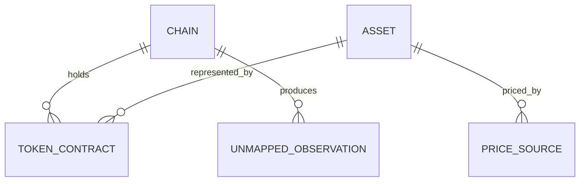

# Functional Specification — u1-walking-skeleton

This Unit delivers the walking skeleton (SPA shell → API Gateway → Asset Registry → its Postgres
schema → Docker Swarm) and the Asset Registry. It implements stories **US1.2** (first valuation
path) and **US9.2** (registry administration).

## 1. Workflows

### WF1 — Resolve an observation to a canonical asset

1. Account or chain sync produces an observation: chain, optional contract address, symbol,
   quantity.
2. The registry looks up `TokenContract` by chain and contract address.
3. If found, return its `Asset`.
4. If not found and the asset is native to the chain, resolve by chain and symbol.
5. If nothing resolves, create an `UnmappedObservation` with status `quarantined` and return
   `unresolved`.
6. The caller excludes the holding from every portfolio total and surfaces it as unpriced.

**Errors:** registry unavailable → the caller keeps the previous holding and labels it stale;
malformed chain or address → reject with a validation problem.

### WF2 — Resolve a price with priority and fallback

1. Read the enabled `PriceSource` list in priority order for the asset.
2. Ask the first source for a price.
3. If it returns a usable price, record source, time, and freshness and return it.
4. If it fails or returns nothing, ask the next enabled source.
5. If every source fails, return `unpriced` with the attempted sources and the reason.

**Errors:** provider timeout → move to the next source; all providers unavailable → unpriced,
never zero; unlicensed source enabled → refuse at configuration time.

### WF3 — Administer the registry

1. Operator opens a registry change: add or edit an asset, a chain, a token contract, or a price
   source; or resolve or ignore a quarantined observation.
2. The change is validated: decimals match (BR1.2), priority is unique (BR2.1), no duplicate
   contract (BR1.1).
3. The change is applied.
4. An audit event is emitted with actor, target, time, and outcome (BR3.1).

**Errors:** validation failure → refuse and name the field; audit emission failure → refuse the
change; unknown operator role → deny and audit the denial.

### WF4 — Gateway request path (walking skeleton)

1. A request arrives at the gateway.
2. Validate the Supabase JWT against JWKS (BR4.1).
3. Resolve the principal through Identity.
4. Match the request against the declared route table (BR4.2).
5. Attach or honour the correlation ID (BR4.3).
6. Forward the request to the owning service with the user JWT unchanged.
7. Return the service response, including the correlation ID on any problem response.

**Errors:** invalid token → 401; no route → 404; unowned resource → 403 from the service;
downstream timeout → 504 with the correlation ID.

## 2. State machines

### UnmappedObservation

| Current state | Event | Guard | Next state | Actions |
|---|---|---|---|---|
| — | observation cannot resolve | — | quarantined | create record, surface to operator |
| quarantined | operator maps to an asset | target asset exists | resolved | link asset, re-value affected holdings |
| quarantined | operator ignores | reason recorded | ignored | keep the record, never re-quarantine the same observation |
| resolved | a later observation of the same token | — | resolved | reuse the mapping |
| ignored | a later observation of the same token | — | ignored | keep excluded |

### PriceSource

| Current state | Event | Guard | Next state | Actions |
|---|---|---|---|---|
| — | source created | licence reference present for production | enabled | add to priority list |
| enabled | operator disables | — | disabled | remove from resolution order |
| disabled | operator enables | licence reference present and priority unique | enabled | add back to resolution order |
| enabled | provider marked unlicensed | — | disabled | remove from resolution order, audit |

## 3. Entity relationships (derived from entities.md)

<!-- Text fallback: one Chain holds many TokenContracts and produces many UnmappedObservations;
one Asset is represented by many TokenContracts and is priced by many PriceSources. -->

## 4. Rules summary (derived from rules.md)

| Rule | What it guarantees |
|---|---|
| BR1.1 | One canonical asset per chain-plus-contract observation |
| BR1.2 | Contract decimals match the asset |
| BR1.3 | Unresolved tokens are quarantined and excluded |
| BR2.1 | Highest-priority price source wins, with fallback |
| BR2.2 | No price means unpriced, never zero |
| BR3.1 | Every registry change is audited |
| BR4.1 | JWT validated before routing |
| BR4.2 | Deny-by-default routing |
| BR4.3 | Correlation ID end to end |

## 5. Integration points

- **Identity** (unit u3-identity): the gateway resolves the principal before routing. Until U3
  exists, the skeleton validates the JWT and uses the token subject as the principal.
- **Account** (unit u4-account): supplies observations for asset resolution.
- **Market Data** (unit u5-market-data): reads the price-source registry.
- **Portfolio** (unit u6-portfolio): reads canonical asset identity and decimals for valuation.
- **Audit** (unit u12-audit): receives registry-change events; until U12 exists the skeleton
  writes a local structured log and the audit call is a no-op behind its port.

## 6. Acceptance criteria coverage

| Story | Criteria | Covered by |
|---|---|---|
| US1.2 | AC1.2.1, AC1.2.2, AC1.2.3 | BR1.1, BR1.3, BR2.1 |
| US9.2 | AC9.2.1, AC9.2.2, AC9.2.3 | BR1.1, BR1.2, BR3.1 |
