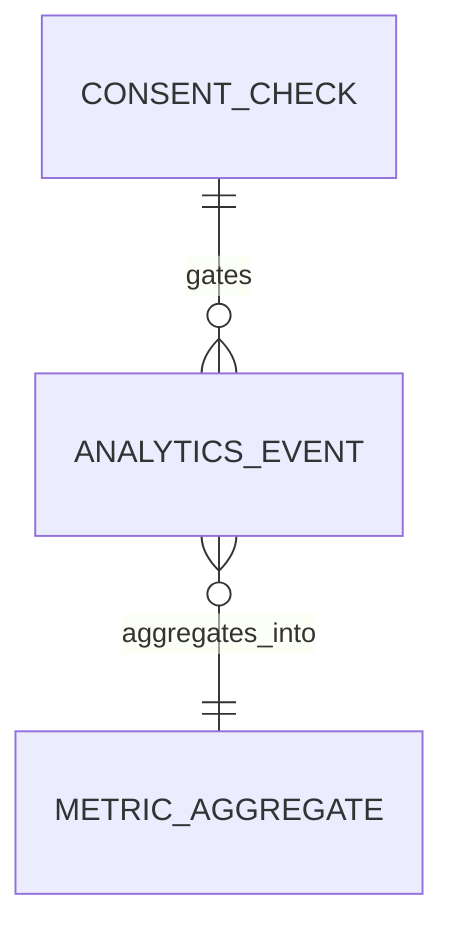

# Functional Specification — u10-analytics

Stories implemented: US7.5 (`inception/user-stories/stories.md`). AC7.5.1 and AC7.5.3 are delivered
jointly with u2-web-app: the SPA renders the consent screen with no pre-ticked box and does not send
a non-essential event before consent; Analytics enforces the same rule server-side by refusing
storage. AC7.5.2 is Analytics' own. Inputs: U10 definition, FR8.3, FR12.2, FR12.3, C12, C3.

## Boundaries

- Consent state is Identity's; Analytics checks it via C3 `getConsent` per request.
- Analytics stores no raw identifier, address, or credential; user ids become an HMAC-SHA256 hash
  under a Vault-held salt.
- Feature flags and aggregates are read by the SPA through C1; flag administration requires the
  `admin` role.
- Marketing consent (FR8.3) is Identity's and out of scope here; Analytics consumes only the
  analytics purpose.
- FR12.3 (feature flags) is delivered by Analytics' API plus the U2 admin UI; its acceptance is
  exercised by the flag rules BR4.1–BR4.3.

## Event catalogue and consent class

| Event name | Class | Allowed properties |
|---|---|---|
| `signup_started` | analytics | `method` (email/google) |
| `onboarding_step` | analytics | `step` (1–6) |
| `onboarding_completed` | analytics | `path` (address/exchange/csv), `duration_bucket` |
| `valuation_read` | analytics | `freshness` (live/delayed/stale/unpriced), `asset_count_bucket` |
| `account_connected` | analytics | `kind` (exchange/wallet/walletconnect/csv) |
| `drift_viewed` | analytics | `portfolio_count_bucket` |
| `upgrade_started` | analytics | `plan` |
| `support_opened` | analytics | `entry` |
| `error_shown` | essential | `code`, `route` |

Any other name is refused with 422. Any property not listed for that event is dropped. The JWT
subject is never a property; it is hashed into `userRef`.

## Operations

| Operation | Contract | Purpose |
|---|---|---|
| `POST /v1/events` | C12 | Ingest one consented, PII-free event |
| `GET /v1/flags/{key}` | C1 | Evaluate one flag for the caller |
| `GET /v1/admin/flags`, `POST/PATCH/DELETE /v1/admin/flags/{key}` | C1 | Admin flag management |
| `GET /v1/analytics/aggregates` | C1 | Read aggregates (admin) |
| `POST /v1/internal/run/analytics-aggregate` | C11 | Nightly aggregation |
| `POST /v1/internal/run/analytics-retention` | C11 | Six-month and 90-day sweep |
| `POST /v1/internal/privacy/erase` | C12 | Identity's erasure of a user's events |

## WF1 — Ingest an event (C12)

1. The gateway validates the JWT and applies the ingest rate limit; it forwards the subject.
2. Analytics validates the event name against the catalogue and keeps only its allow-listed
   properties (BR2.1).
3. It drops any value matching a PII or credential pattern, and refuses the event when the offending
   value is `eventName` or `occurredAt` (BR2.2).
4. It replaces the subject with HMAC-SHA256(salt, subject) (BR2.3).
5. For an analytics-class event it calls C3 `getConsent`; a missing or withdrawn grant returns 403
   and stores nothing (BR1.1–BR1.3). Essential events skip the check.
6. An accepted event is stored and returns 202 `{status: accepted}`; the ConsentCheck row is stored
   for 90 days.

## WF2 — Nightly aggregation (C11)

1. The job computes, from consented events only:
   - activation = consented users with `onboarding_completed` within 24 h of `signup_started` /
     consented users with `signup_started`;
   - engagement = distinct daily active / weekly active;
   - retention = cohort users with `valuation_read` on day 7 or 30 / cohort size;
   - conversion = consented users with `upgrade_started` / consented active users;
   - quality = `valuation_read` with `freshness=live` / all `valuation_read`.
2. Cohorts are `signup_week` or `all`; a cohort under 10 distinct userRef values is suppressed
   (BR3.2).
3. Aggregates are upserted per metric, period, and cohort; retention metrics are weekly.

## WF3 — Flag evaluation

1. The SPA asks `GET /v1/flags/{key}` through the gateway with its JWT.
2. Analytics returns `{key, enabled:false}` when the flag is missing, disabled, or expired (BR4.3).
3. Otherwise bucket = SHA-256(userRef) mod 100; the flag is enabled when bucket < rolloutPercentage
   (BR4.2).

## WF4 — Flag administration

1. An admin with role `admin` creates a flag with key, owner, expiry, and rollout (BR4.1).
2. `GET /v1/admin/flags?expired=true` lists expired flags for cleanup (BR4.3).
3. Every change is audited through C10.

## WF5 — Retention

1. The nightly job deletes raw events older than six months and ConsentCheck rows older than 90 days
   (BR5.1).
2. Aggregates and flags are kept.

## WF6 — Erasure

1. Identity calls `POST /v1/internal/privacy/erase` with the raw `authUserId`.
2. Analytics computes HMAC-SHA256 under every retained salt version and deletes every matching
   event, then returns 204 (BR6.1).
3. Aggregates survive because they hold no userRef.

## State machines

### FeatureFlag.status

```
active --(expiresAt passes)--> expired
active --(disabled)--> disabled --(enabled)--> active
```

## Entity-relationship view (derived from `entities.md`)



<!-- Text fallback: consented AnalyticsEvents aggregate into MetricAggregates by period and cohort; every analytics-class event is gated by a ConsentCheck decision. -->

## Rules summary (derived from `rules.md`)

- Consent: analytics grant required, withdrawal per request, never assumed (BR1.1–BR1.3).
- Data: catalogue and allow-lists, PII patterns, salted hash (BR2.1–BR2.3).
- Aggregates: formulas, suppression under 10 (BR3.1–BR3.2).
- Flags: owner and expiry, deterministic rollout, expired listable (BR4.1–BR4.3).
- Retention and erasure: six months / 90 days, erase by userRef (BR5.1, BR6.1).
