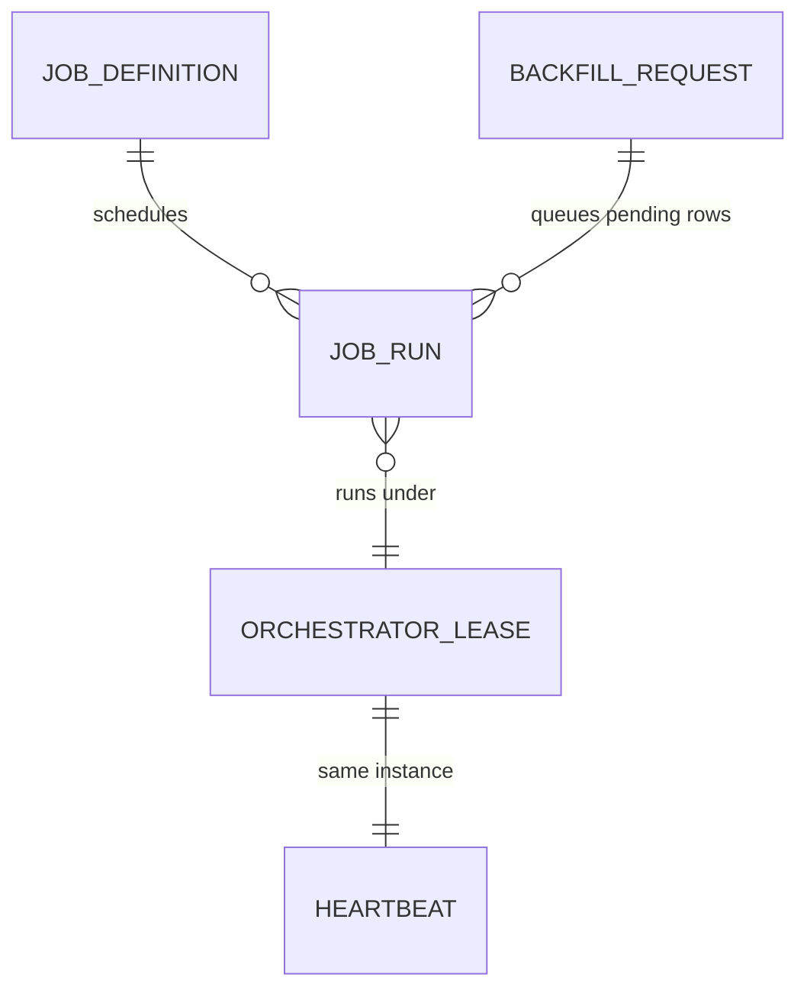
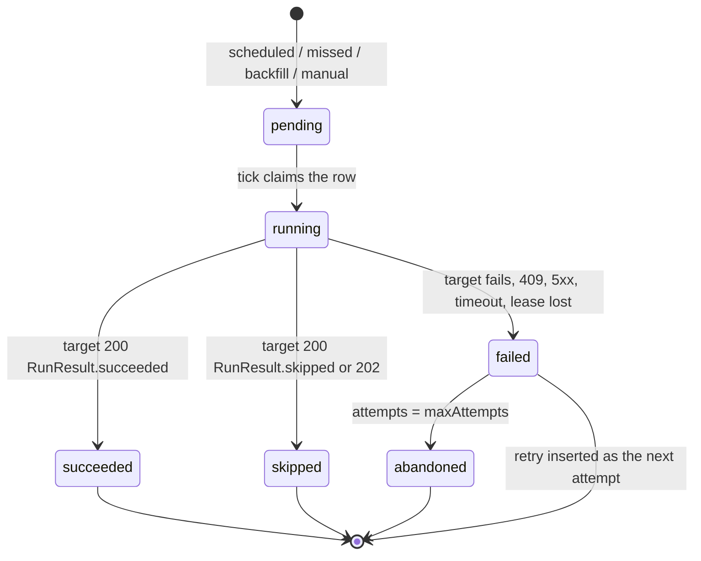

# Functional Specification — u11-job-orchestration

Inputs: `rules.md`, `entities.md`, `inception/units-generation/unit-of-work.md` (U11),
`inception/requirements-analysis/requirements.md` (FR10.1–FR10.3),
`inception/domain-design/components.md`, `inception/user-stories/stories.md` (US9.1,
AC9.1.1–AC9.1.3), and `inception/contract-design/contract-summary.md` (C11 and the services' run
endpoints).

The orchestrator decides which scheduled window each job is due for, calls that service's C11 run
endpoint with its service token and a per-window idempotency key, records one row per attempt,
retries within a bound, catches missed windows and queued operator runs, and publishes a heartbeat
so an operator learns when it stops.

## Entity relationships

Text fallback: a JobDefinition owns many JobRuns; every running JobRun is executed by the
instance holding the single OrchestratorLease, which also writes the Heartbeat; a BackfillRequest
creates pending JobRuns.

## Rules summary

| Rule | One line |
|---|---|
| BR1.1 | schedule grammar is fixed and validated at startup |
| BR1.2 | one row per (job, window, attempt); a retry inserts the next attempt |
| BR1.3 | one leased scheduler; an outcome is written only by the lease owner |
| BR1.4 | canonical window text feeds the idempotency key |
| BR2.1 | retries are scheduled through `nextAttemptAt`, bounded by maxAttempts |
| BR2.2 | the reaper fails expired running rows; the retry rule then applies |
| BR2.3 | exhaustion → abandoned; every failure increments the failure counter |
| BR3.1 | missed windows are recovered oldest-first inside a 24 h lookback |
| BR3.2 | backfill width ≤ 7 days; covered windows are reported, not re-run |
| BR3.3 | backfill records actor, instant and reason |
| BR4.1 | heartbeat at every tick and every 30 s while in flight |
| BR4.2 | stale at 180 s; an absent metric is stale; alert within five minutes |
| BR5.1 | terminal rows are immutable; the retry is a new row |
| BR5.2 | no secret or response body in detail, reason or audit |
| BR6.1 | fixed, provider-named job catalogue |
| BR6.2 | call shape and idempotency key are fixed; the target dedupes |
| BR7.1 | the service validates the JWT and enforces admin/support |
| BR7.2 | trigger, actor and reason are recorded |

## JobRun state machine

Text fallback: `pending → running → succeeded | skipped | failed`; `failed → abandoned` when no
attempts remain, otherwise the next attempt is a new `pending` row. `succeeded`, `skipped` and
`abandoned` are terminal and never change.

## Workflows

### WF1 — A tick

1. A ticker fires every 60 s (`JOB_ORCHESTRATION_TICK_SECONDS`, allowed 30–90, so the heartbeat
   age stays under 90 s and no schedule shorter than one tick is defined).
2. The tick loop writes the heartbeat at its start and again after scheduling (no independent
   task), so a wedged scheduler stops it; the age therefore stays under 90 s while healthy.
3. The instance renews OrchestratorLease (TTL 30 s, renewed every 10 s by a task); if another
   instance holds it, the tick only exports metrics and returns.
4. The reaper marks every `running` row whose lease expired as `failed` with `detail = "lease
   expired"` and `nextAttemptAt` per BR2.1.
5. The tick schedules work and returns within 30 s; it never awaits a target call itself:
   - current window per enabled job, when not covered (BR1.2);
   - the oldest uncovered missed window per job inside the 24 h lookback (BR3.1);
   - every `pending` row queued by a backfill or manual trigger, oldest `scheduledFor` first;
   - every `failed` row whose `nextAttemptAt` has passed and whose attempts remain.
6. Scheduling inserts a `pending` row with its trigger, then hands it to a bounded executor:
   at most 32 outbound calls in flight per instance, each bounded by `timeoutSeconds`. The run
   lease is `timeoutSeconds + 30`, claimed with the row's transition to `running`.
7. Recording an outcome re-reads the row under the owner check (BR1.3); a lost lease leaves the
   outcome unwritten and the reaper retries the window.

### WF2 — Calling a target (BR6.2)

`POST {service_url}/v1/internal/run/{jobName}` with body `{"owner": "<instance>"}` and
`idempotency-key: job:{job}:{scheduledFor}` (canonical text from entities.md).

| Target answer | Recorded as |
|---|---|
| 200 `RunResult.status = succeeded` | `succeeded` |
| 200 `RunResult.status = failed` | `failed` with `detail = "target reported failure"`, retried |
| 200 `RunResult.status = skipped` | `skipped` with `detail = "target skipped"`; not retried |
| 202 `{runId}` | `skipped` with `detail = "run active: {runId}"`; the provider owns it |
| 204/200 without a body | `succeeded` |
| 409 | `failed` with `detail = "lease held"`; retried (per-account leases inside Account use the same status) |
| 4xx other than 409 | `abandoned` with `detail = "target refused the call"`; not retried |
| 5xx, timeout, unreachable | `failed` with `detail = "target unavailable"`; retried |

The orchestrator never sends an account id: `account-sync` runs every account inside Account under
Account's own per-account leases (C11 amendment), and a 409 means "some account is busy", which
the retry rule resolves.

### WF3 — Operator surfaces

- `GET /v1/jobs` lists the catalogue with each job's latest run.
- `GET /v1/jobs/{job}/runs?from=&to=&limit=` lists runs (attempts) newest first, bounded to 500.
- `POST /v1/jobs/{job}/run` queues the current window as a `manual` pending run. An uncovered
  window returns 202 with the run; a covered window returns 409 with the covering run's id.
- `POST /v1/jobs/{job}/backfill` accepts `from`, `to`, `reason`; each accepted uncovered window
  becomes a `backfill` pending run, and covered windows are listed in the response. Width > 7
  days is 422.
All four require a validated Supabase JWT with the `admin` or `support` role, checked by the
service itself (BR7.1); the gateway adds rate limits.

### WF4 — Heartbeat and readiness

`GET /healthz` answers while the process lives; `GET /readyz` checks the orchestrator's own
Postgres. `GET /metrics` exports the heartbeat age, failure counters, run outcomes and target
latency. The external alert rule fires on the stale heartbeat (BR4.2) and on any job failure
counter increase (BR2.3); no user-addressed C9 alert is sent.

## Commands and queries

| Surface | Identity | Result |
|---|---|---|
| `GET /v1/jobs` | admin/support JWT | the jobs and their latest run |
| `GET /v1/jobs/{job}/runs` | admin/support JWT | a bounded run page |
| `POST /v1/jobs/{job}/run` | admin/support JWT | 202 with the queued run, 409 when covered |
| `POST /v1/jobs/{job}/backfill` | admin/support JWT | 202 with accepted and covered windows |
| `GET /v1/internal/smoke` | service token | release smoke |
| `GET /healthz`, `/readyz`, `/metrics` | public | liveness, readiness, metrics |

## Targets

The catalogue in `rules.md`; each job names its owning provider. `market-data-fx` is FR10.1's FX
job; `portfolio-snapshot`, `notification-digest`, `analytics-flag-expiry` and `audit-retention`
are the run families `components.md` names. `account-sync` and `audit-privacy-sweep` already have
provider-side C11 entries; the rest are recorded as C11 amendments in the contract summary
(run call body, idempotency header and the per-service run result).

## Non-goals

- No message queue; the orchestrator's Postgres is the run ledger (BR1.2).
- No admin API that creates or edits jobs; the catalogue is fixed at startup (BR6.1).
- No business math; the orchestrator only schedules and calls.
