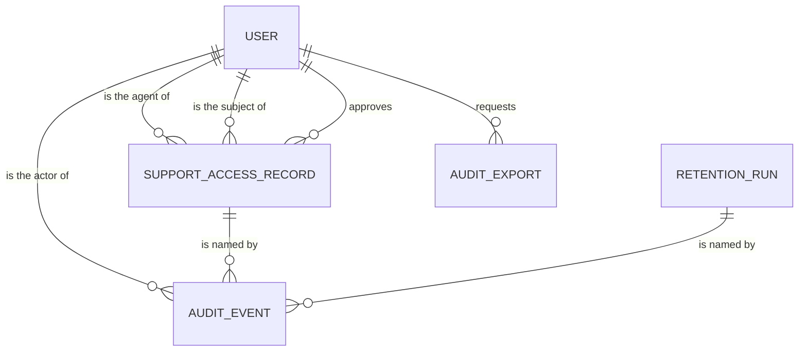

# Audit — Functional Specification

This file is the source of truth for the unit's workflows and state machines. The entity
relationship diagram and the rules table below are derived views of `entities.md` and `rules.md`.

Stories this unit implements: **US7.3** (export my data), **US7.4** (delete my account),
**US9.2** (manage the asset registry with audit), **US9.3** (time-bound audited support access).
Each of those stories is shared: this unit supplies the audit side — the record, the retention
evidence, and the support-session control — while another unit performs the user-facing action.

## 1. Workflows

### WF1 — Append an audit event

The path every other service uses. Contract C10 (`POST /v1/events`).

1. A service raises an event with its actor, action, target, time, context, and outcome.
2. The audit service validates the envelope: required fields present (BR1.2), no secret-shaped
   value in target or context (BR1.3), context limited to identifiers (BR1.4).
3. If the event carries an idempotency key that is already stored, the stored event's id is
   returned and nothing is written (BR2.2).
4. Otherwise the event is inserted through the insert-only role.
5. The caller receives `201` with the new event id once the insert commits (BR2.1).

Failure behaviour, by event class (ADR-006):

- **Security events** must be stored before the caller's action commits. A storage failure answers
  `5xx` and the caller must not proceed; the emitter retries with the same `Idempotency-Key` and
  gets one stored event, not two.
- **Domain events** are best-effort. A storage failure is logged and counted, and the caller's
  action proceeds; the event is not retried indefinitely.
- A rejected envelope answers `422` with a problem document naming the offending field paths and
  stores nothing, whatever its class.
- A reused `Idempotency-Key` with a different payload answers `409`.

The class is derived by the audit service from the event's `sensitivity` — `security` is blocking,
`routine` is best-effort — never taken from the caller's word. A caller that sends an `eventClass`
contradicting the derived value is refused with `422`, so a service cannot quietly downgrade a
sign-in or credential event to best-effort and let it be dropped.

### WF2 — Start a support session

The control behind AC9.3.2. **The audit service is the single owner of the support-session
record.** Identity owns the user and its roles; it holds no session lifecycle of its own.

1. A support agent names the subject, the scope (`account_metadata` or `tickets`), their reason,
   and the requested expiry through the Support Console, which calls the gateway.
2. A second operator, who is not the agent, approves the session.
3. The audit service checks the reason length, that the approver differs from the agent, and that
   the expiry is within eight hours (BR3.1).
4. On success the record moves to `active`, `approvedAt` is stamped, and an audit event names the
   session, both actors, the scope, and the expiry.
5. On failure the record is stored as `denied`, the request is refused with `403`, and the refusal
   is recorded as a security event.

This operation is a contract extension: contract C10 gains `POST /v1/support-sessions`. The
console's existing request shape (contract C2, `SupportAccessRequest`) carries only `userId` and
`reason`, so C2 must be amended to carry `scope`, `expiresAt`, and `secondApproverId` before this
workflow can be built. That amendment is recorded as a contract change for the inception record.

### WF3 — Read under a support session

The control behind AC9.3.1 and AC9.3.3. **The audit service enforces the session; the owning
service serves the data.**

1. A support read reaches the owning service (Account for account metadata) through the gateway,
   naming the session id.
2. The gateway calls the audit service's session check, `GET /v1/support-sessions/{id}/check`,
   which answers `allow` only for an `active` session whose `expiresAt` is still ahead (BR3.2) and
   only when the requested scope matches the session's scope.
3. On `allow`, the owning service serves the read; on anything else the read is refused with `403`.
4. The audit service writes the read event — session id, subject, scope, target — before it answers
   the check, so a served read cannot exist without its record (BR3.3).
5. A read past expiry or outside scope is refused and recorded as denied.

The owning service never reads the audit schema: the check is an HTTP call, exactly as the
project's data-boundary rule requires.

### WF4 — Query the audit trail

The operator path behind BR5.1.

1. An operator asks for events by action prefix, target, time range, and sensitivity.
2. The service checks the caller holds the operator role; anything else is denied by default and
   the denial is audited.
3. Matching events are returned newest first, paginated by a cursor. Retention runs and deletions
   are visible here like any other event.

### WF5 — Export audit records

1. An operator asks for an export with a filter and a time range.
2. The service records an `AuditExport` in the requested state (BR5.2).
3. The matching rows — capped at 100 000 — are streamed from a cursor straight into the HTTP
   response body as JSON Lines. Nothing is written to disk and no download is served later, so no
   replica holds state another replica would need. Over the cap the request is refused with a
   problem document telling the operator to narrow the filter; it is never truncated silently.
4. When the stream ends, the service records the row count and the outcome and writes the export
   event. The body carries no credential, token, or full wallet address.
5. If the stream is cut short, the `AuditExport` row is marked `failed`; a row left in `requested`
   for more than ten minutes is marked `failed` with `replica_lost` when the service next starts.

The export runs synchronously on the request that asked for it: with no queue and no durable
worker, an accepted-but-never-produced export is worse than a slow one.

A request that cannot be recorded is not produced: recording comes first.

### WF6 — Run retention

The path behind NFR14, BR4.1, and BR4.2.

The audit service sweeps **its own audit_logs only**. The two-year financial-record window belongs
to Ledger, which executes it in its own schema; giving the audit service a cross-schema delete
would break the one-schema-one-role rule. Ledger reports its run to the audit service instead.

1. Job Orchestration starts an audit-log run through the shared run endpoint (contract C11). The
   sweep itself runs in the separate retention service, holding its own credential from Vault; the
   service that serves appends holds no delete grant and cannot erase anything.
2. The run opens under the audited retention role, computes its cutoff six calendar months before
   now against `recordedAt`, and drops past-window partitions, keeping back any partition that
   holds a legally held record.
3. It writes a `RetentionRun` row (`category: audit_logs`, `owner: audit`) with the deleted count,
   the privileged role, and the outcome, and writes an audit event naming the run.
4. Ledger reports its own completed financial-record run as `category: reported`, `owner: ledger`,
   with its cutoff, count, role, and outcome; the audit service stores the report and audits it.
5. A run that cannot open under the privileged role does not start, and the attempt is audited. A
   report that names no role or no outcome is refused.

### WF7 — Deletion with legal retention

The audit side of US7.4.

1. Identity starts a deletion and calls each service that holds personal data, this one included,
   with the deletion request id.
2. The audit service records a `PrivacyDeletion` and hands the actual removal to the retention
   service, because only that service holds a `DELETE` grant. It decides per record: delete it, or
   keep it under the stated legal basis.
3. Anything kept already carries `legalBasis` and `deletionRequestId` from the moment it was
   appended, because a stored event can never be updated (BR1.1); a record that must be kept but
   carries no legal basis is a defect the deletion reports rather than invents a label for.
4. The service answers Identity with what it deleted and what it kept, and Identity decides what
   the user is told.

## 2. State machines

### SupportAccessRecord

```
requested ──approve──▶ active ──expiry──▶ expired
    │                    │
    │                    └──revoke──▶ revoked
    └──deny──▶ denied
```

| From | Event | To | What is recorded |
|---|---|---|---|
| — | a support agent asks | `requested` | AuditEvent: session requested |
| `requested` | second approver agrees | `active`, `approvedAt` stamped | AuditEvent: session started |
| `requested` | approval refused | `denied` | AuditEvent: session denied |
| `active` | `expiresAt` passes | `expired` | AuditEvent: session expired |
| `active` | an admin revokes | `revoked` | AuditEvent: session revoked, by whom |

The `expired` transition needs no writer: any read compares now against `expiresAt`, so a session
cannot outlive its window because nothing ran (BR3.2).

### RetentionRun

```
(run starts) ──▶ running ──finish──▶ success
                    │
                    └──fail──▶ failed
```

`state` and `outcome` move together: `running` has no outcome, and `success` or `failed` sets it.

| From | Event | To | What is recorded |
|---|---|---|---|
| — | sweep starts under the privileged role, or a report arrives | `running` | RetentionRun row: category, owner, cutoff, role |
| `running` | sweep completes | `success` | `outcome: success`, deleted count, AuditEvent naming the run |
| `running` | sweep fails | `failed` | `outcome: failed`, reason, AuditEvent naming the run |

A run is never resumed after a failure; the next scheduled run computes a fresh cutoff.

### AuditExport

```
requested ──produce──▶ success
     │
     └──deny or fail──▶ denied / failed
```

| From | Event | To | What is recorded |
|---|---|---|---|
| — | operator asks | `requested` | AuditExport row |
| `requested` | file produced | `success` | row count, outcome, AuditEvent |
| `requested` | caller lacks the operator role | `denied` | AuditEvent naming the denial |
| `requested` | production fails | `failed` | outcome and reason, AuditEvent |

## 3. Integration points

Contract C10 currently defines only `POST /v1/events`. This unit needs four more operations, listed
here as contract extensions to be written into `contract-summary.md` before code generation:

| Operation | Purpose |
|---|---|
| `GET /v1/events` | admin query: action prefix, target, time range, sensitivity, cursor pagination |
| `POST /v1/exports` | admin export request; the response body **is** the export stream, so there is no second download operation |
| `POST /v1/support-sessions`, `GET /v1/support-sessions/{id}/check` | support-session start and enforcement |
| `POST /v1/privacy/deletions` | Identity's deletion call, carrying the deletion request id |

| Boundary | Direction | Shape | Failure behaviour |
|---|---|---|---|
| Every service → Audit | inbound append | Contract C10, `POST /v1/events`, `Idempotency-Key` header required | `422` on a bad envelope, `409` on a reused key with a new payload, `5xx` on storage; security events stop the caller's action, domain events are best-effort |
| ApiGateway → Audit | inbound queries, exports, support sessions | HTTP/JSON, `admin` or `support` role from `app_metadata.role` | `403` deny-by-default, denial audited |
| Owning service or gateway → Audit | inbound session check | `GET /v1/support-sessions/{id}/check` | a check that cannot be answered is a deny, never an allow |
| Identity → Audit | inbound deletion call | internal HTTP with the deletion request id as its idempotency key | the audit service reports what it kept and deleted, or fails the call so Identity can retry |
| Ledger → Audit | inbound retention report | internal HTTP through the run endpoint (contract C11) | a report missing its role or outcome is refused and the attempt is audited |
| Job Orchestration → Audit | inbound audit-log retention run | the shared run endpoint (contract C11) | a run that cannot start is not started, and the attempt is audited |
| Audit → Supabase Postgres | storage | one schema, one service role, plus an insert-only append role and an audited retention role | a refused statement surfaces as `403` with the operation named |

**Append authentication.** An emitter is authenticated by the internal service token used across
service-to-service calls (the same scheme as contract C11), not by a user JWT: an append carries a
system principal and names its human actor in the payload. Only a caller holding a token issued to
one of the registered services may append, and only Audit's own operator paths may write
`actorKind: system` on behalf of a caller.

The audit service is never called synchronously by a user journey on its critical path except at
append time, and an append is a single insert: it has no outbound dependency of its own.

## 4. Entity relationships (derived from `entities.md`)



`User` is owned by Identity and is referenced by identifier only; the audit schema holds no copy of
user profile data. Text fallback: one user relates to many audit events as actor, to many support
access records as agent, subject, and approver, and to many exports as requester; one support
session and one retention run are each named by many audit events.

## 5. Rules applied in these workflows

| Rule | Where it bites |
|---|---|
| BR1.1 | WF1 storage step; the schema grants the service role insert and select only |
| BR1.2, BR1.3, BR1.4 | WF1 step 2 |
| BR2.1, BR2.2 | WF1 steps 3 and 5 |
| BR3.1 | WF2 steps 3 and 5 |
| BR3.2, BR3.3 | WF3 steps 2 and 4 |
| BR4.1, BR4.2 | WF6 steps 2, 3, and 4 |
| BR4.3 | WF7 step 3 |
| BR5.1 | WF4 and WF5 step 2 |
| BR5.2 | WF5 steps 2 and 3 |
