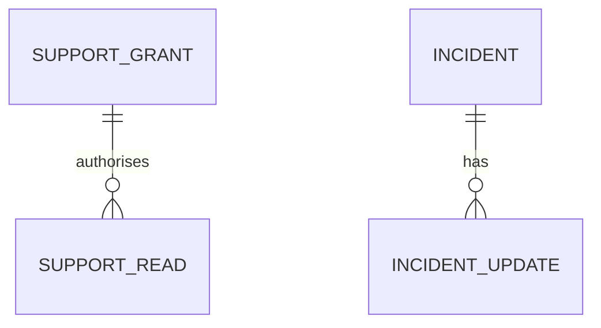

# Functional Specification — u13-support-console

Stories implemented: US8.1 (jointly with u2-web-app), US9.3
(`inception/user-stories/stories.md`). Inputs: `inception/units-generation/unit-of-work.md` (U13), `inception/requirements-analysis/requirements.md`
(FR11.1, FR11.2), C2, C9, C10, C3.

## Boundaries

- The console is a separate static SPA, served under `/support`, reachable only to users whose
  `app_metadata.role` is `support` or `admin`; it is not the customer app.
- It reads **metadata only** through C2: account kind, label, venue, status, last-synced time,
  ticket summary. It never requests or displays a credential, holding, valuation, or portfolio
  content.
- Every metadata read requires an active support grant with a recorded reason, a time bound, and a
  second approver; the read is recorded in C10.
- The status page and help centre (US8.1) are rendered by u2-web-app; U13 supplies the incident
  console that declares incidents and triggers the C9 notification, jointly delivering AC8.1.2 and
  AC8.1.3.

## Operations

| Operation | Contract | Purpose |
|---|---|---|
| `GET /v1/support/accounts?grantId=&query=` | C2 | Search **within the grant's target user** only |
| `GET /v1/support/tickets?grantId=&status=` | C2 | List ticket metadata within the grant's target user only |
| `GET /v1/support/accounts/{accountId}/metadata` with `X-Support-Reason` | C2 | Metadata read under an active grant; the reason is a header, never a URL parameter |
| `POST /v1/support-grants` | C2 | Request a time-bound grant |
| `POST /v1/support-grants/{grantId}/approve`, `DELETE /v1/support-grants/{grantId}` | C2 | Second approver accepts; admin revokes |
| `POST /v1/support/incidents`, `PATCH /v1/support/incidents/{id}` | C2 | Admin declares/updates an incident (backend owned by U1) |
| `GET /v1/support/incidents?active=true` | C2 | u2-web-app's public status page read |

## WF1 — Request a support grant

1. A support user signs in through Supabase Auth; the console checks `role` in `app_metadata` and
   refuses anyone without `support` or `admin`.
2. The user enters a target user, a reason (free text, ≥ 20 characters), a duration (≤ 8 hours),
   and a second approver.
3. The console posts to C2; Identity records the grant as `pending` until the approver accepts.
4. A grant in `pending` grants no access; only `active` and unexpired grants do.

## WF2 — Read account metadata

1. The support user opens an account and supplies the reason again; the console sends it in the
   `X-Support-Reason` request header, never in the URL, so it cannot reach access logs, browser
   history, or referrers.
2. The gateway checks the role; Identity checks the grant is active, unexpired, and its target user
   **is the account's owner**. A grant for one user cannot read another user's account.
3. The console shows only metadata fields; credentials and portfolio contents are absent from the
   DTO and the screen.
4. Every read writes a C10 `support_metadata_read` event with actor, reason, target account, and
   outcome.
5. If the grant expired mid-session, the read returns 403 and the console shows the expiry and a
   link to request a new grant.

## WF3 — Session expiry

1. The console polls the grant's `expiresAt` and disables reads at expiry.
2. A read attempted after expiry is refused; the UI shows "access ended" and hides the metadata.

## WF4 — Declare an incident (US8.1 joint)

The incident store, its C10 audit event, the C9 notification, and the public status read are owned by
**U1's support API**; the console only calls C2 and renders the result.

1. An `admin` submits severity (`sev1|sev2|sev3`), a summary, and affected components.
2. The support API stores the incident (`status` declared/investigating/resolved), writes the C10
   event, and asks C9 to notify subscribers; a SEV-1 notice goes out within 15 minutes.
3. `GET /v1/support/incidents?active=true` feeds u2-web-app's status page; U13 does not render the
   public page.

## WF5 — Help and contact

1. The customer app renders the searchable help articles and the contact channel (U2).
2. The support console shows the same articles in read-only mode and the ticket queue summary.
3. A ticket read is grant-scoped and shows only its metadata; the requester is a pseudonymous
   `requesterRef`, and conversation content stays in the ticket system.

## State machines

### SupportAccessGrant.status

```
pending --(second approver accepts)--> active --(expiresAt passes)--> expired
pending --(rejected)--> rejected
active --(revoked)--> revoked
```

### Incident.status (severity is a separate field: sev1|sev2|sev3)

```
declared --(update)--> investigating --(fix)--> resolved
```

## Entity-relationship view (derived from the unit definition)



<!-- Text fallback: a time-bound SupportGrant authorises SupportReads that C10 records; an Incident has ordered IncidentUpdates and drives the C9 notification. -->

## Rules summary (derived from the story criteria)

- Access: role `support`/`admin`, reason ≥ 20 chars, ≤ 8 h, second approver, expiry ends access
  (AC9.3.1–9.3.2).
- Every read audited; no credential or portfolio content ever shown (AC9.3.3).
- The read reason travels only in `X-Support-Reason`, never in a URL; ticket reads are grant-scoped
  and expose a pseudonymous `requesterRef`, never a requester label or conversation.
- Incident declaration reaches the public status page and C9 within 15 minutes for SEV-1
  (AC8.1.2–8.1.3).
- Help articles and contact channel are U2's; the console reuses them read-only (AC8.1.1).
