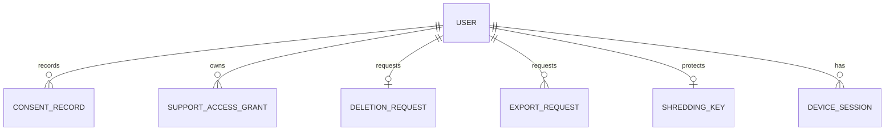

# Functional Specification — u3-identity

This is the behavioural specification for the Identity unit. It is the source of truth for the
ordered workflows and the lifecycle state machines; the entity shapes live in `entities.md` and the
decision logic in `rules.md`. Stories implemented: US1.1, US3.5, US7.1, US7.2, US7.3, US7.4, US7.5,
US7.6, US9.3 (primary rows in `unit-of-work-story-map.md`).

Inputs: the Identity unit in `inception/units-generation/unit-of-work.md`, the requirements in
`inception/requirements-analysis/requirements.md`, and the Identity component in
`inception/domain-design/components.md`.

## Boundaries

- Supabase Auth owns credentials, MFA factors, recovery codes, and tokens. Identity never stores
  them.
- **Identity validates every forwarded Supabase JWT itself** against Supabase JWKS (signature,
  issuer, audience, expiry), matching the project rule that every service validates the JWT. The
  gateway forwards the JWT unchanged; Identity does not trust an unverified principal.
- Identity owns the internal `User`, consent history, preferences, support grants, export and
  deletion requests, the session view, and the jurisdiction rules.
- Identity calls the Audit service (C10) for every access, role, support, privacy, and export event.
- **Export archive store**: one Supabase Storage bucket, `identity-exports`, private, owner-only
  signed URLs, 24-hour download window, object deleted after the window.

## Operations this unit exposes

All of these are additions to the Identity internal API (C3) and are reached through the gateway;
C3 currently documents only `resolvePrincipal` and `getConsent`.

| Operation | Purpose |
|---|---|
| `POST /v1/consent` | Append a consent decision for one purpose |
| `GET /v1/consent/{userId}` | Current consent (existing C3) |
| `PATCH /v1/users/{userId}/preferences` | Change locale, base currency, or timezone |
| `GET /v1/users/{userId}/sessions` | List the device sessions |
| `DELETE /v1/users/{userId}/sessions/{sessionId}` | Revoke a session |
| `POST /v1/exports` | Start an export for the caller |
| `GET /v1/exports/{exportId}` | Poll progress and, when ready, the signed download |
| `POST /v1/privacy/deletions` | Confirm an account deletion |
| `GET /v1/privacy/deletions/{deletionId}` | Poll deletion state |
| `POST /v1/signup-gate` | Pre-authentication jurisdiction and age gate |
| `POST /v1/support-grants` | A support user requests a grant |
| `POST /v1/support-grants/{grantId}/approve` | An admin approves a grant |
| `DELETE /v1/support-grants/{grantId}` | An admin revokes a grant |
| `GET /v1/principals/{authUserId}` | Principal resolution (existing C3) |

## Operations this unit requires from other units

These are **contract change requests** to the shared contract summary; until they are recorded
there, Code Generation cannot build the export and deletion orchestration.

| Owning unit | Contract | Operation | Purpose |
|---|---|---|---|
| U4 Account | C5 | `GET /v1/internal/privacy/export` (service token, `userId`) | Return the user's accounts and holdings for export |
| U4 Account | C5 | `POST /v1/internal/privacy/anonymise` (service token, `userId`, idempotency key) | Anonymise the user's personal fields and keep labelled retention records |
| U6 Portfolio | C8 | `GET /v1/internal/privacy/export` | Return the user's portfolios and snapshots for export |
| U6 Portfolio | C8 | `POST /v1/internal/privacy/anonymise` | Anonymise the user's portfolio personal fields |
| U7 Ledger | C7 | `GET /v1/internal/privacy/export` | Return the user's transactions for export |
| U7 Ledger | C7 | `POST /v1/internal/privacy/anonymise` | Anonymise the user's ledger personal fields and label retained financial records |
| U1 Gateway / U4 Account | C2 | `getAccountMetadata` carries `grantId`; Approval operation is `POST /v1/support-grants/{id}/approve` | Enforce the support grant on the metadata read |
| Supabase Auth | C13 | Admin user delete | Remove the Auth identity, password, and factors on deletion |

Every contribution call is synchronous internal HTTP with a bounded retry and an idempotency key;
the export and deletion workers call them in a fixed order and record each answer.

## WF1 — First authenticated request and principal resolution

1. Identity receives the request with the Supabase JWT and validates it against Supabase JWKS
   (signature, issuer, audience, expiry). A failure returns 401 and writes nothing.
2. Identity reads the internal `User` by the validated `authUserId`.
3. If no record exists, Identity creates it with role from `app_metadata.role` (unknown or missing →
   `user`), `status = pending`, `locale = en`, `baseCurrency = USD`, `timezone = UTC`, and creates
   its `ShreddingKey` reference in Vault.
4. If the record exists, Identity refreshes `role` when the claim differs and leaves preferences as
   stored.
5. **Pending to active**: if the validated JWT shows a confirmed email and, where
   `app_metadata.has_exchange_credentials` is true, `aal = aal2`, Identity sets `status = active`.
   Otherwise it returns the verification or MFA requirement.
6. Identity returns the principal (userId, role, status, `nextStep` of `none`, `verify_email`, or
   `enrol_mfa`) to the gateway; the gateway routes portfolio requests to the required step.
7. The gateway applies deny-by-default routing, the admin/support capability check, and rate limits.

Edge cases: a malformed or expired JWT is refused before any write; a role claim that is not
`user`, `admin`, or `support` never grants an admin or support capability (BR1.2); a `deleted` user
is refused and the state is explained (BR1.3).

## WF2 — Sign-up, verification, and MFA

1. Before sign-up, the jurisdiction and age gate runs (WF6) and collects nothing personal.
2. Supabase Auth performs sign-up with email/password or a supported social provider and sends the
   verification email.
3. Before verification, no portfolio data is reachable; the SPA routes to verification with a
   resend option.
4. On the first authenticated request, WF1 creates the internal user as `pending`.
5. When the validated JWT has `app_metadata.has_exchange_credentials = true` and is below AAL2,
   Identity refuses portfolio data and returns the enrolment requirement; Supabase Auth completes
   enrolment and shows recovery codes once (BR2.1, BR2.2).
6. A correct MFA challenge raises the session to AAL2; a wrong code is refused and the attempt is
   rate-limited (BR2.3).
7. `status` moves to `active` under BR1.5 when verification and, where required, MFA are complete.

## WF3 — Session listing and revocation

1. The user opens the session list through the gateway.
2. Every gateway call forwards the Supabase JWT's `session_id` claim, the user agent, and the
   gateway's coarse IP geolocation (city/country, never the full IP). Identity upserts the
   `DeviceSession` row on each authenticated request with device, location, and last activity
   (BR8.1). When geolocation is unavailable, `location` is null and no IP is stored. When the
   Supabase Auth admin API exposes a session list, Identity reconciles against it.
3. On revoke, Identity calls Supabase Auth's admin logout for that session and marks the row
   revoked (BR8.2).
4. If the target is the current session, the SPA warns that the user will be signed out and revokes
   only after confirmation.
5. A revoked session is signed out at its next request; the revocation is audited.

Edge cases: Supabase Auth unavailable → the list serves the last known view with its last-activity
time, and revoke is refused with the reason; a session that already ended is reported as ended.

## WF4 — Consent, preferences, and disclosures

1. The consent screen shows analytics, marketing, and disclosures unticked.
2. On submit, Identity appends one `ConsentRecord` per purpose with `source` `onboarding` or
   `settings` (BR3.1, BR3.2).
3. `getConsent` returns the newest `analytics` and `marketing` decisions for the user (C3).
4. Withdrawal appends a new record with `granted = false`; later events read the newest record and
   stop (BR3.2).
5. A base currency, locale, or timezone change is validated (ISO 4217, `en`/`vi`, IANA timezone)
   and applies to the user's next read (BR3.3).

## WF5 — Conflict-free access to account metadata (non-support)

1. A user reads their own consent, preferences, export requests, or deletion state.
2. Identity checks ownership (BR1.4) and returns only that user's records.
3. Any missing, other-user, or foreign id returns not-found or forbidden with no data.

## WF6 — Jurisdiction and age gate (before sign-up)

1. The SPA asks the declared jurisdiction and age before calling Supabase Auth.
2. The SPA calls `POST /v1/signup-gate` with the jurisdiction and declared age.
3. Identity resolves the `JurisdictionRule` and denies a blocked, unknown, or below-minimum-age
   declaration with a plain explanation (BR7.1, BR7.3).
4. For an allowed declaration, Identity returns a short-lived signed gate token after the required
   disclosure acknowledgement (BR7.2).
5. Supabase Auth's pre-sign-up hook verifies the gate token; a sign-up that reaches Auth without a
   valid token is refused there, so the gate is enforced server-side even if the client skips it.

Edge cases: a missing rule is a block, not an allow; an expired or forged gate token is refused by
the hook; the gate collects no personal data.

## WF7 — Support access grant

1. A support user requests a grant for one target user with a non-blank reason.
2. Identity creates the grant as `pending_approval` and records the request.
3. A user holding the admin role, distinct from the requester, approves; Identity sets
   `approvedBy`, `approvedAt`, `expiresAt` (default 60 minutes) and moves the grant to `active`
   (BR4.1).
4. Each support read presents the `grantId` to the Account metadata operation (C2 change request);
   Account verifies the grant with Identity (or Identity verifies it in the gateway path), and the
   read is served only when the grant is active and unexpired, metadata-only, and audited before
   the answer (BR4.2–BR4.4).
5. At `expiresAt`, or on revoke, the grant becomes `expired` or `revoked`; later reads are refused
   and audited.

Edge cases: the requester cannot approve their own grant; an approval by a non-admin is refused;
an audit-write failure refuses the read rather than serving it unrecorded.

## WF8 — Data export

1. The authenticated owning user requests an export through the gateway.
2. Identity creates an `ExportRequest` as `pending` with an `assemblyDeadline` and returns its id.
3. A worker moves it to `building`; it calls every contributing service's export operation from the
   contract change requests, advancing `progress` as each answers (BR5.1). The worker is driven by
   the Job Orchestration schedule (`POST /v1/internal/run/audit-privacy-sweep`, C11) and by a
   startup sweep; each run claims `pending`/`building` requests whose lease is free or expired.
4. The worker assembles one machine-readable archive in the private `identity-exports` bucket,
   excluding every credential, token, and secret (BR5.2), sets `downloadExpiresAt`, and marks the
   request `ready` with a `fileReference`.
5. The owner polls progress; when ready, Identity resolves a signed download that expires at
   `downloadExpiresAt` (BR5.3). The object is deleted after that window.
6. A contributing failure marks the request `failed` with the reason; a partial archive is never
   presented as complete.
7. Every request, completion, and download is audited (BR5.4).

## WF9 — Account deletion

1. The owning user confirms deletion in-app.
2. Identity creates a `DeletionRequest` as `requested`; the privacy sweep (the same C11 run
   endpoint and startup sweep) claims it, respects the lease, and moves it to `in_progress` (BR6.1).
3. The worker calls every contributing service's anonymise operation from the contract change
   requests; each answer is recorded (BR6.2).
4. When every service answers, Identity deletes the Supabase Auth user and its factors through the
   Auth admin API, so the person is no longer identifiable and cannot sign in (BR6.7).
5. Identity anonymises its own remaining personal fields, destroys the user's `ShreddingKey` in
   Supabase Vault (BR6.3), sets `status = deleted` and `anonymisedAt`, marks the request `completed`,
   and writes the completion audit event (BR6.6). Consent history is anonymised. Existing audit
   events are append-only and are never rewritten; the internal `userId` is already the pseudonymous
   identifier, and later events use the same id or a new pseudonym.
6. A failed step records `failureReason` and leaves the request retryable; a retry resumes the
   remaining steps without repeating completed destruction (BR6.5).
7. A sign-in while a deletion is active explains the state, collects no new data, and offers no
   portfolio access (BR6.4).

## State machines

### User.status

```
pending --(confirmed email + required MFA)--> active
pending --(deletion)--> deleted
active  --(deletion)--> deleted
deleted (terminal)
```

### SupportAccessGrant.status

```
pending_approval --(distinct admin approves)--> active
pending_approval --(refused or lapses)--> expired
active --(expiresAt reached)--> expired
active --(admin revokes)--> revoked
expired, revoked (terminal)
```

### ExportRequest.status

```
pending --(worker starts)--> building
building --(all services answered, archive built)--> ready
building --(contribution fails)--> failed
pending, building --(assemblyDeadline passes)--> expired
ready --(downloadExpiresAt passes)--> expired
failed, expired (terminal for this request)
```

### DeletionRequest.status

```
requested --(worker starts)--> in_progress
in_progress --(all services answered, Auth user removed, key destroyed)--> completed
in_progress --(step fails)--> failed
failed --(retry)--> in_progress
completed (terminal)
```

## Entity-relationship view (derived from `entities.md`)



<!-- Text fallback: one User has many ConsentRecords, many SupportAccessGrants, at most one active DeletionRequest, many ExportRequests, one ShreddingKey, and many DeviceSessions. JurisdictionRule is standalone configuration. -->

## Rules summary (derived from `rules.md`)

- Identity lifecycle: JWT validated by Identity, JIT creation, least-privilege role, status gating,
  ownership, verified → active (BR1.1–BR1.5).
- MFA: required with exchange credentials, both facts from the validated JWT, Supabase Auth owns
  factors, wrong codes throttled (BR2.1–BR2.3).
- Consent and preferences: deny-by-default, append-only history, validated preferences
  (BR3.1–BR3.3).
- Support: reason plus distinct admin approval, 60-minute default expiry, audited read-only access
  (BR4.1–BR4.4).
- Export: asynchronous with progress, no secrets, owner-only expiring link, audited (BR5.1–BR5.4).
- Deletion: tracked request, anonymise and label retention, Auth user removed, key destroyed,
  explain during deletion, retryable, audited (BR6.1–BR6.6).
- Jurisdiction and age: pre-sign-up server-side gate, disclosures, minimum age (BR7.1–BR7.3).
- Sessions: Identity view backed by Supabase Auth, revocation at next request, no stored tokens
  (BR8.1–BR8.3).
