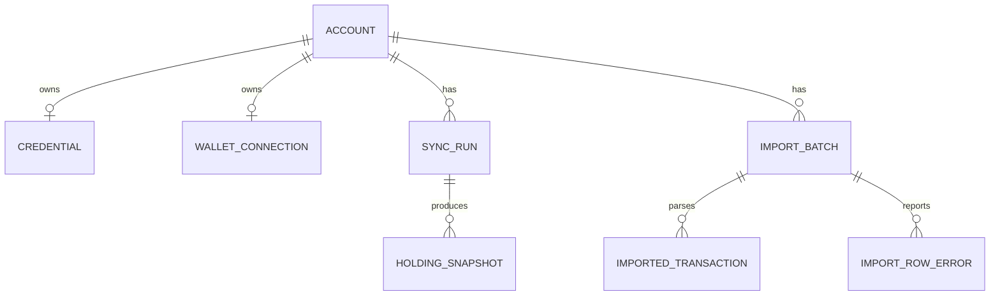

# Functional Specification — u4-account

This is the behavioural specification for the Account unit. It is the source of truth for the
ordered workflows and the lifecycle state machines; the entity shapes live in `entities.md` and the
decision logic in `rules.md`. Stories implemented: US1.2, US1.3, US2.1, US2.2, US2.3 (primary rows
in `unit-of-work-story-map.md`). US1.4's CSV criteria are delivered by u7-ledger; Account owns the
import surface that feeds it.

Inputs: the Account unit in `inception/units-generation/unit-of-work.md`, the requirements in
`inception/requirements-analysis/requirements.md`, and the Account component in
`inception/domain-design/components.md`.

## Boundaries

- Account stores only public addresses, Vault secret references, and observed holdings. It never
  stores or logs a key, token, private key, or seed phrase.
- The SPA holds WalletConnect sessions; Account stores the verified address and an opaque reference.
- Account calls the Asset Registry (C4) to resolve observed tokens and to read supported chains,
  Audit (C10) for the events in BR7.2, Notification (C9) for sync and key-revocation alerts, and
  the Supabase Auth admin API (C15) to maintain `app_metadata.has_exchange_credentials`.
- Pricing, `priced`, and `dust` are Portfolio's job; Account records quantities, the observed token,
  and the spam label only.
- Portfolio and Ledger read Account through C5.

## Operations this unit exposes

The SPA-facing routes are **C1 change requests to U1**; the internal ones are C5 additions.

| Operation | Contract | Purpose |
|---|---|---|
| `POST /v1/accounts/exchange` | C1 | Add an exchange account with a read-only key |
| `POST /v1/accounts/wallet` | C1 | Add a public wallet address |
| `POST /v1/accounts/walletconnect` | C1 | Attach a WalletConnect read-only connection |
| `POST /v1/accounts/{accountId}/resync` | C1 | Trigger a manual sync |
| `GET /v1/users/{userId}/accounts` | C1 | List accounts with status and last-synced time |
| `POST /v1/accounts/{accountId}/imports` | C1 | Upload a CSV |
| `GET /v1/users/{userId}/holdings` | C5 | Holdings per account (existing) |
| `GET /v1/accounts/{accountId}/transactions` | C5 | Venue and imported transactions (existing) |
| `GET /v1/internal/privacy/export` | C5 | Identity's data export for a user |
| `POST /v1/internal/privacy/anonymise` | C5 | Identity's deletion for a user |
| `POST /v1/internal/run/account-sync` | C11 | Scheduled sync run |

C1 schema alignment: `kind` gains `walletconnect`; `venue` carries `binance`, `okx`, `evm:<chainId>`,
`solana`, or `csv:<label>`; `status` is `active`, `syncing`, `error`, `disconnected`.

## WF1 — Add an exchange account

1. The user submits a venue, a label, and a read-only key.
2. Account rejects any input shaped like a private key or seed phrase (BR1.3) and any duplicate
   label (BR1.2).
3. Account verifies the key **before creating anything**: a read-only balances call, then the
   permissions check. A withdrawal or trading permission rejects the key.
4. On success Account creates the `Account` and `Credential` (verified, `readOnly = true`), stores
   the key as a Vault secret, sets `app_metadata.has_exchange_credentials` through the Supabase Auth
   admin API (BR2.4), and starts the first sync immediately.
5. On failure Account destroys the candidate Vault secret and stores neither the account nor the
   credential; the SPA keeps the label and offers a retry (BR1.4, BR2.3).

Edge cases: re-entering a key verifies the new key first, then swaps it in and destroys the old
secret (BR2.2); the key is never echoed in an error or an audit event; a periodic check that finds
trading permission revokes the key, disconnects the account, clears the claim, and notifies
(BR2.5).

## WF2 — Add a wallet address

1. The user submits a chain, an address, and a label.
2. Account resolves the chain through the C4 supported-chains read (or `solana`); an unknown chain is
   refused with the supported list (BR3.1).
3. Account validates the address format; a malformed or unsupported address is refused with the
   supported list and the input kept (BR3.2).
4. Account stores the public address and starts the first sync immediately.

## WF3 — WalletConnect read-only connection

1. The SPA opens a WalletConnect session and the user approves it.
2. The SPA passes Account the verified address, a label the user enters on the approval screen, and
   an opaque session reference. Account enforces label uniqueness like any other account (BR1.2).
3. Account stores the `WalletConnection` and creates the account; no signing key is stored and no
   signing or transfer action exists (BR3.3).
4. A rejected or expired session adds no account and the user can retry.

## WF4 — Sync

1. Job Orchestration (C11) calls `POST /v1/internal/run/account-sync` on the schedule, or the user
   triggers a manual re-sync.
2. Account claims the account while its run lease is live; a held lease returns 409 on the scheduled
   path and 202 with the active run id on the manual path (BR4.1).
3. For an exchange account it reads balances through the venue API; for a wallet it reads on-chain
   balances through the chain's RPC provider. A csv account produces **no** `HoldingSnapshot`: its
   `ImportedTransaction` rows are transaction history for Ledger only, and a csv account is excluded
   from holdings sync.
4. Each observed token is resolved through the Asset Registry (C4); unresolved tokens are recorded
   with their observed token and labelled spam (BR6.2, BR6.3).
5. Account writes a `HoldingSnapshot` per run, sets `lastSyncedAt`, and marks the run `succeeded`.
6. A failure records a non-secret `errorCategory` and `errorMessage`, keeps the previous holdings
   labelled with their last-synced time, and sends the `sync_failed` alert (BR4.4, BR7.1).
7. The account status shows in-progress, then the new time or the visible failure (BR4.3).
8. A run whose lease expires is marked failed by the lease sweep and releases the guard (BR4.2).

## WF5 — CSV import

1. The user uploads a CSV to an account; Account detects Binance, OKX, or generic (BR5.1).
2. Account creates an `ImportBatch` and parses each row into an `ImportedTransaction` with its
   `dedupeKey`.
3. A duplicate row is skipped and counted (BR5.2); a malformed row records an `ImportRowError`
   with its line number and does not stop later rows (BR5.3).
4. The batch returns the imported, skipped, and failed counts and the row errors (BR5.4).
5. Ledger consumes the imported transactions through C5 `getAccountTransactions`.

## WF6 — Holdings read (C5)

1. Portfolio or Ledger calls `getHoldings(userId)` or `getAccountTransactions(accountId, since)`.
2. Account checks the owner or an approved support grant for a user-facing read (BR1.1), or the
   service token for an internal read.
3. Holdings return the latest snapshot with `spam` and the last-synced time; the current view
   recomputes from the latest observation (BR6.1). Portfolio computes `priced` and `dust`.

## WF7 — Periodic key re-verification

1. A scheduled job re-checks each credential's permissions.
2. A key that now carries trading or withdrawal permission becomes `rejected`, its secret is
   destroyed, its account is `disconnected`, the claim is cleared, and the user is notified (BR2.5,
   BR2.4, BR7.1).
3. A transient provider failure marks the credential `stale`, not rejected, and retries on the next
   run.

## WF8 — Privacy export and deletion (C5, called by Identity)

1. Identity calls `GET /v1/internal/privacy/export` with a user id and the service token; Account
   returns the account rows, labels, wallet addresses, holdings, and imported transactions for that
   user (BR8.1).
2. Identity calls `POST /v1/internal/privacy/anonymise` with the user id, an idempotency key, and
   the service token; Account removes the labels and wallet addresses, anonymises the personal
   fields, keeps the labelled financial-retention rows, and returns the retained categories (BR8.2).
3. A failed anonymise step is reported to Identity and the deletion stays retryable.

## State machines

### Account.status

```
active --(sync starts)--> syncing --(success)--> active
syncing --(failure)--> error --(next success)--> active
active, syncing, error --(credential revoked)--> disconnected
disconnected --(new credential verifies)--> active
```

### SyncRun.status

```
running --(provider answers)--> succeeded
running --(failure or lease expiry)--> failed
```

### Credential.verificationStatus

```
pending --(read-only check passes)--> verified
pending --(withdrawal/trading or malformed)--> rejected
verified --(transient failure)--> stale --(next check passes)--> verified
verified, stale --(permissions now include trading)--> rejected
rejected (terminal for this credential; a new key starts pending)
```

## Entity-relationship view (derived from `entities.md`)



<!-- Text fallback: one Account has at most one active Credential and one WalletConnection, many SyncRuns each producing many HoldingSnapshots, and many ImportBatches each parsing many ImportedTransactions and reporting many ImportRowErrors. -->

## Rules summary (derived from `rules.md`)

- Account lifecycle: owner or approved support grant, unique labels, no private keys, account only
  after verification (BR1.1–BR1.4).
- Credentials: read-only verification before use and periodically, verify-then-swap, retryable,
  claim maintenance and revocation (BR2.1–BR2.5).
- Wallets: C4 supported chains, address validation, read-only WalletConnect (BR3.1–BR3.3).
- Sync: one live run, lease-expired runs fail and release, visible status, failures keep labelled
  holdings, disconnected recovers (BR4.1–BR4.5).
- CSV: Account owns the import surface, dedupeKey, per-line errors, reconciling summary
  (BR5.1–BR5.4).
- Holdings: snapshot plus computed view, decimals, observed token, spam label; pricing and dust are
  Portfolio's (BR6.1–BR6.3).
- Notifications and audit: C9 types and idempotency keys, C10 events (BR7.1–BR7.2).
- Privacy: export and anonymise for Identity, with labelled retention (BR8.1–BR8.2).
