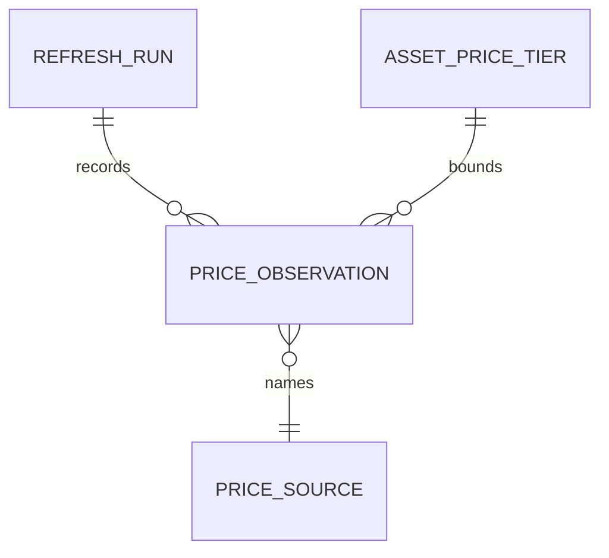

# Functional Specification — u5-market-data

This is the behavioural specification for the Market Data unit. It is the source of truth for the
ordered workflows and the lifecycle state machines; the entity shapes live in `entities.md` and the
decision logic in `rules.md`. Stories implemented: US3.3, US3.4 (`inception/user-stories/stories.md`).

Inputs: the Market Data unit in `inception/units-generation/unit-of-work.md`, the requirements in
`inception/requirements-analysis/requirements.md` (FR3, FR4.5, FR10.1, NFR5), the Market Data entry
in `inception/domain-design/components.md`, and C4/C6/C10/C11 in
`inception/contract-design/contract-summary.md`.

## Boundaries

- Market Data serves prices and FX rates only. It owns no portfolio, holding, quantity, or
  valuation; Portfolio (U6) multiplies quantity by the served quote.
- The price-source registry (priority, quote currency, rate limit, delayed-feed flag) and the
  canonical asset list with each asset's rank are Asset Registry (U1) data, read through C4. Market
  Data keeps no second copy.
- It calls the configured sources over HTTPS, records their provenance, writes audit events through
  C10, and exposes the C11 run endpoint for Job Orchestration.
- Benchmark series and market-data licence metadata are out of scope for this unit: `licenceRef`
  stays in the Asset Registry's source registry, and benchmark series belong to Reporting (U8).

## Operations this unit exposes

| Operation | Contract | Purpose |
|---|---|---|
| `GET /v1/prices?assetIds=` | C6 | Batched prices with source, timestamp, and freshness |
| `GET /v1/fx?base=&quote=` | C6 | One FX rate with source and timestamp |
| `POST /v1/internal/run/price-refresh-top100` and `.../price-refresh-tail` | C11 | Scheduled refreshes; a manual caller gets 202 with the active run id |
| `GET /healthz`, `GET /readyz`, `GET /metrics` | platform | Liveness, readiness, observability |

## WF1 — Serve prices (C6)

1. Portfolio, Reporting, or Job Orchestration calls `getPrices` with one or more asset ids and a
   service token.
2. Market Data refuses an unknown caller, or an empty or malformed list, with an RFC 7807 problem
   (BR5.1, BR1.5).
3. It reads the enabled sources in priority order from C4 (BR1.4).
4. For each asset it reads the newest accepted observation per candidate source and applies the
   tier bound (BR2.1).
5. The first source within its bound wins; the quote carries `source`, `observedAt`, and
   `freshness = delayed` when that source's `delayedFeed` is true, otherwise `live`
   (BR1.1, BR2.1, BR2.2).
6. If no source is within its bound but an accepted observation exists within 24 hours, the quote
   is `stale` with its timestamp (BR1.3, BR2.1).
7. If no acceptable observation exists, the quote is `unpriced` with null price, source, and
   timestamp (BR1.3).
8. The batch returns in request order; one unpriced asset never fails the batch.
9. If the C4 source list cannot be read, Market Data serves each asset's newest accepted
   observation as `stale` with its recorded source, skipping priority selection, and returns
   `unpriced` for assets with no observation, all in the same 200 response (NFR1.11).

## WF2 — Serve one FX rate (C6)

1. A caller requests `getFxRate` with a base and a quote currency and a service token.
2. Market Data refuses an unknown caller, an identical pair, or a malformed currency code
   (BR5.1, BR1.5).
3. It serves a stored reading within the one-hour FX bound with its source and timestamp (BR3.1).
4. If the direct pair is absent, it tries base→USD and USD→quote, both fresh, and serves the
   product with both sources in `derivedFrom` (BR3.2).
5. If neither path is fresh, it returns an unavailable problem with a reason; it never defaults to
   one (BR3.1).

## WF3 — Refresh run (C11)

1. Job Orchestration calls `POST /v1/internal/run/price-refresh-top100` every five minutes and
   `POST /v1/internal/run/price-refresh-tail` every ten minutes, or an operator calls the same
   route manually.
2. Market Data claims the job's single-flight lease: a live lease for that job returns 409 on the
   scheduled path and 202 with the active run id on the manual path; the two jobs may run
   concurrently (BR4.1).
3. The top100 job reads the canonical asset list, ordered by rank, and the enabled sources from C4,
   refreshes the tiers, and refreshes the FX pairs; the tail job reads only its own asset slice
   (BR1.4, BR3.1).
4. For each asset it calls the enabled sources in priority order until one returns an acceptable
   reading, and stores that one accepted observation per asset per run; it honours each source's
   rate limit and bounded retries (BR4.2, BR4.3).
5. A malformed, non-positive, or clock-invalid reading becomes a rejected observation and does not
   replace the previous accepted one (BR4.4).
6. A successful reading becomes an accepted observation with the source's timestamp.
7. The run refreshes the FX pairs the launch base currencies need.
8. The run renews its 300-second lease every 60 seconds; a failed renewal stops it rather than
   continue without ownership (BR4.1).
9. The run records `requestedCount`, `pricedCount`, `unpricedCount`, and ends `succeeded` (with the
   unpriced count) or `failed` when no source was usable (BR4.5).
10. A failed run writes an audit event and raises the refresh alert (BR5.2).

## WF4 — Tier maintenance

1. At the start of a run, Market Data reads the canonical assets and their rank from C4.
2. Rank 1–100 are `top100` with a 300-second bound; the rest are `tail` with a 900-second bound
   (BR2.1).
3. The tier row is written or refreshed in `AssetPriceTier`; an asset with no row is treated as
   `tail`.
4. A rank change takes effect on the next run without a redeploy.

## WF5 — Source administration

1. An operator adds, reprioritises, disables, or re-enables a price source in the Asset Registry
   through its audited admin path; Market Data never writes the source registry (BR1.4).
2. A duplicate priority among enabled sources is refused by the registry and the previous
   configuration stays in force.
3. The change is audited by the registry; Market Data's failed refreshes are audited by Market Data
   (BR5.2).

## State machines

### RefreshRun.status

```
running --(run completes; counts reconcile)--> succeeded
running --(no source usable)--> failed
running --(lease expiry sweep)--> failed
```

### PriceObservation.status

```
accepted --(never changes)--> accepted
rejected --(never served)--> rejected
```

### PriceQuote.freshness (derived per request)

```
unpriced <--(no accepted observation) any
delayed <--(delayedFeed source, age <= bound) accepted observation
live <--(age <= tier bound)------ accepted observation
stale <--(bound < age <= 24 h)--- accepted observation
```

## Entity-relationship view (derived from `entities.md`)



<!-- Text fallback: one RefreshRun records many PriceObservations; each canonical Asset has one AssetPriceTier row that sets its freshness bound; each observation names one PriceSource read from C4. -->

## Rules summary (derived from `rules.md`)

- Price selection: deterministic priority from C4, fallback with provenance, no guessed price,
  registry read not copied, boundary validation (BR1.1–BR1.5).
- Freshness: tier bound, source and time always present, unpriced excluded and labelled, recovery
  on the next refresh (BR2.1–BR2.4).
- FX: fresh pair or unavailable, USD cross from two fresh legs, positive decimals (BR3.1–BR3.3).
- Refresh: one leased run, transient vs permanent failures, per-source limits, rejections keep the
  last good price, reconciling counts (BR4.1–BR4.5).
- Access and audit: service-token callers only, source changes and failed runs audited, 90-day
  retention with the latest observation kept (BR5.1–BR5.3).
