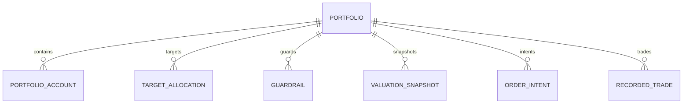

# Functional Specification — u6-portfolio

Stories implemented: US1.2, US3.1, US3.2, US3.3, US3.4, US4.4, US5.1, US5.2, US5.3, US5.4, US5.5,
US5.6 (`inception/user-stories/stories.md`), jointly with U1/U4 (first valuation), U5 (prices),
U7 (recorded trade ledger), and U9 (guardrail alert). Inputs: U6 definition, FR4/FR6, C5–C10.

## Boundaries

- Portfolio owns portfolios, membership, targets, guardrails, valuation, snapshots, intents, and
  recorded trades. It reads holdings from Account (C5), prices/FX from Market Data (C6), writes
  trades to Ledger (C7), alerts through Notification (C9), and audits through C10.
- All valuation, allocation, and drift math happens here; the SPA renders the returned numbers.
- Order intents are advisory; no external order call exists.

## Operations

| Operation | Contract | Purpose |
|---|---|---|
| `GET /v1/portfolios` | C1 | List the caller's portfolios |
| `POST /v1/portfolios` | C1 | Create a portfolio (first one on demand) |
| `GET /v1/portfolios/{id}` | C1 | Portfolio with valuation, breakdown, and drift |
| `PUT /v1/portfolios/{id}/accounts/{accountId}` | C1 | Assign or move an account |
| `PUT /v1/portfolios/{id}/targets?preview=true` | C1 | Preview the target sum/difference; without preview, save |
| `GET /v1/portfolios/{id}/snapshots` | C8 | Snapshot history |
| `POST /v1/portfolios/{id}/order-intents?preview=true` | C1 | Project allocation/drift/shortfall; without preview, record |
| `POST /v1/portfolios/{id}/order-intents/{intentId}/cancel` | C1 | Cancel a pending intent |
| `POST /v1/portfolios/{id}/trades` | C1 | Record an executed trade |
| `POST /v1/internal/run/portfolio-valuation` | C11 | Scheduled valuation and guardrail evaluation |

## WF1 — Portfolio and membership

1. A signed-in user lists portfolios; with none, one is created and opened (BR1.2).
2. Assigning an account moves it from any other portfolio, so totals update on both (BR1.3).
3. Every read is owner-scoped (BR1.1).

## WF2 — Valuation

1. Portfolio reads holdings per account from C5 and quotes/FX from C6.
2. It values each holding at its quote, converts to the base currency, and sums the priced total
   (BR2.1).
3. Each line carries the quote source and timestamp, and FX details for a foreign holding (BR2.2).
4. An unpriced holding is excluded from the total, kept in the breakdown as a labelled line with its
   quantity, and counted (BR2.3).
5. If C5 holdings are unavailable, the read returns `status = partial` with `holdingsUnavailable =
   true` and no fabricated lines; only a Postgres failure returns 503 (NFR1.2).

## WF3 — Targets and drift

1. The user edits targets; the preview returns the sum and any difference from 100 (BR3.2).
2. Saving persists targets and guardrails; a guardrail without a target is refused.
3. The portfolio returns actual, target, and drift in percentage points per asset (BR3.1); with no
   targets it omits drift and prompts (BR3.3).

## WF4 — Snapshots

1. A valuation run stores an immutable snapshot with its frozen inputs and digest (BR4.1–BR4.2);
   the run takes one snapshot per portfolio per hour, and a manual refresh may take one more.
2. Reproduction from the stored inputs yields identical lines and total; a digest mismatch is
   flagged, never served silently.
3. History returns snapshots over the requested window.

## WF5 — Order intents

1. The user creates a buy or sell intent; the preview projects post-trade allocation and drift and
   states a shortfall for a sell beyond holdings (BR5.2).
2. Recording the intent stores it as pending; no external call is made (BR5.1).
3. Cancelling sets cancelled with a time and keeps it visible (BR5.3).

## WF6 — Recorded trade

1. The user confirms an executed trade; a missing price must be supplied and is labelled user
   (BR6.2).
2. Portfolio calls Ledger C7 to record it, writes C10, and recomputes the portfolio so allocation
   and drift reflect it immediately (BR6.1).

## WF7 — Guardrail evaluation

1. After a valuation, Portfolio compares each asset's drift with its guardrail.
2. A crossing from inside submits one C9 alert keyed by the crossing; staying outside reuses the
   key; returning inside clears the state (BR7.1).

## State machines

### OrderIntent.status

```
pending --(cancel)--> cancelled
pending --(never autocompletes)--> pending
```

### Guardrail crossing state (per portfolio and asset)

```
inside --(drift > threshold)--> outside (alert keyed by crossingAt)
outside --(drift still > threshold)--> outside (same key)
outside --(drift <= threshold)--> inside
```

## Entity-relationship view (derived from `entities.md`)



<!-- Text fallback: one portfolio has many account memberships, target allocations, guardrails, snapshots, order intents, and recorded trades. -->

## Rules summary (derived from `rules.md`)

- Portfolio and membership: owner-scoped, one default, one portfolio per account (BR1.1–BR1.3).
- Valuation: backend math, provenance, unpriced labelled (BR2.1–BR2.3).
- Targets and drift: percentage points, sum preview, no fabricated drift (BR3.1–BR3.3).
- Snapshots: immutable, frozen inputs with digest (BR4.1–BR4.2).
- Intents: advisory, projection and shortfall, cancelled visible (BR5.1–BR5.3).
- Trades: Ledger + audit + immediate allocation, user price labelled (BR6.1–BR6.2).
- Guardrails: one alert per crossing (BR7.1).
