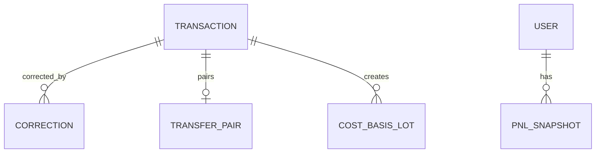

# Functional Specification — u7-ledger

Stories implemented: US1.4, US4.1, US4.2, US4.3, US4.5, US5.4 (jointly with u2-web-app and, for
US5.4, u6-portfolio) in `inception/user-stories/stories.md`. Inputs: U7 definition, FR5.1–FR5.4,
FR6.4, C5/C7/C10.

## Boundaries

- Ledger reads Account's venue and imported transactions through C5 and Portfolio's recorded trades
  through C7; it never reads another service's tables.
- Account owns `ImportBatch`, `ImportedTransaction`, and `ImportRowError` (C5 amendment); U7's
  original "import batches" bullet is superseded and Ledger only consumes the resulting rows.
- Transactions are append-only; a correction is a new row and the original stays recoverable.
- P&L always carries coverage; a partial or absent history is labelled, never filled with zero.
- Ledger computes money; the SPA renders it.

## Operations

| Operation | Contract | Purpose |
|---|---|---|
| `GET /v1/users/{userId}/transactions` | C7 (extension) | Ledger entries with source, asset, quantity, price, time |
| `GET /v1/users/{userId}/pnl` | C7 | P&L with coverage, per asset and total |
| `POST /v1/transactions/{transactionId}/corrections` | C1 via gateway | Record a correction |
| `POST /v1/users/{userId}/trades` | C7 (Portfolio → Ledger backend call) | Record an executed trade |
| `POST /v1/internal/run/ledger-reconcile` | C11 | Recompute lots and P&L |

## WF1 — Ingest from C5

1. On a sync or import completion, Ledger reads Account's transactions through C5.
2. Each row builds its dedupeKey; a row with a line error is reported and not stored (BR1.4).
3. A duplicate dedupeKey is skipped and counted (BR1.2).
4. New rows are stored with source venue or csv and are immutable (BR1.1).

## WF2 — Transfer pairing

1. A transfer_out or transfer_in is stored with a pending pair.
2. Ledger looks for an unmatched counter-entry of the same asset with quantity within 1% and
   executedAt within 24 hours; the nearest in time wins, the rest stay pending.
3. A match moves the outgoing lots' remaining quantity and cost to the incoming lot; no realized
   P&L and no independent priced lot (BR2.4).
4. An explicit user rejection sets `rejected`; a pending or rejected transfer is never a disposal
   (BR6.1).

## WF3 — Cost basis

1. A buy or a priced transfer_in creates a FIFO lot (BR2.1).
2. A sell consumes the oldest lots, computing realized P&L from their unit cost.
3. A fee with the same asset within the same minute as a buy or sell is added to the buy's cost or
   subtracted from the sell's proceeds; a standalone fee is its own cost, never a disposal (BR2.5).

## WF4 — P&L and coverage

1. On request, Ledger computes net invested (open-lot cost), realized, unrealized, and total return
   per asset and in total; per-asset figures are computed transiently for the C7 response and only
   the total is stored (BR2.2).
2. It computes coverage = held value with acquisition history / total held value (BR3.1).
3. Coverage below 1 returns partial figures that exclude the uncovered holdings and names them in
   the gap; coverage 0 returns unavailable with no figures (BR3.1).
4. When an import or sync completes missing history, the next run raises coverage and clears the
   label at 1 (BR3.2).

## WF5 — Correct a transaction

1. A user submits a correction with field, new value, and a reason.
2. Ledger validates the value for the field; an invalid one returns a field-level reason (BR4.1).
3. It stores a Correction with the old value copied, writes a C10 event, and recomputes lots and
   P&L from the corrected view (BR2.3, BR4.1).
4. The original transaction remains and is always recoverable.

## WF6 — Record an executed trade

1. Portfolio submits a recorded trade (from US5.4) with asset, kind, quantity, price, and time.
2. A missing price must be supplied by the user and is labelled `priceSource = user` (BR5.2).
3. Ledger stores the transaction with source `recorded_trade`, writes a C10 event, and recomputes
   P&L (BR5.1).

## State machines

### TransferPair.status

```
pending --(counter-entry found)--> matched
pending --(window passes)--> pending (reported)
matched --(never changes)--> matched
```

### Correction lifecycle

```
submitted --(validated + audited)--> recorded (immutable)
```

## Entity-relationship view (derived from `entities.md`)



<!-- Text fallback: a Transaction may have many Corrections and at most one TransferPair, and creates cost-basis lots; a user has P&L snapshots. -->

## Rules summary (derived from `rules.md`)

- Ledger integrity: append-only, dedupe, no missing-price zero, line errors (BR1.1–BR1.4).
- Cost basis: FIFO, net invested, corrections reflow (BR2.1–BR2.3).
- Coverage: always labelled, gap clears (BR3.1–BR3.2).
- Corrections and trades: reason + audit, user price labelled (BR4.1, BR5.1–BR5.2).
- Transfers: paired by asset and opposite kinds (BR6.1).
