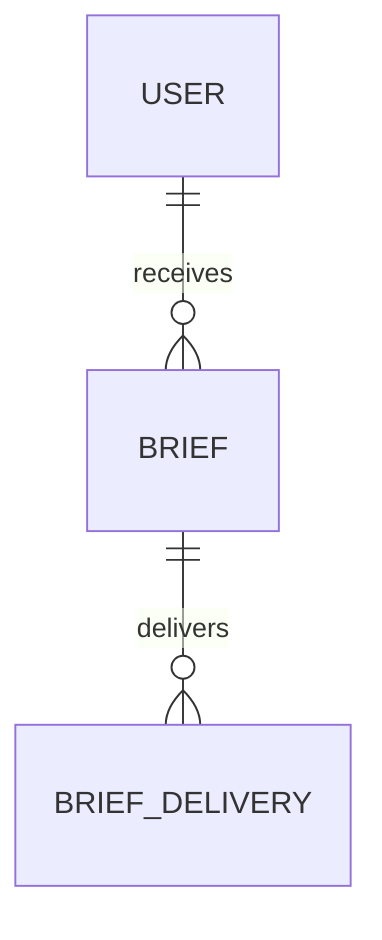

# Functional Specification — u8-reporting

Stories implemented: US6.1, US6.2 (`inception/user-stories/stories.md`), jointly with u9-notification
(email delivery) and u2-web-app (rendering). Inputs: U8 definition, FR7.1, C7/C8/C9/C10.

## Boundaries

- Reporting composes briefs from Portfolio's valuation/snapshots (C8) and Ledger's P&L (C7); it
  never computes valuation or P&L itself.
- Email goes through Notification (C9) type `brief`; Reporting never calls an email provider.
- Every figure carries an as-of time and data status; the SPA renders, it does not recompute.

## Operations

| Operation | Contract | Purpose |
|---|---|---|
| `GET /v1/users/{userId}/briefs` | C1 | List the user's briefs (owner-only) |
| `GET /v1/users/{userId}/briefs/{briefId}` | C1 | Open one brief (owner-only) |
| `POST /v1/internal/run/brief-generation` | C11 | Generate due daily/weekly briefs |

## WF1 — Scheduled generation

1. The C11 run asks Identity (C3 `GET /v1/internal/users/due`) for users whose daily 07:00 local
   boundary or Monday 07:00 local ISO-week boundary has passed without a generated brief, and uses
   the returned timezone to compute the period.
2. For each, the run creates a `pending` brief keyed by (user, period, periodStart); a generated
   brief is skipped, a failed or hour-old pending brief is retried (BR1.1).
3. It lists the user's portfolios and reads each latest valuation with lines (C8), and Ledger's
   P&L (C7).
4. It composes the sections: total value and per-asset lines with provenance, drift against
   targets, and P&L with coverage.
5. It stamps `asOf` (the oldest source as-of) and `dataStatus` (complete/partial/unavailable) on
   the brief and every figure (BR1.2); a missing figure is an em dash (BR1.3).
6. It stores the brief as `generated`, then always hands an email-channel C9 alert to Notification,
   which suppresses it per preference (BR2.2).

## WF2 — Open in-app

1. The user lists briefs; each shows period, status, and generated time.
2. Opening a generated brief shows its figures with their as-of and data status.
3. A failed brief shows its reason and offers retry on the next schedule (BR2.1).

## WF3 — Email delivery

1. Reporting always submits a C9 `brief` alert on the email channel with the key
   `brief:{briefId}:email` (BR2.2); it never reads preferences.
2. Notification applies the brief email preference and the verified address, records outcomes and
   retries within bounds (BR2.3); Reporting records the accepted alert id (`sent` means accepted).
3. A disabled email leaves the brief in-app only. The C9 brief alert is email-only and does not add
   a second in-app entry; Reporting's brief list is the in-app surface.

## WF4 — Failure

1. A brief is `failed` only when a required source is unavailable (no valuation at all); a
   degraded source still produces a `generated` brief with `dataStatus = partial` or `unavailable`
   and labelled figures (BR2.1).
2. The next scheduled run retries the same period; a successful retry updates the same brief to
   generated (BR1.1).

## State machines

### Brief.status

```
pending --(all sources composed)--> generated
pending --(required source failed)--> failed --(next run succeeds)--> generated
```

### BriefDelivery.status

```
pending --(C9 accepted)--> sent
pending --(C9 refused after retries)--> failed
```

## Entity-relationship view (derived from `entities.md`)



<!-- Text fallback: one user has many briefs; one brief has an in-app delivery and, when enabled, an email delivery. -->

## Rules summary (derived from `rules.md`)

- One brief per period (BR1.1); period/as-of/status on every figure (BR1.2); em dash for missing
  (BR1.3).
- Explicit failure (BR2.1); email preference and in-app always (BR2.2); verified address and
  outcomes (BR2.3).
- Owner-scoped (BR3.1).
