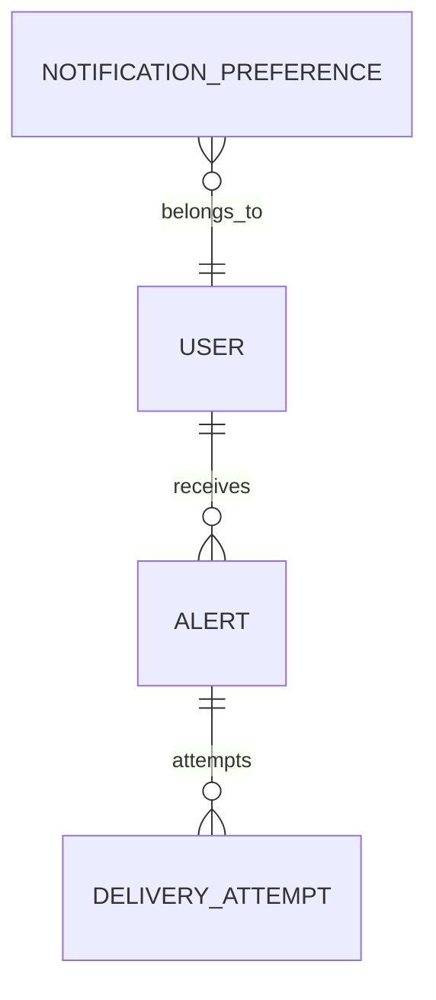

# Functional Specification — u9-notification

Stories implemented: US5.6, US6.2, US6.3, US6.4 (`inception/user-stories/stories.md`), jointly with
u6-portfolio (drift evaluation) and u8-reporting (brief generation). Inputs: U9 definition,
FR7.1–FR7.4, C9/C10.

## Boundaries

- Other services submit alerts through C9; Notification never reads another service's tables.
- Notification owns preferences, alerts, and delivery attempts; the drift threshold itself is
  Portfolio's and the brief content is Reporting's.
- Content never carries a credential, token, or full address.

## Operations

| Operation | Contract | Purpose |
|---|---|---|
| `POST /v1/alerts` | C9 | Submit an alert with an idempotency key |
| `GET /v1/users/{userId}/notifications` | C1 | The caller's in-app alerts feed |
| `GET /v1/users/{userId}/notifications/preferences` | C1 | View per-type, per-channel preferences |
| `PUT /v1/users/{userId}/notifications/preferences` | C1 | Save preferences |
| `POST /v1/internal/run/notification-deliver` | C11 | Deliver queued alerts and retry failures (fallback run every 60 s) |
| `POST /v1/internal/privacy/anonymise` | C9 | Identity's erasure of a user's notification rows |

## WF1 — Submit and dedupe

1. A service submits an alert with userId, type, idempotency key, and an allow-listed payload.
2. A duplicate key returns `deduplicated` and sends nothing (BR1.1).
3. The payload is sanitised: a key, token, seed, or full address is dropped and recorded as a
   content error (BR5.1).
4. A mandatory type is queued for email regardless of preferences (BR3.1).

## WF2 — Drift guardrail (Portfolio calls)

1. Portfolio evaluates drift against the guardrail and, on a crossing, submits an alert keyed by
   (user, portfolio, asset, guardrail, crossing time).
2. Staying outside reuses the key and sends nothing; returning inside clears the state so a later
   crossing notifies again (BR1.2).

## WF3 — Preferences

1. The user views preferences; a missing row shows the default for both channels (BR2.3).
2. Saving a change applies to the next event (BR2.2).
3. A disabled type/channel is skipped on delivery (BR2.1), except a mandatory email (BR3.1).

## WF4 — Delivery

1. A delivery run reads queued and retry-due alerts.
2. In-app delivery is the stored alert in the user's feed.
3. An email goes to the verified address only, read from Identity C3 at delivery time (BR4.2); a
   failure is retried up to 3 attempts (initial + 2, after 1 and 5 minutes), then abandoned with the
   alert marked failed or partially delivered (BR4.1).
4. A brief with email off is in-app only and records no email attempt (BR4.3).

## WF5 — Mandatory security email

1. Identity (C9 consumer for new-device sign-in and account-security events) or Account (credential
   revocation) submits a `security` or `key_revoked` alert.
2. Email is queued even if general notifications are off (BR3.1) and the content carries no
   credential or full address (BR5.1).

## State machines

### Alert.status (a duplicate key returns `deduplicated` to the caller and leaves the stored alert unchanged)

```
queued --(all enabled channels sent)--> delivered
queued --(some channels sent, one abandoned)--> partially_delivered
queued --(all enabled channels abandoned)--> failed
```

### DeliveryAttempt.status

```
sent (terminal)
failed --(attempt < 3)--> retried
failed --(attempt = 3)--> abandoned (terminal)
```

## Entity-relationship view (derived from `entities.md`)



<!-- Text fallback: a user has preferences and alerts; each alert has up to three delivery attempts per channel. -->

## Rules summary (derived from `rules.md`)

- Dedupe and crossing semantics (BR1.1–BR1.2).
- Preferences, defaults, and suppression (BR2.1–BR2.3).
- Mandatory security email (BR3.1).
- Delivery retries, verified address, in-app brief (BR4.1–BR4.3).
- Content safety (BR5.1).
