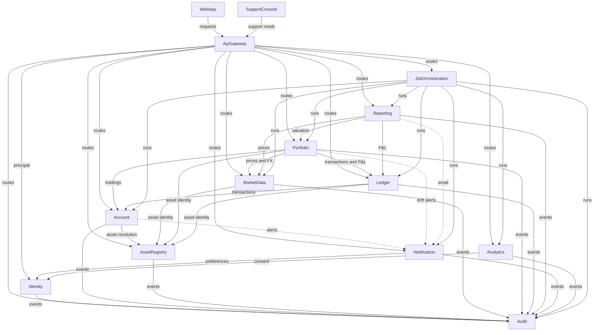

# Domain Design — Components

Logical building blocks for Crypto Pocket Butler, derived from
`requirements-analysis/requirements.md`, `user-stories/stories.md`, and the C4 container model
in `docs/architecture/README.md`. Components are code we write; databases, caches, providers,
and the observability stack are dependencies, not components.

Two documented containers are deliberately absent: **Billing** (billing, plans, entitlements,
and quotas were removed by the requirements interview) and the **Observability stack**
(infrastructure, not application code).

```yaml
components:
  - name: WebApp
    summary: Responsive SPA and PWA for onboarding, portfolio, drift, orders, briefs, and settings.
    behaviour: >
      Renders data supplied by the gateway; holds no business math. Session tokens live in
      memory only and never in persistent storage. Calls only the API Gateway, except Supabase
      Auth for sign-in and WalletConnect for read-only sessions. Localizes to English and
      Vietnamese and meets WCAG 2.2 AA on core flows.
    responsibilities:
      - Onboarding, connect, dashboard, asset detail, drift, order intent, brief, settings, support views
      - Client-side form validation and accessible state handling
    depends_on:
      - component: ApiGateway
        interaction: Every application request and query
        style: sync
    dependents: []
    external_dependencies:
      - name: Supabase Auth
        kind: third-party-api
        purpose: Sign-up, sign-in, MFA, session refresh
      - name: WalletConnect Relay
        kind: third-party-api
        purpose: Read-only wallet sessions
    entities: []

  - name: SupportConsole
    summary: Least-privilege support UI for account metadata and tickets.
    behaviour: >
      Reads account metadata through the gateway and Identity under a recorded reason and a
      time bound; never reads credentials or portfolio contents; every access is audited.
    responsibilities:
      - Support lookup of account metadata and ticket context
      - Requests time-bound support access grants
    depends_on:
      - component: ApiGateway
        interaction: All support reads and access requests
        style: sync
    dependents: []
    external_dependencies:
      - name: Help Desk & Status Page
        kind: third-party-api
        purpose: Ticket lookup and status
    entities: []

  - name: ApiGateway
    summary: Deny-by-default entry point that validates JWTs and routes to owning components.
    behaviour: >
      Validates the Supabase JWT against JWKS with an in-memory cache, resolves the principal
      through Identity, enforces admin and support gating, applies per-user/IP/region rate
      limits with stricter limits for auth and manual triggers, adds correlation IDs, and
      forwards the user JWT unchanged. Stateless.
    responsibilities:
      - Authentication enforcement and principal resolution
      - Deny-by-default routing, rate limiting, correlation IDs
      - Admin and support gating
    depends_on:
      - component: Identity
        interaction: Principal resolution and role lookup
        style: sync
      - component: Account
        interaction: Routes account and sync requests
        style: sync
      - component: AssetRegistry
        interaction: Routes registry and admin requests
        style: sync
      - component: MarketData
        interaction: Routes price and FX queries
        style: sync
      - component: Portfolio
        interaction: Routes portfolio, valuation, drift, and order requests
        style: sync
      - component: Ledger
        interaction: Routes transaction and P&L requests
        style: sync
      - component: Reporting
        interaction: Routes brief requests
        style: sync
      - component: Notification
        interaction: Routes preference requests
        style: sync
      - component: Analytics
        interaction: Routes consent-aware event ingestion
        style: sync
      - component: JobOrchestration
        interaction: Routes admin job triggers
        style: sync
      - component: Audit
        interaction: Routes audit queries
        style: sync
    dependents:
      - component: WebApp
        interaction: Every application request
      - component: SupportConsole
        interaction: All support reads and access requests
    external_dependencies:
      - name: Supabase Auth JWKS
        kind: third-party-api
        purpose: Signature, issuer, audience, and expiry validation
    entities: []

  - name: Identity
    summary: Internal users, roles, consent, preferences, support grants, and deletion.
    behaviour: >
      Upserts the internal user from the validated JWT or a signed Supabase Auth webhook. Roles
      come from app_metadata.role. Owns consent state, locale, base currency, timezone, and
      support-access grants. Deletion anonymises personal data and records what legal retention
      keeps. Requires MFA for users with exchange credentials.
    responsibilities:
      - User lifecycle and role assignment
      - Consent and preference state
      - Support access grants and deletion requests
    depends_on:
      - component: Audit
        interaction: Records access, role, privacy, and export events
        style: sync
      - component: Account
        interaction: Maintains the has_exchange_credentials claim on the Auth user, read from the JWT
        style: sync
      - component: JobOrchestration
        interaction: Calls the privacy sweep run endpoint to resume exports and deletions
        style: sync
    dependents:
      - component: ApiGateway
        interaction: Principal resolution
      - component: Notification
        interaction: Preferences and consent
      - component: Analytics
        interaction: Consent checks
    external_dependencies:
      - name: Supabase Auth
        kind: third-party-api
        purpose: Identity provider and signed webhooks
      - name: Supabase Vault
        kind: other
        purpose: Per-subject crypto-shredding keys
      - name: Supabase Storage
        kind: third-party-api
        purpose: Private identity-exports bucket for assembled export archives
    entities:
      - name: User
        identifier: id
        attributes: [id, authUserId, role, status, locale, baseCurrency, timezone]
      - name: ConsentRecord
        identifier: id
        attributes: [id, userId, purpose, granted, recordedAt]
        references:
          - entity: User
            owned_by: Identity
            relationship: each consent record belongs to one user
      - name: SupportAccessGrant
        identifier: id
        attributes: [id, userId, supportAgentId, reason, expiresAt]
      - name: DeletionRequest
        identifier: id
        attributes: [id, userId, requestedAt, status, retainedCategories]
      - name: ExportRequest
        identifier: id
        attributes: [id, userId, requestedAt, status, progress, assemblyDeadline, downloadExpiresAt]
      - name: JurisdictionRule
        identifier: code
        attributes: [code, allowed, minimumAge, disclosuresRequired]
      - name: ShreddingKey
        identifier: id
        attributes: [id, userId, vaultReference, status]
      - name: DeviceSession
        identifier: id
        attributes: [id, userId, authSessionId, device, location, lastActivityAt]

  - name: Account
    summary: Read-only exchange, wallet, and CSV accounts with verified credentials and holdings.
    behaviour: >
      Stores read-only credentials encrypted in Vault and verifies key permissions before use
      and periodically; rejects withdrawal or trading permission. Syncs balances for Binance and
      OKX, EVM chains, BNB Smart Chain, and Solana, and imports CSV. Labels spam, keeps
      last-synced time, and never stores private keys or seed phrases; pricing and dust are
      Portfolio's (it values holdings).
    responsibilities:
      - Account lifecycle and credential verification
      - Balance and holdings sync across the launch coverage
      - CSV import and sync status
      - Maintains app_metadata.has_exchange_credentials on the Supabase Auth user when a credential is stored or removed
    depends_on:
      - component: AssetRegistry
        interaction: Resolves observed tokens to canonical assets
        style: sync
      - component: Audit
        interaction: Records credential, sync, and account events
        style: sync
      - component: Notification
        interaction: Sync failures and key revocation alerts (synchronous HTTP with bounded retry)
        style: sync
      - component: Identity
        interaction: Verifies an approved support grant on a support metadata read
        style: sync
    dependents:
      - component: ApiGateway
        interaction: Account and sync routes
      - component: Portfolio
        interaction: Holdings for valuation
      - component: Ledger
        interaction: Transaction source for import and reconciliation
      - component: JobOrchestration
        interaction: Scheduled sync runs
    external_dependencies:
      - name: Binance API
        kind: third-party-api
        purpose: Read-only balances and trades
      - name: OKX API
        kind: third-party-api
        purpose: Read-only balances and trades
      - name: EVM / BNB / Solana RPC providers
        kind: third-party-api
        purpose: On-chain balances and token metadata
      - name: WalletConnect Relay
        kind: third-party-api
        purpose: Read-only wallet sessions
      - name: Supabase Vault
        kind: other
        purpose: Encrypted exchange credentials
      - name: Supabase Auth admin API
        kind: third-party-api
        purpose: Maintains app_metadata.has_exchange_credentials on the Auth user
    entities:
      - name: Account
        identifier: id
        attributes: [id, userId, kind, venue, label, status, lastSyncedAt]
      - name: Credential
        identifier: id
        attributes: [id, accountId, vaultSecretRef, permissionsVerifiedAt, readOnly]
        references:
          - entity: Account
            owned_by: Account
            relationship: each credential belongs to one account
      - name: Holding
        identifier: id
        attributes: [id, accountId, observedToken, assetId, quantity, observedAt, spam]
        references:
          - entity: Asset
            owned_by: AssetRegistry
            relationship: each resolved holding is of one canonical asset; a spam holding has no asset
      - name: SyncRun
        identifier: id
        attributes: [id, accountId, startedAt, leaseUntil, finishedAt, status, error]
      - name: WalletConnection
        identifier: id
        attributes: [id, accountId, address, observedChain, sessionRef]
      - name: ImportBatch
        identifier: id
        attributes: [id, accountId, source, fileName, importedCount, skippedCount, failedCount]
      - name: ImportedTransaction
        identifier: id
        attributes: [id, batchId, accountId, externalId, dedupeKey, assetId, kind, quantity, price, executedAt]
      - name: ImportRowError
        identifier: id
        attributes: [id, batchId, lineNumber, reason]

  - name: AssetRegistry
    summary: Canonical asset identity, chains, token contracts, price sources, and quarantine.
    behaviour: >
      Resolves a token contract or symbol to one canonical asset with its decimals. Keeps the
      chain and contract registry, the price-source priority list, and a quarantine for
      unmapped observations. Admin changes are audited. Never double counts one asset observed
      on two chains.
    responsibilities:
      - Canonical asset and decimal registry
      - Chain and token-contract registry
      - Price-source registry and unmapped quarantine
    depends_on:
      - component: Audit
        interaction: Records registry changes
        style: sync
    dependents:
      - component: ApiGateway
        interaction: Registry routes
      - component: Account
        interaction: Asset resolution for holdings
      - component: MarketData
        interaction: Asset identity for prices
      - component: Portfolio
        interaction: Asset identity for valuation
      - component: Ledger
        interaction: Asset identity for transactions
    external_dependencies: []
    entities:
      - name: Asset
        identifier: id
        attributes: [id, symbol, name, decimals, canonical]
      - name: Chain
        identifier: id
        attributes: [id, name, family, launchCoverage]
      - name: TokenContract
        identifier: id
        attributes: [id, chainId, contractAddress, assetId, decimals]
        references:
          - entity: Asset
            owned_by: AssetRegistry
            relationship: each contract resolves to one canonical asset
          - entity: Chain
            owned_by: AssetRegistry
            relationship: each contract lives on one chain
      - name: PriceSource
        identifier: id
        attributes: [id, name, priority, licenceRef, enabled]
      - name: UnmappedObservation
        identifier: id
        attributes: [id, observedSymbol, chainId, firstSeenAt, status]

  - name: MarketData
    summary: Multi-source prices, FX, and freshness for valuation.
    behaviour: >
      Collects prices from sources in a deterministic priority with fallback, records
      provenance and freshness, and serves FX rates for base-currency conversion. An asset with
      no sourceable price is reported as unpriced, never guessed. Serves the timestamp shown
      with every figure.
    responsibilities:
      - Price collection, priority, fallback, and provenance
      - FX rates and base-currency conversion inputs
      - Freshness and staleness reporting
    depends_on:
      - component: AssetRegistry
        interaction: Canonical asset identity
        style: sync
      - component: Audit
        interaction: Records source failures and licensing events
        style: sync
    dependents:
      - component: ApiGateway
        interaction: Price and FX queries
      - component: Portfolio
        interaction: Prices and FX for valuation
      - component: Reporting
        interaction: Prices and FX for briefs
      - component: JobOrchestration
        interaction: Scheduled price and FX collection
    external_dependencies:
      - name: Market Data & FX Providers
        kind: third-party-api
        purpose: Prices, candles, and FX
    entities:
      - name: PriceObservation
        identifier: id
        attributes: [id, assetId, sourceId, price, observedAt, freshness]
        references:
          - entity: Asset
            owned_by: AssetRegistry
            relationship: each price is for one canonical asset
      - name: FxRate
        identifier: id
        attributes: [id, baseCurrency, quoteCurrency, rate, observedAt]
      - name: BenchmarkSeries
        identifier: id
        attributes: [id, name, licenceRef, observedAt, value]

  - name: Portfolio
    summary: Portfolios, targets, guardrails, valuation, drift, snapshots, order intents, and trades.
    behaviour: >
      Values a portfolio in the user's base currency, computes drift in percentage points,
      records immutable snapshots reproducible from stored inputs, and applies a recorded trade
      to allocation immediately. Excludes unpriced assets from the total and discloses them.
      Never places an order and never requires withdrawal permission.
    responsibilities:
      - Portfolio lifecycle and account membership
      - Targets, guardrails, valuation, and drift
      - Immutable snapshots
      - Order intents and recorded trades
    depends_on:
      - component: Account
        interaction: Holdings to value
        style: sync
      - component: MarketData
        interaction: Prices and FX
        style: sync
      - component: Ledger
        interaction: Transactions and P&L for performance
        style: sync
      - component: AssetRegistry
        interaction: Canonical asset identity
        style: sync
      - component: Audit
        interaction: Records portfolio, target, order, and trade events
        style: sync
      - component: Notification
        interaction: Drift guardrail alerts
        style: async
    dependents:
      - component: ApiGateway
        interaction: Portfolio, valuation, drift, and order routes
      - component: Reporting
        interaction: Valuation and snapshots for briefs
      - component: JobOrchestration
        interaction: Scheduled valuation and snapshot runs
    external_dependencies: []
    entities:
      - name: Portfolio
        identifier: id
        attributes: [id, userId, name, baseCurrency, createdAt]
      - name: PortfolioAccount
        identifier: id
        attributes: [id, portfolioId, accountId]
        references:
          - entity: Account
            owned_by: Account
            relationship: each portfolio membership points to one account
      - name: TargetAllocation
        identifier: id
        attributes: [id, portfolioId, assetId, targetPercent]
      - name: Guardrail
        identifier: id
        attributes: [id, portfolioId, assetId, thresholdPoints]
      - name: ValuationSnapshot
        identifier: id
        attributes: [id, portfolioId, asOf, totalValue, pricedCoverage, inputsDigest]
      - name: OrderIntent
        identifier: id
        attributes: [id, portfolioId, assetId, side, quantity, status, createdAt]
      - name: RecordedTrade
        identifier: id
        attributes: [id, portfolioId, assetId, side, quantity, price, priceSource, executedAt]

  - name: Ledger
    summary: Append-only transactions, imports, dedupe, cost basis, and P&L.
    behaviour: >
      Records transactions once, deduplicating across exchange sync and CSV import. Computes
      cost basis, net invested, and realized and unrealized P&L, and labels coverage when
      history is missing rather than fabricating it. Corrections keep the original recoverable
      and are audited.
    responsibilities:
      - Transaction ledger and deduplication
      - Cost basis and P&L
      - Import batches and corrections
    depends_on:
      - component: AssetRegistry
        interaction: Canonical asset identity
        style: sync
      - component: Account
        interaction: Transactions synced from venues
        style: sync
      - component: Audit
        interaction: Records imports, adjustments, and corrections
        style: sync
    dependents:
      - component: ApiGateway
        interaction: Transaction and P&L routes
      - component: Portfolio
        interaction: P&L and performance inputs
      - component: Reporting
        interaction: P&L for briefs
      - component: JobOrchestration
        interaction: Scheduled transaction sync and reconciliation
    external_dependencies: []
    entities:
      - name: Transaction
        identifier: id
        attributes: [id, userId, accountId, assetId, kind, quantity, price, executedAt, dedupeKey]
      - name: ImportBatch
        identifier: id
        attributes: [id, userId, source, importedCount, skippedCount, status]
      - name: CostBasisPosition
        identifier: id
        attributes: [id, userId, assetId, method, quantity, costBasis, asOf]
      - name: PnlSnapshot
        identifier: id
        attributes: [id, userId, portfolioId, asOf, realized, unrealized, netInvested, coverage]

  - name: Reporting
    summary: Daily and weekly briefs, in-app and by email.
    behaviour: >
      Composes a brief from valuation, snapshots, and P&L, idempotent per owner, portfolio, and
      period. Marks a brief explicitly failed with a reason when generation fails. Every figure
      carries an as-of time and data status. Delivery goes through Notification.
    responsibilities:
      - Brief composition and scheduling
      - Brief delivery records
    depends_on:
      - component: Portfolio
        interaction: Valuation and snapshots
        style: sync
      - component: Ledger
        interaction: P&L
        style: sync
      - component: MarketData
        interaction: Prices and FX
        style: sync
      - component: Notification
        interaction: Email delivery
        style: async
      - component: Audit
        interaction: Records generation and delivery outcomes
        style: sync
    dependents:
      - component: ApiGateway
        interaction: Brief routes
      - component: JobOrchestration
        interaction: Scheduled brief generation
    external_dependencies: []
    entities:
      - name: Brief
        identifier: id
        attributes: [id, userId, portfolioId, period, status, asOf, failureReason]
      - name: BriefDelivery
        identifier: id
        attributes: [id, briefId, channel, status, attemptedAt]
        references:
          - entity: Brief
            owned_by: Reporting
            relationship: each delivery belongs to one brief

  - name: Notification
    summary: Alert catalogue, preferences, dedupe, and delivery across in-app and email.
    behaviour: >
      Owns every notification channel and delivery. Applies per-type preferences, sends
      mandatory security and credential email even when general notifications are off,
      deduplicates repeated alerts, retries within bounds, and keeps a delivery log. Never
      sends credentials or full addresses.
    responsibilities:
      - Notification catalogue and preferences
      - Dedupe, retry, and delivery log
      - Email and in-app dispatch
    depends_on:
      - component: Identity
        interaction: Preferences and consent
        style: sync
      - component: Audit
        interaction: Records delivery outcomes and mandatory sends
        style: sync
    dependents:
      - component: ApiGateway
        interaction: Preference routes
      - component: Account
        interaction: Sync and key alerts
      - component: Portfolio
        interaction: Drift alerts
      - component: Reporting
        interaction: Brief email delivery
      - component: JobOrchestration
        interaction: Scheduled dispatch and digests
    external_dependencies:
      - name: Transactional Email Provider
        kind: third-party-api
        purpose: Email delivery
    entities:
      - name: NotificationPreference
        identifier: id
        attributes: [id, userId, type, inApp, email, mandatory]
      - name: Alert
        identifier: id
        attributes: [id, userId, type, payload, createdAt, dedupeKey]
      - name: DeliveryAttempt
        identifier: id
        attributes: [id, alertId, channel, status, attemptedAt, error]

  - name: Analytics
    summary: Consent-aware events, aggregates, and feature flags.
    behaviour: >
      Ingests events only after Identity confirms consent, stores no PII, credentials, or
      addresses, aggregates activation and retention metrics, and holds feature flags with an
      owner, an expiry, and a rollout percentage.
    responsibilities:
      - Consent-aware event ingestion
      - Metric aggregation
      - Feature flags and experiment exposure
    depends_on:
      - component: Identity
        interaction: Consent checks before storing an event
        style: sync
      - component: Audit
        interaction: Records flag changes and exposure anomalies
        style: sync
    dependents:
      - component: ApiGateway
        interaction: Event ingestion routes
      - component: JobOrchestration
        interaction: Scheduled aggregation and flag expiry
    external_dependencies: []
    entities:
      - name: AnalyticsEvent
        identifier: id
        attributes: [id, userRef, eventName, occurredAt, properties, consentPurpose]
      - name: MetricAggregate
        identifier: id
        attributes: [id, metric, period, value]
      - name: FeatureFlag
        identifier: id
        attributes: [id, key, owner, expiresAt, rolloutPercentage, status]

  - name: JobOrchestration
    summary: Schedules, run records, single-flight, and missed-run detection.
    behaviour: >
      Ticks from an in-process ticker guarded by a single OrchestratorLease row (no Supabase Cron
      and no message queue), takes a single-flight lock per run, calls the owning component's run
      endpoint with the shared service token and a per-window idempotency key, and records one row
      per attempt. Detects missed runs and stale heartbeats within five minutes; retries and
      backfills are bounded. The change from Supabase Cron is recorded in
      construction/u11-job-orchestration/functional-design/entities.md.
    responsibilities:
      - Schedules and run triggering
      - Single-flight locks and run records
      - Missed-run detection and heartbeat
    depends_on:
      - component: Account
        interaction: Account and transaction sync runs
        style: sync
      - component: MarketData
        interaction: Price, FX, and benchmark runs
        style: sync
      - component: Portfolio
        interaction: Valuation and snapshot runs
        style: sync
      - component: Ledger
        interaction: Reconciliation runs
        style: sync
      - component: Reporting
        interaction: Brief generation runs
        style: sync
      - component: Notification
        interaction: Dispatch and digest runs
        style: sync
      - component: Analytics
        interaction: Aggregation and flag expiry runs
        style: sync
      - component: Audit
        interaction: Retention runs and run audit
        style: sync
    dependents:
      - component: ApiGateway
        interaction: Admin job triggers
    external_dependencies:
      - name: Heartbeat metric and alert rule
        kind: other
        purpose: Dead-man check in the self-hosted Prometheus/Alertmanager stack
      - name: Supabase Vault
        kind: other
        purpose: Shared internal service token
    entities:
      - name: JobSchedule
        identifier: id
        attributes: [id, jobName, interval, ownerComponent, enabled]
      - name: JobRun
        identifier: id
        attributes: [id, scheduleId, startedAt, finishedAt, status, error]
        references:
          - entity: JobSchedule
            owned_by: JobOrchestration
            relationship: each run belongs to one schedule
      - name: Heartbeat
        identifier: id
        attributes: [id, recordedAt, schedulerId]

  - name: Audit
    summary: Append-only audit events, support-access records, and retention.
    behaviour: >
      Stores audit events through an insert-only role, each with actor or system, action,
      target, timestamp, context, and outcome. Never stores credentials, tokens, or full
      addresses. Serves admin queries, records support access, and runs retention under a
      separate audited privileged role.
    responsibilities:
      - Append-only audit storage and queries
      - Support-access records
      - Retention and export of audit data
    depends_on: []
    dependents:
      - component: ApiGateway
        interaction: Audit query routes
      - component: Identity
        interaction: Access, role, and privacy events
      - component: Account
        interaction: Credential and sync events
      - component: AssetRegistry
        interaction: Registry changes
      - component: MarketData
        interaction: Source failures and licensing
      - component: Portfolio
        interaction: Portfolio, target, order, and trade events
      - component: Ledger
        interaction: Import and correction events
      - component: Reporting
        interaction: Brief generation outcomes
      - component: Notification
        interaction: Delivery outcomes
      - component: Analytics
        interaction: Flag changes
      - component: JobOrchestration
        interaction: Retention runs and run audit
    external_dependencies:
      - name: Supabase Postgres
        kind: database
        purpose: Append-only audit schema with an insert-only role
    entities:
      - name: AuditEvent
        identifier: id
        attributes: [id, actorId, action, target, occurredAt, context, outcome]
        references:
          - entity: User
            owned_by: Identity
            relationship: each event names the acting user or is system-attributed
      - name: SupportAccessRecord
        identifier: id
        attributes: [id, supportAgentId, userId, reason, startedAt, expiresAt, outcome]
```

## Component Diagram



<!-- Text fallback: WebApp and SupportConsole call the ApiGateway; the gateway calls every
backend component; Identity, Account, AssetRegistry, MarketData, Portfolio, Ledger, Reporting,
Notification, and Analytics emit audit events to Audit; Portfolio reads Account, MarketData,
Ledger, and AssetRegistry; Reporting reads Portfolio, Ledger, and MarketData and asks
Notification to deliver email; JobOrchestration calls every component's run endpoint. -->

## Component Summary

| Component | Purpose | Depends On | Dependents | Entities Owned |
|---|---|---|---|---|
| WebApp | SPA and PWA | ApiGateway | — | none |
| SupportConsole | Least-privilege support UI | ApiGateway | — | none |
| ApiGateway | JWT validation, routing, rate limits | Identity, Account, AssetRegistry, MarketData, Portfolio, Ledger, Reporting, Notification, Analytics, JobOrchestration, Audit | WebApp, SupportConsole | none |
| Identity | Users, roles, consent, preferences, deletion | Audit | ApiGateway, Notification, Analytics | User, ConsentRecord, SupportAccessGrant, DeletionRequest |
| Account | Read-only accounts, credentials, holdings sync, CSV import | AssetRegistry, Audit, Notification, Identity, Supabase Auth | ApiGateway, Portfolio, Ledger, JobOrchestration | Account, Credential, Holding, SyncRun, WalletConnection, ImportBatch, ImportedTransaction, ImportRowError |
| AssetRegistry | Canonical assets, chains, contracts, sources | Audit | ApiGateway, Account, MarketData, Portfolio, Ledger | Asset, Chain, TokenContract, PriceSource, UnmappedObservation |
| MarketData | Prices, FX, freshness | AssetRegistry, Audit | ApiGateway, Portfolio, Reporting, JobOrchestration | PriceObservation, FxRate, RefreshRun, AssetPriceTier |
| Portfolio | Portfolios, targets, valuation, drift, snapshots, orders | Account, MarketData, Ledger, AssetRegistry, Audit, Notification | ApiGateway, Reporting, JobOrchestration | Portfolio, PortfolioAccount, TargetAllocation, Guardrail, ValuationSnapshot, OrderIntent, RecordedTrade |
| Ledger | Transactions, cost basis, P&L | AssetRegistry, Account, MarketData, Audit | ApiGateway, Portfolio, Reporting, JobOrchestration | Transaction, CostBasisPosition, PnlSnapshot |
| Reporting | Briefs in-app and by email | Portfolio, Ledger, MarketData, Notification, Audit | ApiGateway, JobOrchestration | Brief, BriefDelivery |
| Notification | Alert catalogue, preferences, delivery | Identity, Audit | ApiGateway, Account, Portfolio, Reporting, JobOrchestration | NotificationPreference, Alert, DeliveryAttempt |
| Analytics | Consent-aware events, aggregates, flags | Identity, Audit | ApiGateway, JobOrchestration | AnalyticsEvent, MetricAggregate, FeatureFlag |
| JobOrchestration | Schedules, runs, missed-run detection | Account, MarketData, Portfolio, Ledger, Reporting, Notification, Analytics, Audit | ApiGateway | JobSchedule, JobRun, Heartbeat |
| Audit | Append-only audit and support-access records | — | ApiGateway, Identity, Account, AssetRegistry, MarketData, Portfolio, Ledger, Reporting, Notification, Analytics, JobOrchestration | AuditEvent, SupportAccessRecord |

## Entity Ownership

| Entity | Owning Component | Identifier | Attributes | References |
|---|---|---|---|---|
| User | Identity | id | id, authUserId, role, status, locale, baseCurrency, timezone | — |
| ConsentRecord | Identity | id | id, userId, purpose, granted, recordedAt | User |
| SupportAccessGrant | Identity | id | id, userId, supportAgentId, reason, expiresAt | — |
| DeletionRequest | Identity | id | id, userId, requestedAt, status, retainedCategories | — |
| Account | Account | id | id, userId, kind, venue, label, status, lastSyncedAt | — |
| Credential | Account | id | id, accountId, vaultSecretRef, permissionsVerifiedAt, readOnly | Account |
| Holding | Account | id | id, accountId, assetId, quantity, observedAt, priced | Asset |
| SyncRun | Account | id | id, accountId, startedAt, finishedAt, status, error | — |
| Asset | AssetRegistry | id | id, symbol, name, decimals, canonical, rank | — |
| Chain | AssetRegistry | id | id, name, family, launchCoverage | — |
| TokenContract | AssetRegistry | id | id, chainId, contractAddress, assetId, decimals | Asset, Chain |
| PriceSource | AssetRegistry | id | id, name, kind, priority, quoteCurrency, rateLimitPerMinute, delayedFeed, licenceRef, enabled | — |
| UnmappedObservation | AssetRegistry | id | id, observedSymbol, chainId, firstSeenAt, status | — |
| PriceObservation | MarketData | id | id, assetId, sourceName, price, currency, observedAt, receivedAt, status | Asset, PriceSource (by name) |
| FxRate | MarketData | id | id, base, quote, rate, source, observedAt, receivedAt | PriceSource (by name) |
| RefreshRun | MarketData | id | id, startedAt, leaseUntil, finishedAt, status, requestedCount, pricedCount, unpricedCount, error | — |
| AssetPriceTier | MarketData | assetId | assetId, rank, tier, boundSeconds, updatedAt | Asset |
| Portfolio | Portfolio | id | id, userId, name, baseCurrency, createdAt | — |
| PortfolioAccount | Portfolio | id | id, portfolioId, accountId | Account |
| TargetAllocation | Portfolio | id | id, portfolioId, assetId, targetPercent | — |
| Guardrail | Portfolio | id | id, portfolioId, assetId, thresholdPoints | — |
| ValuationSnapshot | Portfolio | id | id, portfolioId, asOf, totalValue, pricedCoverage, inputsDigest | — |
| OrderIntent | Portfolio | id | id, portfolioId, assetId, side, quantity, status, createdAt | — |
| RecordedTrade | Portfolio | id | id, portfolioId, assetId, side, quantity, price, priceSource, executedAt | — |
| Transaction | Ledger | id | id, userId, accountId, assetId, kind, quantity, price, executedAt, dedupeKey | — |
| ImportBatch | Ledger | id | id, userId, source, importedCount, skippedCount, status | — |
| CostBasisPosition | Ledger | id | id, userId, assetId, method, quantity, costBasis, asOf | — |
| PnlSnapshot | Ledger | id | id, userId, portfolioId, asOf, realized, unrealized, netInvested, coverage | — |
| Brief | Reporting | id | id, userId, portfolioId, period, status, asOf, failureReason | — |
| BriefDelivery | Reporting | id | id, briefId, channel, status, attemptedAt | Brief |
| NotificationPreference | Notification | id | id, userId, type, inApp, email, mandatory | — |
| Alert | Notification | id | id, userId, type, payload, createdAt, dedupeKey | — |
| DeliveryAttempt | Notification | id | id, alertId, channel, status, attemptedAt, error | — |
| AnalyticsEvent | Analytics | id | id, userRef (salted hash), eventName, occurredAt, properties, consentPurpose | — |
| MetricAggregate | Analytics | id | id, metric, period, value | — |
| FeatureFlag | Analytics | id | id, name, owner, expiresAt, rolloutPercent, enabled | — |
| JobSchedule | JobOrchestration | id | id, jobName, interval, ownerComponent, enabled | — |
| JobRun | JobOrchestration | id | id, scheduleId, startedAt, finishedAt, status, error | JobSchedule |
| Heartbeat | JobOrchestration | id | id, recordedAt, schedulerId | — |
| AuditEvent | Audit | id | id, actorId, action, target, occurredAt, context, outcome | User |
| SupportAccessRecord | Audit | id | id, supportAgentId, userId, reason, startedAt, expiresAt, outcome | — |

## External Dependencies

| Component | Dependency | Kind | Purpose |
|---|---|---|---|
| WebApp | Supabase Auth | third-party-api | Sign-up, sign-in, MFA, session refresh |
| WebApp | WalletConnect Relay | third-party-api | Read-only wallet sessions |
| SupportConsole | Help Desk & Status Page | third-party-api | Ticket lookup and status |
| ApiGateway | Supabase Auth JWKS | third-party-api | JWT validation |
| Identity | Supabase Auth | third-party-api | Identity provider and webhooks |
| Identity | Supabase Vault | other | Per-subject crypto-shredding keys |
| Account | Binance API | third-party-api | Read-only balances and trades |
| Account | OKX API | third-party-api | Read-only balances and trades |
| Account | EVM / BNB / Solana RPC providers | third-party-api | On-chain balances and token metadata |
| Account | WalletConnect Relay | third-party-api | Read-only wallet sessions |
| Account | Supabase Vault | other | Encrypted exchange credentials |
| MarketData | Market Data & FX Providers | third-party-api | Prices, candles, and FX |
| Notification | Transactional Email Provider | third-party-api | Email delivery |
| JobOrchestration | Heartbeat alert rule | other | Dead-man check in Prometheus/Alertmanager |
| JobOrchestration | Supabase Vault | other | Shared internal service token |
| Audit | Supabase Postgres | database | Append-only audit schema |

## Rationale

| Component | Why it is a separate building block |
|---|---|---|
| WebApp | UI lifecycle and accessibility are independent of backend change rates; holds no business math |
| SupportConsole | Least-privilege support access is a distinct security boundary from the customer app |
| ApiGateway | One enforcement point for authentication, routing, and rate limits; stateless and independently scalable |
| Identity | Owns user, role, consent, and preference state that every other component reads |
| Account | Owns the venue and chain integrations, credential lifecycle, and sync, which change at a different rate from valuation |
| AssetRegistry | Canonical identity and decimals are referenced by every value path; a change here affects all of them |
| MarketData | Owns provider priority, fallback, freshness, and licensing, independent of how values are computed |
| Portfolio | Owns targets, valuation, drift, snapshots, and orders — the core decision-support loop |
| Ledger | Transaction history, cost basis, and P&L evolve independently and are the retail value loop |
| Reporting | Brief composition and delivery records are a separate concern from the data they summarise |
| Notification | Channel, preference, dedupe, and deliverability state must not couple to the components that raise alerts |
| Analytics | Consent, event taxonomy, and privacy controls are a distinct concern from operational data |
| JobOrchestration | Scheduling, single-flight, and missed-run detection are cross-cutting operational concerns |
| Audit | Append-only, insert-only storage is a compliance boundary distinct from every domain |

## Boundary options considered

- **Option A — one component per documented service (chosen).** Pros: matches the C4 model, each
  owns one schema and role, independent change rates, clear ownership. Cons: 14 building blocks
  and 12 backend deployables to operate. Reversibility: high at design time, low after code.
- **Option B — fewer, coarser components (collapse Ledger into Portfolio, Analytics into
  Notification).** Pros: fewer moving parts. Cons: mixes transaction history with valuation, and
  consent-aware analytics with delivery, breaking the data-ownership rule and the C4 model.
  Reversibility: medium; splitting later requires schema extraction.
- **Option C — finer components inside each service.** Pros: smaller units. Cons: no independent
  data ownership and no distinct lifecycle, so the extra boundaries would be arbitrary.
  Reversibility: high but with no benefit.

**Recommendation:** Option A, because each component owns a distinct schema and changes for a
different reason. The team chose it.
