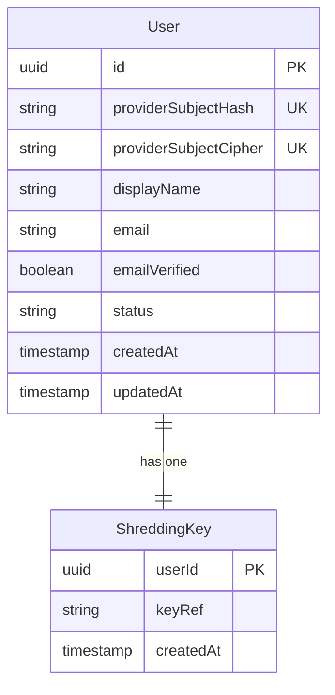

# Functional Specification — u1-user-registry

Implements **US1.1–US1.6**, **US4.1**, and the lookup half of **US7.1** from `stories.md`.

## Workflows

### W1 — First authentication and provisioning

1. A request arrives with a validated provider token (subject, email, email-verified, display name).
2. The registry hashes the subject and looks up the user by `providerSubjectHash`.
3. **Not found:** the registry asks the jurisdiction gate to clear the provider (C8); a denial returns a refusal and stores nothing. On clearance it creates a `ShreddingKey` reference, then the `User` row with `status = pending`, and emits `identity.user.provisioned`.
4. **Found:** it refreshes role-independent profile fields (email, email-verified, display name) unless overridden, and emits `identity.user.activated` / `identity.role.changed` when those change.
5. It upserts the device session (owned by the session path) and returns the principal: id, role (from the token, not stored), status, nextStep.

**Success outcome:** exactly one user record per subject, with the correct next step.
**Error paths:** gate denied → refusal, nothing stored; hash collision (two subjects, same hash) is treated as not-found and logged; a write failure creates no partial record (single transaction).

### W2 — Profile update

1. The user submits display name, email, or email-verification override.
2. The registry validates the values (length, RFC 5322 shape) and marks the field as overridden.
3. A later claim refresh does not overwrite an overridden field.

**Error paths:** invalid email → 422 naming the field, previous value kept.

### W3 — Account recovery

1. The user completes recovery at the provider (email change, lost device).
2. The next request arrives with a new or changed subject-adjacent claim but the same subject identity.
3. The registry resolves the same internal user; role and status rules apply unchanged.

**Error paths:** a disabled or deleted user is still denied; a changed subject that does not match any record provisions nothing without a gate clearance.

### W4 — Principal status reporting

1. The principal endpoint returns the stored status.
2. A `pending` user is offered only the confirmation step; a `disabled`, `pending_deletion`, or `deleted` user is denied with the response the authorisation unit defines.

## State model — User.status

| Current state | Event | Guard | Next state | Owner of the transition |
|---|---|---|---|---|
| pending | Provider email verified | Gate cleared | active | u5-account-lifecycle |
| active | Admin disables | Reason recorded | disabled | u5 |
| disabled | Admin restores | Reason recorded | active | u5 |
| active | User requests deletion | Terms acknowledged | pending_deletion | u5 |
| pending_deletion | User restores within 30 days | Window open | active | u5 |
| pending_deletion | 30-day window ends | Legal hold checked | deleted | u5 |
| Any | Erasure completes | Legal hold absent | deleted | u5 |

u1 owns the stored field and the allowed value set (BR1.7, BR1.10); u5 owns every transition.

## Derived entity-relationship view

Text fallback: one user has exactly one shredding-key reference; the subject is stored twice, as a hash and as a ciphertext, never in plaintext.

## Derived rules summary

| Rule | Statement |
|---|---|
| BR1.1 | One record per provider subject |
| BR1.2 | Stable internal id |
| BR1.3 | Exactly one owner per user-owned resource |
| BR1.4 | Profile from provider unless overridden |
| BR1.5 | No credentials or tokens stored |
| BR1.6 | Recovery at the provider, no bypass |
| BR1.7 | Status values drive denial |
| BR1.8 | Subject hashed and encrypted only |
| BR1.9 | Admin lookup; role change is u2 |
| BR1.10 | Invalid status rejected |

## Integration points

- **C3** in `contract-summary.md`: `GET/PUT /internal/users/by-subject/{subjectHash}`, `PUT /internal/users/{id}/status` (status transition requests from u5 only).
- **C8**: the gate must clear the provider before provisioning.
- **Audit service (C9)**: provisioned, activated, role-changed, and admin-lookup events.

## Error catalogue

| Condition | Status | Behaviour |
|---|---|---|
| Gate denied | 403/422 | Refusal; nothing stored |
| Duplicate subject | 200/201 with the existing record | No second row |
| Invalid email | 422 | Field named; previous value kept |
| Unknown status value | 422 | Write refused |
| Non-admin lookup | 403 | Denied and audited |
