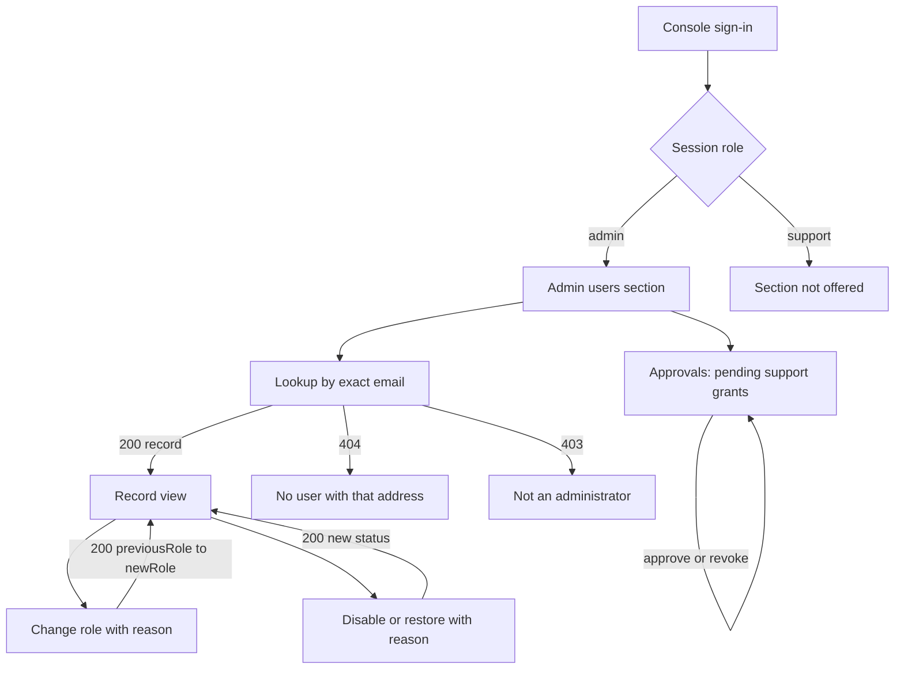

# Functional Spec — U10 Admin Users UI (`u10-admin-users-ui`)

**Stage:** Functional Design · **Unit kind:** ui (embedded in the support console's admin section,
`support-console/`) · **Complexity:** M
**Stories:** US7.1 · **Requirements:** FR20.1, FR15.4, FR15.9, FR17.2, NFR24, NFR25, NFR26
**Upstream:** `unit-of-work.md` (U10), `unit-of-work-story-map.md` (US7.1 → U10; U1; U2),
`stories.md` (US7.1 and its AC7.1.1–AC7.1.2; US2.9, US3.2 and US4.2 for the surrounding rules),
`requirements.md` (FR20.1–FR20.4, FR15.4, FR15.9, FR17.2, NFR24–NFR26), `components.md`
(`AdminUsersUI`), `contract-summary.md` (C1/C2 gateway surface, C3 user record read, C4
authorisation decisions, C5 support access, C7 account lifecycle).
**Decisions taken here:** the unit definition, US7.1 and the contracts fix the shape of the work;
four product choices are this spec's own and are recorded here for the reader, not left implicit —
exact-email lookup only (§3.1, §12 item 2), the inline confirmation step for destructive actions
(§3.4), a non-blocking self-account warning because no server rule exists (§3.3, §12 item 3), and
the approvals panel reading a new pending-grant list route (§3.5, W5). Whatever the repository
cannot settle is recorded in §12.

## 1. Purpose

U10 is the administrator's user-management surface inside the support console. It looks a user up
by exact email, opens the record, changes the user's role, disables or restores the account — each
change requiring a reason and each stating that it is audited — and presents support-grant
approval. It presents no entitlement control of any kind and reads no portfolio content.

This spec is self-contained: it is the authoritative description of U10's screens, their states,
and the contract additions the unit needs to satisfy its story (the current role on the admin
record, and the browser-reachable status and grant-list routes — §4).

### What this unit does not own

- **The role-change rule.** U2 owns `RoleChangeService`: the admin check, the reason bounds, the
  intent-then-outcome audit (`identity.role.change.requested`, `identity.role.changed`), and the
  provider write (contract C4, `/internal/admin/role` and the gateway surface
  `PUT /v1/admin/users/{userId}/role`). U10 presents the change; it decides nothing.
- **The status transitions.** U5 owns `AccountLifecycle::disable`/`restore` — the admin check, the
  BR5.2 reason, the BR5.1 edge, the transition record and its audit (contract C7). U10 sends the
  reason and renders the answer.
- **The grant lifecycle.** U3 owns the grant aggregate, the second-approver rule and the expiry
  (contract C5). U10 mounts the existing approval queue and adds one read-only list route (W5) so
  the queue has a source; it adds no grant rule, no state and no write path.
- **The metadata boundary.** C3's user record is the whole surface: display name, email and its
  verification, status, the internal id, and timestamps. Holdings, balances, valuations,
  transactions, orders, credentials and tokens are not on this surface (BR1.4) and the support
  metadata projection is not called from here.
- **Entitlements.** Nothing in this release has an entitlement model (AC7.1.2, FR20.1). U10
  presents no entitlement control, adds no entitlement route, and the gateway's deny-by-default
  table gains none.

## 2. Journey and screen flow

The console signs a support or admin user in through Supabase Auth (unchanged). The admin section
is offered only when the session's `app_metadata.role` is `admin`:

Text fallback: console sign-in → session role → {admin: the admin users section | support: the
section is not offered}; inside the section, an exact-email lookup answers one record or no
record; from the record the admin changes the role or the account status, each with a reason and
each re-reading the record after the change; the same section lists pending support grants for
approval or revocation.

### 2.1 Entry and gating

- The console is a hash-routed shell (`support-console/src/screens/SupportShell.tsx`). U10 adds
  the section id `admin-users` with `adminOnly: true`, beside the existing `incidents` section. A
  support-role session never renders the link, and a hand-typed `#admin-users` hash falls back to
  `grants`. The shell's `visibleSection` guard is hard-coded to one section today
  (`section === "incidents" && role !== "admin" ? "grants" : section`), so this unit widens that
  guard to read `adminOnly` from `SECTIONS` instead of naming `incidents` — a small, additive
  change in `SupportShell.tsx` that the new section inherits.
- The gate is presentational only (FR15.9, US2.9). Every path U10 calls is `requires_admin: true`
  in the gateway's deny-by-default table, and Identity re-checks the admin role from the same
  forwarded JWT. Hiding the section is not what protects the data; a tampered client that shows it
  still receives `403`.
- A `403` from any U10 call is rendered as "your session is not an administrator" with the
  correlation id, never as a silent empty list.

### 2.2 Screen states

The section has two panels stacked in reading order — **Find a user**, then the **record** once one
is loaded — and a third, **Approvals**, that is present whether or not a record is open:

| State | What renders |
|---|---|
| no record | the lookup form alone |
| lookup in flight | the form disabled with "Looking up…" |
| record loaded | the record view, its two change forms, and Approvals |
| lookup `404` | the form plus "No user has that address." — no record view |
| lookup error | the form plus an inline error with the correlation id and a retry |

The record view stays until another lookup replaces it or the section is left. The one change
failure that clears it is a `404` — the target no longer exists — which returns the section to the
lookup with one sentence (§3.3, §3.4, §10).

## 3. Screen rules

### 3.1 Find a user

One field: the **exact email address**. Submit calls `POST /v1/admin/users/lookup` with body
`{"email": "<address>"}` (A1′, §8); the address never travels in a URL or an access log (D-S1).
The answer is one user record or `404`.

- **Exact match only.** The server looks up by normalised exact email (BR1.9); U10 offers no
  browse, no prefix search, and no list of all users, and invents none. A search that finds
  nothing is a `404` rendered as "No user has that address." — the same answer a wrong address
  and an address that does not exist receive.
- **The lookup is audited.** The server records `identity.admin.user_lookup` on success and on a
  refusal (`not_admin`); U10 does not repeat or duplicate that statement in the UI, and shows no
  audit id.
- An empty or malformed address is refused by the client before the call (presentation only) and
  again by the server. A `422` names `email`.

### 3.2 Record view

Reads the record the lookup answered (§8 A1's shape plus the `role` this unit adds, §4 W1).
Content, in reading order:

1. **Identity** — display name (em dash when absent), the email with a **Verified** or
   **Unverified** badge from `emailVerified`, and the internal user id in mono, selectable, so the
   admin can quote it in a ticket.
2. **Role** — a `RoleBadge` for the current role, `owner`, `admin`, or `support`, read from the
   provider's current `app_metadata.role` at lookup time (W1).
3. **Status** — a status badge for `status`, whose label, tone and shape this unit defines for all
   five statuses (`frontend-components.md` §5); status never reads by colour alone.
4. **Timestamps** — `createdAt` and `updatedAt`, formatted with `Intl.DateTimeFormat` in the
   console's locale.

The record is read-only. The only writers are the two forms below it, and each re-reads the record
after it succeeds (§3.3, §3.4).

**Metadata boundary.** The record shows no holding, balance, valuation, transaction, order,
credential, token, provider subject, or wallet address, and no control that would fetch one. It
shows no subscription, plan, quota, seat, or billing field, because none exists (AC7.1.2): the
section renders no entitlement control and calls no entitlement path, and the gateway declares
none, so any such request is a `404` before a service is reached.

### 3.3 Change the role

A form with two controls: a **role select** (`owner`, `admin`, `support`) pre-filled with the
record's current role, and a **reason** (required, 1–500 characters after trimming). Submit is
disabled until the role differs from the current one and the reason is non-empty.

- Submit calls `PUT /v1/admin/users/{userId}/role` with `{"newRole": "<role>", "reason": "<text>"}`
  (A2). The target id is the **internal user id** from the record, never the console session's
  Supabase user id — the two id spaces are different.
- `200` answers `{ userId, previousRole, newRole }`. The form renders the transition
  ("admin → support"), states **"This change is audited."** beside it, and re-reads the record
  through the lookup, which reads the provider's current role (W1), so the badge and the select
  show the value the provider now holds, not the typed one. NFR24 still governs what the target
  sees: the change takes effect at the target's next request, and the console claims nothing
  sooner.
- `422` names `newRole` or `reason`. A `403` renders the not-an-administrator message. A `404`
  means the target is gone: the record view is cleared back to the lookup with that sentence.
- `503` means the intent or outcome audit could not be recorded, or the provider write failed after
  the intent was recorded. The provider write may or may not have applied; the form therefore
  re-reads the record and renders what the server now reports instead of claiming the change
  failed. The correlation id is shown; the failure is never swallowed.
- **Your own account.** When the record's email equals the signed-in session's email, the form
  shows a quiet warning above the submit: "This is the account you are signed in with. Demoting it
  removes your own administrator access at your next request." It is a warning, not a block: no
  self-change rule exists on the server (§12, open item 3), and the console does not invent one.

Every role change stores actor, target, previous role, new role, reason and outcome in the audit
trail (AC7.2.1) — U2's rule, recorded in the intent entry before the provider is touched and in the
outcome entry after. U10's copy states that the change is audited and shows the previous and new
role; it does not read the audit log.

### 3.4 Disable or restore the account

The available action is chosen from the record's `status`; the server re-checks the edge (BR5.1)
and stays authoritative:

| Current status | Action offered | Call |
|---|---|---|
| `active` | **Disable account** | `POST /v1/admin/users/{userId}/disable` (D1) |
| `disabled` | **Restore account** | `POST /v1/admin/users/{userId}/restore` (D2) |
| `pending`, `pending_deletion`, `deleted` | none, with one explanatory line | — |

- The explanatory line names the reason and no action: a pending-deletion account restores itself
  from the person's own recovery screen (U7), and an erased account has no record to re-enable.
  Neither status gains a control here.
- Both actions require the same **reason** (required, 1–500 characters after trimming) and an
  explicit confirmation step: submit swaps the button pair for a confirmation block that restates
  what happens — "The user cannot sign in while the account is disabled. History is not deleted."
  for disable, "The user can sign in again at their next request." for restore — with **Confirm**
  and **Cancel**, and focus moves to Confirm. Nothing is sent until Confirm.
- Submit calls D1 or D2 with `{"reason": "<text>"}`. `200` answers
  `{ userId, status, transitionId, occurredAt }`; the panel states **"This change is audited."**,
  renders the new status, and re-reads the record.
- `409` means the edge no longer holds — another admin changed the account, or the status moved
  since the read. The panel re-reads the record and renders the server's state; the failure is
  reported in one line and is not retried automatically.
- `403` is the not-an-administrator message; `404` returns to the lookup with the target-gone
  sentence; `503` re-reads and reports as §3.3 does.
- Disabling never deletes history (FR17.2), and a disabled user cannot re-enable themselves: the
  person's own surfaces refuse a disabled account and their blocked screen names support only
  (U7) — U10 adds no self-service path.

### 3.5 Approvals

The admin section includes the console's **grant approval queue** — the same component and the same
approve/revoke calls the `grants` section uses, with its list read from the pending-grant route
(A5′, W5) instead of the shell's session-scoped array (§11). It exists here because support-grant
approval is administrative management (FR15.4, C5, `POST
/v1/support-grants/{grantId}/approve` is `requires_admin: true`):

- Each pending grant shows its reason, target user, requester, and status badge.
- **Approve** is disabled for the admin's own request (AC3.2.2) and refused by the server with
  `403` if attempted; the queue states why.
- **Revoke** is offered for a grant that is not revoked or expired, and calls the existing
  `DELETE /v1/support-grants/{grantId}`.
- After either action the shell's grant state updates as it does for the `grants` section; the
  active-grant banner and the 60-minute clock remain the shell's.
- The panel reads `GET /v1/support-grants?status=pending_approval` (A5′, W5) for its list, so a
  fresh admin session sees every pending grant — not only the requests it created. The route is
  admin-only at the edge and again from the forwarded JWT.

## 4. Record and contract rules this unit adds

U10 is presentational plus one projection and three gateway-facing routes. These are the only
record-level additions; each delegates to a use case that already exists and owns the rule.

- **W1 — The admin record answers the role.** `GET /v1/admin/users?email=` answers C3's user
  record, which carries no role today, so an administrator cannot see the role they are about to
  change and AC7.1.1's "change the role" is blind. The admin answer gains `role` (`owner`,
  `admin`, or `support`), **read from the provider's current `app_metadata.role` at lookup time** —
  the same metadata the role write sets, through the read the existing `RoleWriter::set_role`
  already performs before it writes. The stored user row is deliberately not the source: it is
  refreshed only when the target's own principal is next resolved, so it can be stale on exactly
  the screen used to judge access, and an immediate re-read after a change would show the old
  role. The mapping follows `Role::from_claim`: `admin` and `support` as written, `owner` and the
  legacy `user` as `owner`, and an absent or unknown value as `owner`. A provider read failure
  answers `503` and the lookup says the user cannot be looked up right now — it never shows a
  stale role. The answer is a distinct admin DTO (`AdminUserResponse` in `http`, `AdminUserView`
  in `application`, both carrying `role`); `UserResponse`, `UserRecordView` and the internal C3
  reads keep their shape, so the widened answer reaches the admin surface only. This is a contract
  addition to C3 and to the role port (§12, open item 1).
- **W2 — Disable through the gateway.** `POST /v1/admin/users/{userId}/disable` accepts
  `{"reason": "…"}`, requires the admin role at the edge and again from the forwarded JWT, and
  delegates to `AccountLifecycle::disable` (U5): version 1–500 characters of reason, the BR5.1
  edge, one transition record, and the existing audit. It answers C7's
  `{ userId, status, transitionId, occurredAt }`, and `404` for an unknown target, `422` for the
  reason, `403` for a non-admin, `409` for an edge outside BR5.1. Today only the internal,
  service-token-guarded C7 route exists; a browser cannot reach it, and the console must not call
  a service directly. The route is a contract addition to C1/C2 and C7 (§12, open item 1).
- **W3 — Restore through the gateway.** `POST /v1/admin/users/{userId}/restore`, identical in
  shape to W2, delegating to `AccountLifecycle::restore`.
- **W4 — No entitlement surface.** Neither the gateway table, Identity, nor the console gains an
  entitlement path or control; an undeclared path is `404` at the gateway before any service is
  reached. A request that would "override an entitlement" has nothing to call, which is AC7.1.2's
  API half.
- **W5 — The pending-grant list.** `GET /v1/support-grants?status=pending_approval` answers the C5
  grant shape for every pending request, newest first and bounded to 100 rows; it requires the
  admin role at the edge and again from the forwarded JWT, and `422` for any other `status` value.
  It reads the grant store U3 owns and adds no grant rule, table or state. Without it the
  approvals panel could only render grants the session itself created, which is not FR20.1's
  "view support grants" (components.md, `AdminUsersUI` → SupportAccess). The route is a contract
  addition to C1/C2 and C5 (§12, open item 1).

W2, W3 and W5 are the same shape as `change_role_for_gateway` (U2's gateway-facing role change):
the same JWT-forwarding rule, the same admin re-check, the same path binding. They add no use case
and no table.

## 5. Form and field rules

| Screen | Field | Rule | Failure shown |
|---|---|---|---|
| Lookup | Email | Required; a syntactically valid address; looked up exactly | "Enter the user's email address." / `422` field |
| Role change | New role | One of `owner`, `admin`, `support`; must differ from the current role | "Choose a different role." / `422` `newRole` |
| Role change | Reason | Required after trimming; 1–500 characters | "Enter a reason of up to 500 characters." / `422` `reason` |
| Status change | Reason | Required after trimming; 1–500 characters | as above / `422` `reason` |
| Status change | Confirmation | The explicit **Confirm** step is the only gate; no typed phrase | — |

Client-side checks are presentation only; the server re-checks every one and its answer wins. A
`422` renders per-field messages from the response's `errors[].field` and never the problem
`detail` text.

## 6. Accessibility and localisation

- **WCAG 2.2 AA (NFR25):** the admin section is a labelled region with a visible `h2`; the section
  link carries `aria-current="page"` through the shell's existing nav behaviour; every input has a
  visible label; each error is tied to its field with `aria-describedby`; a completed change is
  announced in a `role="status"` live region; the confirmation step moves focus to **Confirm**,
  Escape cancels it, and focus returns to the action button; the role and status badges pair their
  colour with text and a shape; focus is visible and never colour-only.
- **Parchment Ledger tokens only** (`support-console/src/styles.css`): `--accent`, `--surface`,
  `--surface-warm`, `--border`, `--border-soft`, `--ink`, `--ink-2`, `--muted`, `--success`,
  `--warn`, `--danger`, through the console's existing `ui.ts` class helpers and `StatusBadge`. No
  raw colour, spacing, or type value.
- **Missing values** render as an em dash, never `0` or `$0.00`. An absent display name or email is
  an em dash; no financial value appears on this surface.
- **English and Vietnamese (NFR26):** the console's copy is presentation-level and follows the
  console's existing strings; dates and numbers go through `Intl`. (The console has no i18n module
  today — it renders English strings, as every existing section does. §12, open item 5.)

## 7. Security posture

- The session's access token lives in memory only (`support-console/src/auth/session.ts`, BRD-012
  NFR-SEC-10); U10 stores nothing in `localStorage`, `sessionStorage`, a cookie, or IndexedDB — not
  the looked-up email, not the record, not the reason draft.
- Every call goes through the API Gateway through the one client module
  (`support-console/src/api/client.ts`); the console never calls a service directly. Every U10
  path is `requires_admin: true` at the edge and re-checked in the service from the forwarded JWT.
- The reasons the admin types reach the server in a JSON body (like the role change), never in a
  URL or a header, so they do not reach access logs, browser history, or referrers.
- No screen renders ProblemDetails `detail` text; the status and the correlation id reach the UI.
- The record carries no credential, token, provider subject, wallet address, or provider
  identifier; the console never asks for one.
- The console's own role is read from `app_metadata.role` and only `support` and `admin` reach the
  console at all (BR1.1); `owner` is a target role here, never a console session role.

## 8. API integration points (gateway `/v1` surface)

All through `support-console/src/api/client.ts`, which U10 extends and which owns every URL.

Existing routes U10 consumes, unchanged:

| Id | Call | Use |
|---|---|---|
| A2 | `PUT /v1/admin/users/{userId}/role` | the role change (§3.3). Body `{newRole, reason}`; `200` `{userId, previousRole, newRole}`; `422`, `403`, `404`, `503`. |
| A3 | `POST /v1/support-grants/{grantId}/approve` | grant approval (§3.5); `403` for self-approval. |
| A4 | `DELETE /v1/support-grants/{grantId}` | grant revocation (§3.5). |

The U1 `GET /v1/admin/users?email=<address>` search is no longer served: the lookup below replaces
it, because an address must never reach a URL or an access log (D-S1). The gateway answers that
path with its deny-by-default `404`.

The console's client module also carries an unused `getSupportGrant` call for a by-id read; no such
route exists in the gateway table, in C5 or in the Identity router, and U10 neither relies on it
nor calls it.

Routes and fields this unit adds:

| Id | Call | Behaviour |
|---|---|---|
| A1′ | `POST /v1/admin/users/lookup` | body `{"email":"…"}`, the exact-email lookup, whose answer gains `role` (W1): `{ id, displayName?, email?, emailVerified, status, role, createdAt, updatedAt }` · `200` · `403` non-admin (audited) · `404` no such address · `422` malformed body · `503` the provider's role cannot be read |
| A5′ | `GET /v1/support-grants?status=pending_approval` | the pending-grant list (W5) · `200` an array of the C5 grant shape · `403` non-admin · `422` another `status` value |
| D1 | `POST /v1/admin/users/{userId}/disable` | body `{"reason":"…"}` · `200` `{userId, status, transitionId, occurredAt}` · `403` · `404` · `409` edge outside BR5.1 · `422` reason · `503` audit failure (W2) |
| D2 | `POST /v1/admin/users/{userId}/restore` | as D1, to `active` (W3) |

Gateway table additions (all `requires_admin: true`, all Identity): `POST
/v1/admin/users/lookup`, `POST /v1/admin/users/{userId}/disable`, `POST
/v1/admin/users/{userId}/restore` and `GET /v1/support-grants` with a `pending_approval` filter.
The lookup and the grant list carry the shared per-IP budget; the role change, disable and restore
carry the stricter manual-trigger budget. Whether a stricter budget is also applied to the lookup
is §12's open item 6.

## 9. Story coverage

| Story AC | Where satisfied in this spec |
|---|---|
| AC7.1.1 — an admin searching for a user can open the record, change the role, or disable the account | §3.1 (exact-email lookup, one record), §3.2 (record view), §3.3 (role change with reason and the previous→new role), §3.4 (disable), W1 (the record shows the role), W2/W3 (the gateway-facing status routes). The lookup rule itself is U1's `identity.admin.user_lookup`. |
| AC7.1.2 — the admin screen and the API present and accept no entitlement control | §3.2 (metadata boundary — no entitlement field or control), §3.4 (only status actions), W4 (no entitlement path exists; an undeclared path is `404`) |

US7.2 (role and status changes are never silent), US7.3 (security-sensitive actions are audited)
and US7.4 (audit records never carry secrets) are not this unit's rows: `unit-of-work-story-map.md`
assigns them to U5, U3 and U2. U10 presents the changes those units audit and states that they are
audited; it holds no audit rule of its own.

## 10. Error handling summary

| Failure | Classification | Surface |
|---|---|---|
| A1 `404` | Not an error | "No user has that address."; the previous record view is cleared |
| A1 `422` | Recoverable | Inline field error on email; the typed value is kept |
| A1 `503` | Recoverable (provider) | "This user cannot be looked up right now." with the correlation id and a retry; no record and no stale role is shown |
| A1/D1/D2 `403` | Recoverable (session) | "Your session is not an administrator." with the correlation id |
| A2/D1/D2 `422` | Recoverable | Per-field errors from `errors[]`; the typed values are kept |
| A2 `404`, D1/D2 `404` | Recoverable | Target gone: back to the lookup with one sentence |
| D1/D2 `409` | Not an error (state moved) | Re-read the record and render the server's state; one explanatory line |
| A2 `503` | Ambiguous | Re-read the record and render the server's answer; correlation id shown, never a claim that nothing changed |
| D1/D2 `503` | Ambiguous | As above |
| A5′ `403` | Recoverable (session) | The approvals panel shows the not-an-administrator line with the correlation id; the rest of the section still renders |
| A5′ other failure | Recoverable | The approvals panel shows an inline error with a retry; it never renders an empty list as if there were no pending grants |
| Network failure | Recoverable | Inline error with a retry; no optimistic state anywhere |
| Unexpected ProblemDetails | Recoverable | Inline error with the correlation id; surfaced, never swallowed |

## 11. Shared components

- **`GrantApprovalQueue`** is reused from `support-console/src/components/` with its list supplied
  by the pending-grant read (W5); its approve and revoke behaviour is unchanged. U10 adds no second
  approval implementation.
- **`StatusBadge`** (a label plus tone and shape, never colour alone) is reused for the record's
  status; the mapping from the five user statuses to label, tone and shape is this unit's and is
  specified in `frontend-components.md` §5. The console has no shared account-status union today —
  `AccountSearch.tsx` keeps a local presentation — so U10 defines the admin status type and its
  mapping rather than claiming an existing one.
- **`RoleBadge`** is the one new shared component, authored in
  `support-console/src/components/RoleBadge.tsx` because its consumer lives in this package: a
  role label with a tone and a shape from the same `StatusPresentation` vocabulary, so a role never
  reads by colour alone. The unit-of-work note expects the shared trio to ship with U7; they could
  not, because U7 lives in the separate `web/` package (§12, open item 7).

## 12. Open items (recorded, not resolved here)

1. **Contract additions.** A1′ (`role` on the admin answer, plus a read on the role port for the
   provider's current metadata), A5′ (the pending-grant list), D1 and D2 are new or widened paths in
   C1/C2, C3, C5 and C7. `contract-summary.md` and the C4 model must carry them in the change that
   lands them (the model and `docs/architecture/README.md` move together).
2. **No user list, by design.** The admin surface offers exact-email lookup only; there is no
   paginated list and this unit adds none. AC7.1.1 says "searching", and a list would be an
   enumeration surface nothing here requires. If operations need one, it is a new decision with its
   own ratio of need to enumeration risk.
3. **No self-change rule on the server.** `RoleChangeService` and `AccountLifecycle` do not refuse an
   admin changing their own role or status; the console warns when the looked-up email matches the
   signed-in session's email (§3.3) and stops there. Whether self-demotion or self-disable should be
   refused is a policy decision for the authorisation unit; until then the audit records it and
   NFR24 makes it effective at the admin's next request. Comparing internal ids is not possible
   client-side today: the session holds the Supabase user id, the record holds the internal id.
4. **The pending-grant list is this unit's contract addition.** C5 and C1/C2 declare no list and the
   gateway serves no by-id grant read, so the approvals panel would otherwise render only grants the
   session itself created. U10 adds `GET /v1/support-grants?status=pending_approval` (A5′, W5) with
   its C1/C2 and C5 entries; it reads U3's grant store and adds no grant rule. The console's unused
   `getSupportGrant` call goes with it.
5. **The console has no i18n module.** Every existing section renders English strings; NFR26 is
   satisfied in the SPA and not yet in the console. U10 adds strings the same way the console
   already does and does not invent a second localisation mechanism here.
6. **Manual-trigger rate limit.** D1 and D2 carry the shared per-IP budget, matching the role change.
   NFR-SEC-12 asks for stricter limits on manual triggers; no budget is stated for admin changes, so
   none is invented here — the gateway owner decides, and the route record is where it lands.
7. **`RoleBadge` ships here, not with U7.** U7's review established that `RoleBadge` and
   `GrantBanner` belong to the units that render them, in this package; `GrantBanner` already
   exists here, and U10 adds `RoleBadge`.
8. **Approvals appear in two sections.** The existing `grants` section keeps its queue untouched by
   this unit; the admin section mounts the same component for administrative work. Consolidating
   the console's information architecture (and the fact that a support session sees an Approve
   button that can only answer `403`) is U9's decision, not this unit's.