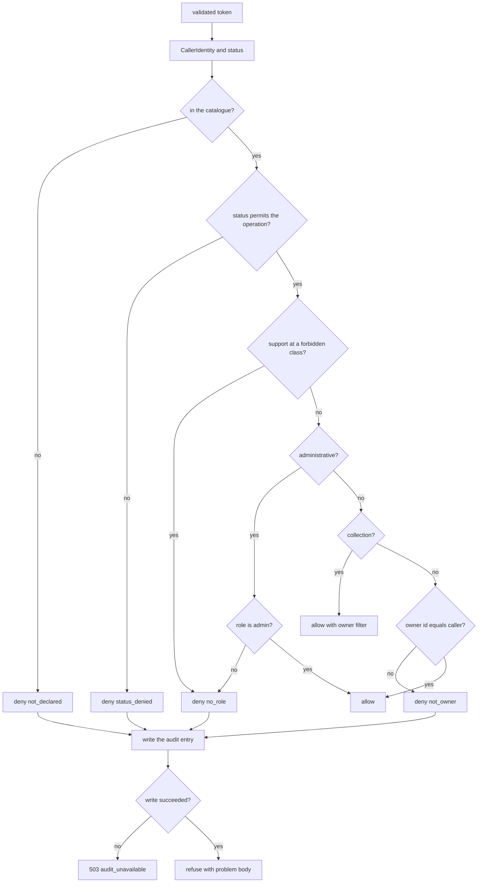

# Functional Specification — u2-authorisation

Implements **US2.1–US2.9**, **US5.1–US5.3**, and the role-change and denial-audit share of
**US7.1–US7.4** from `stories.md`. U2 owns role, status, and ownership decisions; it owns no
persistent entity, so this file is the source of truth for the decision's ordered behaviour.

## Where the decision lives

The decision is **one implementation, reachable two ways**:

- **Inside the Identity service** — it is a module of the `application` crate, called
  in-process by every other Identity module (the registry, lifecycle, support access,
  preferences). No network hop and no new crate: `unit-of-work.md` forbids a shared crate, and
  this stays inside the service's own workspace.
- **Outside the Identity service** — the **C4 internal HTTP endpoint `/internal/authorize`
  remains**, implemented as a thin adapter over the same module, with the request and response
  shapes C4 already declares. This is the surface for any caller that cannot link the Identity
  workspace: the Account and Portfolio services enforcing BR2.13, and any future service. The
  TypeScript surfaces (U7, U9, U10) never call it directly — they call the gateway, and the
  gateway's own enforcement plus the owning service's decision protect them (BR2.9).

One implementation, two delivery paths, and no shared crate. The C4 contract keeps its shape;
only its request and reason enums gain the values this design added (below).

**Internal authentication.** A caller on the C4 endpoint presents a **per-service token plus an
allowlist** of which service may ask for which operation (Q3). On a path that acts for a user —
a role change — the **user's Supabase JWT is forwarded unchanged and validated** alongside the
service token, so the acting admin's identity is established (the project's forwarding rule is
not waived). A service token alone never authorises a user-scoped action.

## Caller identity and status

Every decision needs the caller's internal user id and status.

- **Inside the Identity service** both are read in-process from the unit's own repository.
- **Outside it** they come from C4's sibling read on u1-user-registry, under the contract's
  connect-5s / read-10s / three-attempt budget, retrying only idempotent reads.
- **When u1 cannot be reached**, the decision fails closed: the caller answers 503 and the
  attempt is logged. A short-lived cache (at most 30 seconds, per process) may answer during an
  outage so a registry blip does not take every service down; a cached `active` never outlives
  the window, so a disable takes effect within 30 seconds at worst (NFR24). The window is a
  bounded exception, not a second source of truth, and `/readyz` reports u1 as a dependency.

## The operation catalogue

An operation name is only meaningful because the catalogue says what class it is. A name the
catalogue does not hold is **undeclared** and is denied (BR2.1).

| Operation | Class | Decided by |
|---|---|---|
| `principal:read` | owner-scoped | role, status, ownership, support denial |
| `profile:read`, `profile:write` | owner-scoped | role, status, ownership |
| `resource:read`, `resource:write` | owner-scoped | role, status, ownership (the resource kind travels with it) |
| `collection:list`, `collection:search`, `collection:export` | collection | role, status, support denial; the decision returns the owner filter |
| `guard:confirm` | confirmation | status alone (the only operation a `pending` account may reach) |
| `admin:*` (user lookup, role change, disable/restore, grant approval, flags, jobs) | administrative | role only — no ownership assertion is evaluated |
| `support:metadata:read` | owner-scoped | role, status, and the grant check owned by u3 |
| anything else | undeclared | deny `not_declared` |

## Workflows

### W1 — Evaluate one request

1. The caller's middleware validates the provider token (signature, issuer, audience, expiry).
   A token that fails is a **401 before any decision**; it produces no decision, no reason, and
   no audit entry from this unit.
2. The caller assembles the `CallerIdentity`: subject and role from the token, internal user id
   and status for that subject (the section above).
3. The caller names the operation from the catalogue and, for a resource operation, the
   `ResourceOwnership` the service loaded — one row's owner, or a collection's obligation.
4. It calls `decide(caller, operation, ownership)`. The decision evaluates in this order and
   stops at the first deny:
   1. **Declared?** The operation is not in the catalogue → deny `not_declared` (BR2.1).
   2. **Status?** `disabled`, `pending_deletion`, or `deleted` → deny `status_denied`; `pending`
      permits only `guard:confirm` (BR2.7).
   3. **Support?** A support caller at any owner-scoped, collection, portfolio-content, or
      administrative operation → deny `no_role` (BR2.4, BR2.14).
   4. **Administrative?** The class is administrative: **the role alone decides — allow when it
      is admin, deny `no_role` otherwise, and skip the ownership check entirely** (BR2.3,
      BR2.4). This is the cell W2's role change relies on.
   5. **Ownership, one row?** `scope` is resource and `resourceOwnerId` is absent or differs
      from the caller's user id → deny `not_owner` (BR2.5).
   6. **Ownership, collection?** `scope` is collection → allow, and return the caller's user id
      as the filter the service must apply to every row (BR2.5).
   7. Otherwise allow.
5. On a deny, the decision writes the audit entry through its `AuditSink` port **before it
   returns** — actor, action, target, timestamp, context, outcome (BR2.11, BR2.12). If that
   write fails, the decision returns `audit_unavailable` and the caller answers **503**.
6. The service acts: the operation proceeds, or it answers with the decision's status and a
   problem body that discloses nothing about another user's resource (BR2.6). `not_owner` and a
   nonexistent id both answer 404.

**Success outcome:** every request that reaches the library leaves with exactly one decision;
an allowed request carries the identity and ownership assertion it was allowed on, and an
allowed collection carries its owner filter.
**Error paths:** invalid token → 401 before the library; missing owner id on a row → deny, never
an allow; audit failure on a deny → 503.

### W2 — Role change

1. An admin opens a user record and submits a role change with a reason.
2. The caller must be `admin`, established from the forwarded user JWT and the service token
   (BR2.4, BR2.10).
3. The reason must be present and non-blank; otherwise 422 naming the field and nothing is
   written.
4. The unit records the audit entry **first** — actor, target, previous role, intended new
   role, reason, outcome `attempted` (BR2.10).
5. It writes the new value to the provider's `app_metadata.role` on that user's account. It
   stores no copy of the role.
6. It records the outcome (`applied` or `failed`) against the same entry, then answers.
7. The user's next request reads the new role from their refreshed token (NFR24).

**Error paths:** non-admin → 403 and audited; no reason → 422, nothing written; the audit entry
cannot be written → nothing is attempted; the provider refuses the write → outcome `failed`
recorded and an error returned, so a privileged change is never completed unaudited.

### W3 — Collections, searches, and exports

1. A caller runs a list, search, or export.
2. The decision allows the operation and returns the owner filter (W1 step 4.6).
3. The owning service applies the filter to every row it returns; a row the filter would
   exclude never appears.
4. An export of another user's data is refused before any file is produced (BR2.5).

**Error paths:** a shared or unowned row is not authorisable and is excluded from both the
result and the export; a refused export produces no partial file.

### W4 — A job acts for no user

1. A scheduled job starts with the **system** variant of `CallerIdentity`: a service name and
   the `system` role, never a subject or user id.
2. The system role is never an owner and never an admin: a job may read rows it iterates for a
   stated owner and may not request an administrative operation (BR2.8).
3. Each row it writes carries the owner it was read for; its response carries no other user's
   data.

**Error paths:** a job that would write under the wrong owner, or that requests an
administrative operation, fails the run rather than writing.

### W5 — Account–portfolio linkage

1. A caller links a source account to a portfolio.
2. Both rows are loaded; their owner ids must match each other and the caller (BR2.13).
3. The link is stored by the owning service; U2 decided, the owning service wrote.
4. Removing a connection deletes the connection and its links only.

**Mechanism.** The Account and Portfolio services live outside this intent. They enforce BR2.13
by calling the **C4 endpoint** — the surface this design deliberately kept — with their service
token and the caller's forwarded JWT.

**Error paths:** a cross-owner link is refused with 403, nothing stored, and the attempt audited;
a removal never touches the portfolio's other accounts.

## Decision flow

Text fallback: a validated token yields the caller identity and status; the decision checks
whether the operation is in the catalogue, whether the status permits it, whether support is
barred from its class, and then branches on the class — administrative operations are decided by
the role alone, collections are allowed with an owner filter, and single rows by comparing the
owner to the caller. The first failure denies, the denial is audited before it returns, and an
audit failure answers 503.

## Decision table

| Operation class | owner | admin (own rows) | admin (foreign rows) | support | system job |
|---|---|---|---|---|---|
| Owner-scoped, own row | allow | allow | deny not_owner | deny no_role | allow for the iterated owner |
| Owner-scoped, foreign row | deny not_owner | deny not_owner | deny not_owner | deny no_role | deny not_owner |
| Collection | allow + owner filter | allow + owner filter | allow + owner filter (filter is the admin's own id) | deny no_role | allow + owner filter |
| Administrative | deny no_role | allow | allow (no ownership check) | deny no_role | deny no_role |
| Confirmation (`guard:confirm`) | allow when pending | allow when pending | allow when pending | deny no_role | deny no_role |
| Undeclared | deny not_declared | deny not_declared | deny not_declared | deny not_declared | deny not_declared |

Status overrides every row: `disabled`, `pending_deletion`, and `deleted` deny everything;
`pending` permits only `guard:confirm`.

## Error catalogue

| Condition | Status | Behaviour |
|---|---|---|
| Missing or invalid token | 401 | Refused by the caller's middleware before any decision; no denial audit from this unit |
| Operation not in the catalogue | 403 `not_declared` | Denied and audited |
| Status denies use | 403 `status_denied` | Denied and audited |
| Role does not permit the operation | 403 `no_role` | Denied and audited |
| Caller does not own the row | 404 `not_owner` | The same response a nonexistent id produces; audited as `not_owner` |
| Role change without a reason | 422 | Field named, nothing written |
| Denial cannot be audited | 503 `audit_unavailable` | Fail closed; the request fails rather than passing unaudited |

## Integration points

- **u1-user-registry (C3):** the caller's internal user id and status. Read in-process inside
  Identity, over C3 outside it, with the bounded cache and fail-closed behaviour above.
- **The audit service (C9):** every denial (written by the decision), every role change (intent
  then outcome), every refusal of a cross-owner link. No record carries a credential, token,
  secret, or full wallet address (BR2.12).
- **Supabase Auth:** the only store of `app_metadata.role`, written on a role change.
- **Identity modules:** the library call `decide(caller, operation, ownership)` → `Decision`.
- **Everything outside Identity:** the C4 `/internal/authorize` endpoint, service token plus
  allowlist, user JWT forwarded.

## Open items carried forward

- **`contract-summary.md` C4 needs three edits** that belong to contract-design, not to this
  stage: the reason enum gains `not_declared` and `audit_unavailable`, the status set gains 503,
  the operation enum gains `confirm` and the class names, and its consumer list and
  mechanism note must say that in-Identity callers use the in-process library while U3 and the
  Account/Portfolio services use the endpoint. The C4 model changes with it.
- **AC7.3.1 is broader than this unit.** Its sign-in, credential-change, and order-decision
  parts belong to other units; U2 delivers the denial and role-change share (BR2.10, BR2.11).
  The traceability row records U2's share, and the split is recorded here so the wider claim is
  not mistaken for this unit's.
- **The account/portfolio services are outside this intent.** They call C4 to enforce BR2.13;
  their own builds own that wiring.
