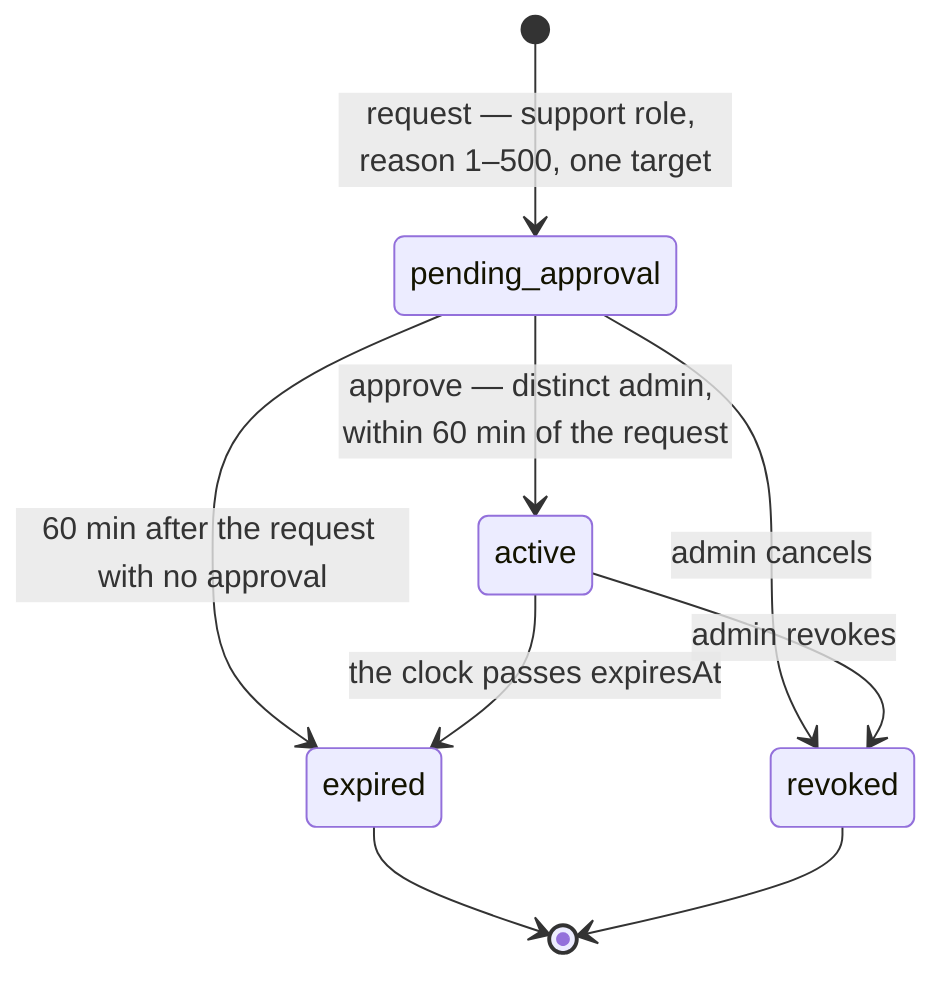

# Functional Specification — u3-support-access

**Upstream:** `unit-of-work.md` (U3), `components.md` (SupportAccess), `contract-summary.md`
(C1, C2, C5), `stories.md` (US3.1–US3.6, US7.3), `requirements.md` (FR16.1–FR16.6).

U3 implements the support-access half of BRD-002: a named support agent asks for a time-bound,
reason-recorded grant; a different admin approves it; the agent reads an allowlisted metadata list
for one user record until the window ends; an admin can revoke it; and every step is audited. The
grant never becomes an identity, a role, or an ownership path.

The unit's own edge is a small resource: a grant. The larger part of the work is the **boundary** —
proving that the only thing a grant reaches is the metadata projection, and that the projection has
no field a credential, holding, balance, valuation, transaction or order could travel in.

## What already exists (checked against the code)

The identity service already has most of the lifecycle, so this design describes the target
behaviour and marks the delta rather than re-specifying what ships.

| Piece | Where | State |
|---|---|---|
| Grant aggregate — request, approve, revoke, read-time expiry, target binding | `services/identity/domain/src/support.rs` | Exists. Four statuses; reason 1–500; window 1–60; `effective_status` and `expire_if_due` implement BR3.7 and part of BR3.6 |
| Application service — request/approve/revoke/check, role checks, audit calls | `services/identity/application/src/support.rs` | Exists. Uses a synchronous audit append and **fails closed** on the check path |
| Postgres repository over `support_access_grants` | `services/identity/infrastructure/src/repositories/support.rs`; migration `0001_init` | Exists |
| HTTP routes — request, approve, revoke, internal check | `services/identity/http/src/routes.rs` | Exist; the check route has no caller through the gateway and is retired by this unit |
| Gateway route table | `services/gateway/domain/src/route.rs` | **No support routes declared.** Nothing above is reachable through the gateway today |
| `support_grants_approval_shape` constraint | migration `0001_init.up.sql` | Exists. Requires `approved_at` for every non-pending status except `revoked`, so an unapproved `expired` row is illegal as the schema stands — migration `0007_support_access` relaxes that one clause (BR3.5) |
| Metadata projection reader | — | **Does not exist.** No support route returns metadata; the Account and Portfolio services have no support-scoped read |
| Caller binding (only the requester reads) | — | **Does not exist** on the check path |
| One live grant per (agent, target), stale-request bound, pending-deletion target refusal | — | **Do not exist** |
| Mutation audit durability (outbox) | — | **Does not exist** for grants (U4 and U5 use the pattern; `support_audit_outbox` would be new) |

The design therefore adds: the projection and its reader, the gateway routes, the caller binding,
two narrowing rules, and the outbox. It deliberately keeps the aggregate's shape.

## The grant model and its states



Text fallback: a grant starts `pending_approval`; a distinct admin approval within 60 minutes makes
it `active` with an expiry 60 minutes after the approval; an unapproved request becomes `expired`
after 60 minutes; an `active` grant becomes `expired` when its window passes, or `revoked` when an
admin cancels it; `expired` and `revoked` are terminal.

| From | To | Cause | Who | Rule |
|---|---|---|---|---|
| — | `pending_approval` | request | support agent | BR3.1–BR3.3 |
| `pending_approval` | `active` | approve | distinct admin | BR3.4–BR3.6 |
| `pending_approval` | `expired` | clock (60 min after request) | — | BR3.5 |
| `pending_approval` | `revoked` | revoke | admin | BR3.12 |
| `active` | `expired` | clock (`now ≥ expiresAt`) | — | BR3.6, BR3.7 |
| `active` | `revoked` | revoke | admin | BR3.12 |

Two stored states can be observed out of date: an `active` row past `expiresAt`, and a
`pending_approval` row past its request window. Both are **decided by the clock on the request that
observes them**, and the observation persists the transition (BR3.5, BR3.7). There is no lifecycle
job, so no window exists in which a stored `active` row is treated as usable after its expiry.
The pending edge needs one schema change: the existing `support_grants_approval_shape` constraint
requires `approved_at` for a non-pending status (except `revoked`), so migration
`0007_support_access` relaxes exactly that clause to allow an `expired` row with no approval
fields — together with the `support_audit_outbox` table and the partial unique index BR3.3 needs.
The down migration restores the constraint.

Atomicity is stated with the rules because the invariants are concurrent: the partial unique index
`(support_agent_id, user_id) WHERE status IN ('pending_approval','active')` makes BR3.3 hold under
two simultaneous requests, and approval is a conditional `UPDATE ... WHERE status =
'pending_approval'` whose zero rows affected is the 409 (BR3.4) — not a read followed by a write.

## Workflows

### W1 — Support agent requests a grant

Entry: `POST /v1/support-grants` (gateway → Identity), body `{ "userId": "<uuid>", "reason": "…" }`.

1. The gateway matches its declared route, validates the Supabase JWT, and forwards it unchanged.
2. Identity parses the path/body; a malformed `userId` is 400, a missing or non-string `reason` is 422.
3. The caller's role is read from the validated claims (Support role only) — never from a body or
   header field. Non-support → 403.
4. The target user is loaded: absent or deleted → 404; `pending_deletion` → 403 and audited
   (BR3.2, interim); target equal to the caller → 422.
5. Any non-terminal grant for the same (agent, target) → 409 naming the existing grant (BR3.3).
6. The domain builds a `pending_approval` grant: reason trimmed, 1–500 characters (BR3.1).
7. One transaction writes the grant and its `support_audit_outbox` row. Failure of either rolls
   back both; the request answers 503 `unavailable` and nothing is stored.
8. 201 with the `SupportGrantResponse` shape that already exists (grant id, user id, status,
   reason, requestedAt, and the null approval fields).

Every refusal in steps 3–6 is itself audited before it is returned: the refusal's
`support_audit_outbox` row is written in its own transaction, and if that write fails the response
is 503 `audit-unavailable` instead of the refusal (BR3.13) — a refusal that cannot be recorded is
surfaced, never returned as a clean refusal.

Error paths: 400 malformed id · 403 `support-role-required` · 403 `target-not-accessible` · 404
user not found · 409 live grant exists · 422 validation · 503 audit row could not be written.

### W2 — A different admin approves

Entry: `POST /v1/support-grants/{grantId}/approve`, no body. The gateway route is declared with
`requires_admin`; Identity **re-checks** the role from the forwarded token (the gateway's check is a
cheap refusal, not the authority).

1. Caller not admin → 403 `admin-role-required`, **checked before the grant is loaded**, so a
   non-admin cannot use the answer to learn whether a grant id exists.
2. Unknown grant id → 404; caller equals the requester → 403 `self-approval` (BR3.4).
3. Now ≥ requestedAt + 60 minutes → persist `expired` and answer 409 `request-expired` (BR3.5).
4. The approval is a conditional update — `UPDATE ... WHERE id = :id AND status =
   'pending_approval'` — setting `approvedBy`, `approvedAt`, `expiresAt = approvedAt + 60 min` and
   status `active`. Zero rows affected means a concurrent approval or revocation moved the grant
   first: 409 `grant-not-pending` (BR3.4).
5. The update and its `support_audit_outbox` row commit together; 200 with the grant response.

Every refusal in steps 1–4 is audited in its own outbox row before it is returned; a failed write
answers 503 `audit-unavailable` instead of the refusal (BR3.13).

The admin sees the reason and the target on the grant; approving is the moment the reason becomes an
active permission, which is why it is a separate, audited action.

### W3 — An admin revokes

Entry: `DELETE /v1/support-grants/{grantId}`.

1. Caller not admin → 403, checked before the grant is loaded (the same ordering as W2).
2. Unknown grant id → 404.
3. The revocation is a conditional update — `UPDATE ... SET revoked_at = now(), status = 'revoked'
   WHERE id = :id AND status IN ('pending_approval','active')`. Zero rows affected means the grant
   is already terminal: 409 (BR3.12). The row is kept as evidence and is never deleted.
4. The update and its outbox row commit together; 200 with the grant response.

Every refusal above is audited in its own outbox row before it is returned; a failed write answers
503 `audit-unavailable` (BR3.13).

The next access under that grant is refused (W4 step 4). There is no push to an open session; the
support console re-reads, and the API is the enforcement point.

### W4 — The support agent reads the metadata projection

Entry: `GET /v1/support-grants/{grantId}/metadata`.

1. The gateway matches its declared route, validates the JWT, forwards it unchanged. (The
   `X-Support-Reason` header the gateway already forwards is not evidence here: the reason of record
   is the grant's own, and a per-request header can neither replace nor extend it.)
2. Identity parses the grant id (malformed → 400) and loads the grant.
3. **Validity, in this order, each refusal audited and answered 403** (BR3.7, BR3.8):
   - caller's role is not support → `support-role-required` (an admin is not a reader)
   - the grant id is unknown **or** the caller is not its `requestedBy` → one uniform
     `support-access-refused`, with the precise reason only in the audit context, so a grant id
     cannot be told from a non-existent one by anyone but its holder
   - the holder's grant is `pending_approval` → `grant-pending`; `revoked` → `grant-revoked`;
     `active` with now ≥ `expiresAt` → persist `expired`, `grant-expired`
4. The target user is loaded: absent, deleted or `pending_deletion` → 403 `target-not-accessible`
   and audited (BR3.2's interim rule, applied to the read too).

The refusal in steps 3–4 is audited — `identity.support_read.denied`, appended before the response
— and a failed append answers 503 `audit-unavailable` instead of the refusal (BR3.13).
5. The projection is assembled:
   - `userId`, `displayName`, `emailVerified` from the Identity user row (in-process, no HTTP hop);
   - `accounts` from the Account service's new internal support-metadata endpoint;
   - `portfolios` from the Portfolio service's new internal support-metadata endpoint;
   - both calls run concurrently with a bounded timeout, carrying Identity's own service token.
6. A source failure (timeout, non-200, invalid payload) refuses the read with 503 `unavailable` and
   audits `identity.support_read.denied` with outcome `failed` and code `metadata-source-unavailable`.
   **No partial projection is ever returned** — half a metadata list reads as a complete one.
7. The `identity.support_read.served` event is appended synchronously **before** the response; a
   failed append refuses the read with 503 (BR3.13).
8. 200 with the `SupportMetadata` shape of `entities.md`.

Note on the audit order: for a read, the projection is assembled first and the event written
second, because the event names what was served. The invariant is "no data leaves without a
record", not "record before computing"; a failed append still yields no data.

### W5 — Audit delivery

1. `support_audit_outbox` rows carry the event, an idempotency key (`support:<event id>`), a
   `pending|delivered|failed` state, an attempt count and `next_attempt_at` — the same shape
   `consent_audit_outbox` and `status_audit_outbox` use.
2. The existing `identity-worker` drain pass gains the support outbox: batches of due rows, bounded
   concurrency, exponential backoff, delivery to C10, idempotent on replay.
3. Metrics: `support_outbox_pending`, `support_outbox_oldest_age_seconds`,
   `support_outbox_deliveries_total{outcome}`. The age metric is the alert target: a growing oldest
   age means audit delivery is broken even though grants keep working.
4. Read events do not use the outbox — they are appended inline and fail closed (BR3.13).

## The metadata boundary

The projection is a closed shape. This table is the whole of what a grant can reach.

| Field | Source | Owner | Why it is allowed |
|---|---|---|---|
| `userId` | Identity user row | U1 | Identifies the record the grant names |
| `displayName` | Identity user row | U1 | FR16.3 names it; null when genuinely absent |
| `emailVerified` | Identity user row | U1 | Verification status only — never the address |
| `accounts[].id` | Account service | Account | FR16.3 identifiers |
| `accounts[].label` | Account service | Account | FR16.3 labels |
| `accounts[].sourceType` | Account service (`kind`) | Account | FR16.3 source type: exchange, wallet, walletconnect, csv |
| `accounts[].syncStatus` | Account service (`status`) | Account | FR16.3 sync status: active, syncing, error, disconnected |
| `accounts[].lastSyncedAt` | Account service | Account | FR16.3 timestamps |
| `portfolios[].id` | Portfolio service | Portfolio | FR16.3 identifiers |
| `portfolios[].label` | Portfolio service | Portfolio | FR16.3 labels |

Absent by construction, not by filtering: the email address, the provider subject, the venue, the
provider account id, any credential or Vault reference, and every holding, balance, valuation,
transaction and order field. The Account and Portfolio endpoints do not select them; Identity does
not ask for them.

Response shape:

```json
{
  "userId": "…",
  "displayName": "…",
  "emailVerified": true,
  "accounts": [
    { "id": "…", "label": "…", "sourceType": "exchange", "syncStatus": "active",
      "lastSyncedAt": "2026-11-11T07:00:00Z" }
  ],
  "portfolios": [{ "id": "…", "label": "…" }]
}
```

`displayName` and `lastSyncedAt` are nullable and serialized as `null` when absent — never as an
empty string or a placeholder; the frontend's em-dash rule applies at render time, not here.

## Error catalogue

| Status | Problem type | Code (detail) | When |
|---|---|---|---|
| 400 | `bad-request` | `invalid-grant-id` / `invalid-user-id` | A path or body id is not a UUID |
| 401 | `unauthorized` | — | Missing or invalid Supabase JWT (middleware) |
| 403 | `forbidden` | `support-role-required` | Request or read by a non-support caller |
| 403 | `forbidden` | `admin-role-required` | Approve or revoke by a non-admin |
| 403 | `forbidden` | `self-approval` | The requester tries to approve |
| 403 | `forbidden` | `support-access-refused` | A metadata read under an unknown grant id, or by a support caller who is not its requester — one uniform answer |
| 403 | `forbidden` | `grant-pending` / `grant-expired` / `grant-revoked` | The holder's own grant is not active (precise, because the holder already knows it exists) |
| 403 | `forbidden` | `target-not-accessible` | The target is deleted or pending deletion |
| 404 | `not-found` | — | A request for an unknown user; an admin approve/revoke on an unknown grant (the admin role is checked first, so only an admin can reach this answer) |
| 409 | `conflict` | `grant-already-live` | A second live grant for the same (agent, target) |
| 409 | `conflict` | `grant-not-pending` | Approving or re-revoking a non-pending grant |
| 409 | `conflict` | `request-expired` | Approving a request older than 60 minutes |
| 422 | `validation` | field errors | Reason absent or over 500 characters |
| 503 | `unavailable` | `audit-unavailable` | An audit record could not be written — the read's append, or a refusal's own outbox row (fail closed; the refusal is replaced by this 503) |
| 503 | `unavailable` | `metadata-source-unavailable` | Account or Portfolio could not answer |

Exact codes are internal identifiers in the problem `detail`; the `type` stays the existing
problem-type vocabulary, so no new RFC 7807 type is introduced. Two ordering facts matter as much as
the codes: the admin role is checked before the grant is loaded on approve and revoke, and the
metadata read gives every caller who is not the grant's holder the same `support-access-refused`
answer whether the grant exists or not.

## Audit events

| Action | Actor | Target | Outcomes | Written by |
|---|---|---|---|---|
| `identity.support_grant.requested` | support agent | target user id | `success` (accepted), `denied` (refused) | outbox — with the grant row when accepted, in its own transaction when refused |
| `identity.support_grant.approved` | admin | grant id | `success`, `denied` | outbox — same split |
| `identity.support_grant.revoked` | admin | grant id | `success`, `denied` | outbox — same split |
| `identity.support_read.served` | support agent | target user id | `success` | synchronous, before the response |
| `identity.support_read.denied` | the caller who was refused | grant or user id | `denied`, `failed` | synchronous, before the response |

`failed` is C9's third outcome and covers an operation that could not complete (a metadata source
that did not answer); it replaces the "error" spelling an earlier draft used, which neither C9 nor
the existing `AuditOutcome` type accepts. `actor` is always present: every event in this unit is
caused by a caller, so the unit writes no system-actor event.

Context carries identifiers and the refusal code only — never the reason body, a credential, a token,
or a full address (BRD-012 audit rule). The reason itself lives on the grant row and in the
requested event's outcome, not copied into every read event.

## Integration points

- **C1/C2 gateway routes (new):** `POST /v1/support-grants` (`requires_admin: false`, Identity
  refuses a non-support caller), `POST /v1/support-grants/{grantId}/approve` (`true`),
  `DELETE /v1/support-grants/{grantId}` (`true`), `GET /v1/support-grants/{grantId}/metadata`
  (`false`). Without these four declarations the Identity routes are unreachable, exactly as the
  U8 build found for its own paths.
- **C5 Support Access contract (amend):** the metadata read moves from
  `/internal/support-grants/{id}/metadata` to the `/v1/support-grants/{grantId}/metadata` surface
  the other three paths use; the status enum drops `denied`; the two internal support-metadata
  endpoints below are added; consumers are the gateway (C1/C2) and Identity (as caller).
- **C3 user read:** in-process — the user row is in the identity schema, so `displayName` and
  `emailVerified` need no HTTP hop and no new contract path.
- **Account service (new internal path):** `GET /v1/internal/support-metadata/{userId}` on the
  `require_service` router, with a route-scoped allowlist of `identity` (not "any registered
  service token"); returns `{ "accounts": [...] }` in the BR3.9 shape.
- **Portfolio service (new internal path):** `GET /v1/internal/support-metadata/{userId}`, same
  guard, returns `{ "portfolios": [...] }`.
- **No callback.** C4 already makes Account and Portfolio callers of Identity's
  `/internal/authorize`; this design adds the reverse edge for one read. The two new endpoints
  answer from their own schema and must **not** call back into Identity's authorisation — the
  support-metadata path is one-directional, so no service-level request cycle and no shared failure
  domain is created between the two directions.
- **C10 audit:** identity's existing `AuditClient`; reads append inline, mutations drain from the
  outbox.
- **Infrastructure:** a service token for `identity` in the service-token registry (Vault-backed),
  and the two owning services' allowlists naming it.
- **`docs/architecture/README.md` + C4:** two new Identity → Account/Portfolio relationships must be
  added with the model, per the project rule that the README and the C4 model move together.

## What this unit does not own

- **The support console screens and any export.** U9 (`u9-support-console-ui`) renders the
  metadata panel and the grant lifecycle, and U10 (`u10-admin-users-ui`) renders grant approval; the
  consoles must not add a field the API does not return. The "no credential column" half of
  AC3.4.1 is a U9/U10 screen-review obligation on top of this unit's API guarantee — the API half
  (no support endpoint returns, reads or resets a credential, BR3.10) is what U3 ships.
- **The admin user-management surface.** The approve/revoke buttons live in U10; this unit owns the
  decisions behind them.
- **The role decision.** U2's authorisation library decides support/admin from validated claims;
  U3 calls it and does not re-derive a role from any other field.
- **Account and Portfolio availability and their schemas.** This unit consumes two endpoints; it
  never reads their tables (no cross-schema access).
- **Audit retention.** NFR21's six-month retention is the audit service's policy.
- **The deletion policy for a `pending_deletion` target.** This unit applies a stricter interim
  refusal; BRD-019 settles the rule.

## Open items carried forward

1. **Account and Portfolio support-metadata endpoints do not exist and belong to those services.**
   Until both ship, the metadata read refuses with 503 `metadata-source-unavailable` — correct and
   auditable, but AC3.3 is not demonstrable end to end. Their contract paths, shapes and the
   `identity` allowlist are specified above so their units can implement against them.
2. **C5 and `components.md` edits** belong to contract design; the design records the intended text
   above rather than editing them in this stage. C5 needs the path alignment, the `denied`
   removal and the two internal endpoints; `components.md` needs the matching narrowing in
   **two** places — the `SupportAccess` component's `deny` edge and `AdminUsersUI`'s
   "approves or denies pending grants" (both describe an action no requirement defines, see
   `entities.md` divergence 2).
3. **OQ-B** — whether support may read a pending-deletion user's metadata — is answered "no" as an
   interim rule and must be revisited with BRD-019.
4. **The service token for `identity`** must be provisioned (Vault) and registered in both owning
   services' allowlists; that is an infrastructure change, not an application one.
5. **BR3.3 and BR3.5 are derived rules.** They are narrower than FR16 and recorded here and in the
   stage diary as design decisions, not as requirements.
6. **`GET /v1/internal/support-grants/{grantId}/check` is retired in this unit, not kept.** The
   gateway's route table declares no support route at all, so the check route has no caller today —
   it is dead surface, and leaving it in place would keep a second, differently-guarded grant
   decision next to the metadata read. The unit removes the route (and its handler wiring) in the
   same change that adds the four `/v1/support-grants` declarations; the grant evaluation itself
   stays, as the internal step the metadata read performs. If a future caller genuinely needs a
   separate check, it is added then, with the same caller binding BR3.8 applies here.