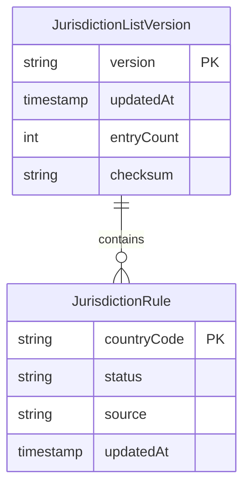

# Functional Specification — u6-jurisdiction-gate

Implements **US6.3** (jurisdiction at sign-up and continued use) and **US6.4** (a restricted sign-up stores nothing) from `stories.md`.

## Workflows

### W1 — Sign-up gate check

1. The caller submits `countryCode` (self-declared) and `ip`.
2. The gate validates `countryCode` (BR1.4); invalid input returns `422`.
3. The gate resolves the IP signal through the geolocation provider.
   - Provider unavailable → `503` and no decision is recorded (BR1.5).
4. The gate loads the current `JurisdictionListVersion` and evaluates both signals (BR1.1–BR1.3).
5. The gate returns `allowed`, `restrictedBy` (`self_declared`, `ip`, or `both`), and `listVersion` (BR1.10).
6. The gate writes one audit event with the signals, list version, and outcome — no personal data (BR1.7).
7. On `allowed`, the caller may provision the user; on `denied`, the caller must not write any record (BR1.9).

**Success outcome:** an allowed visitor proceeds to the first-source step; a restricted visitor sees the unavailability notice and no personal data exists.
**Error paths:** invalid country `422`; geolocation `503` (fail closed, nothing stored); list checksum mismatch → `503` at startup (BR1.6).

### W2 — Continued-use check

1. An authenticated request arrives at the gate's continued-use endpoint with the caller's IP.
2. The gate re-evaluates the IP signal (and the stored self-declared country, when present) against the current list version (BR1.8).
3. A restricted result returns a block decision and writes an audit event naming the user and the list version.
4. An allowed result returns `allowed` and the decision is cached for the re-evaluation window.

**Success outcome:** an existing user whose location becomes restricted is blocked at their next re-evaluation.
**Error paths:** geolocation unavailable → fail closed for the restricted check only if the stored signal is also restricted; otherwise the stored decision stands until the next successful check (recorded in the audit event).

### W3 — Publish a new list version

1. Compliance supplies a complete list of rules.
2. The gate validates every country code, computes the entry count and checksum, and stores a new immutable `JurisdictionListVersion`.
3. The previous version stays readable so old decisions keep a valid citation.

**Success outcome:** a new version is active and every subsequent decision cites it.
**Error paths:** an invalid country code or a checksum mismatch refuses the publish; the previous version stays active.

## State model — JurisdictionListVersion

| Current state | Event | Guard | Next state | Actions |
|---|---|---|---|---|
| Draft | Validate | Every country code is ISO alpha-2 | Validated | Compute checksum and entry count |
| Validated | Publish | Checksum matches, count > 0 | Active | Mark previous version superseded, record audit event |
| Validated | Reject | Any invalid entry | Draft (discarded) | Report the offending entries |
| Active | Supersede | A newer version publishes | Superseded | Keep readable for citation |

No other transitions are valid.

## Derived entity-relationship view

Text fallback: one list version contains many country rules; each rule belongs to exactly one version; a new version never edits a published one.

## Derived rules summary

| Rule | Statement |
|---|---|
| BR1.1 | Evaluate both signals against the current list and decide |
| BR1.2 | A restricted self-declared country denies |
| BR1.3 | A restricted IP country denies; stricter wins |
| BR1.4 | Country code must be ISO alpha-2 |
| BR1.5 | Geolocation unavailable → fail closed |
| BR1.6 | Never decide on a partial or mismatched list |
| BR1.7 | Every decision records evidence, no personal data |
| BR1.8 | Continued use re-evaluates and blocks |
| BR1.9 | Denial returns before any personal data is written |
| BR1.10 | Decisions cite the list version |

## Integration points

- **C8** in `contract-summary.md`: `POST /internal/jurisdiction/check` — request `{countryCode, ip}`, response `{allowed, restrictedBy, listVersion}`; `503` when the geolocation provider or the list is unavailable.
- **Audit service (C9)**: one event per decision, actor `system` or the caller, no personal data.
- **u1-user-registry**: calls the gate before provisioning; a denial is final for that attempt.
- **u8-signup-gates-ui**: displays the unavailability notice and the retry path.

## Error catalogue

| Condition | Status | User-facing behaviour |
|---|---|---|
| Invalid country code | 422 | The gate names the field; nothing stored |
| Geolocation unavailable | 503 | Retry offered; nothing stored |
| List checksum mismatch | 503 | Service unavailable; startup error logged loudly |
| Restricted sign-up | 200 with `allowed: false` | Written unavailability notice; nothing stored |
| Restricted continued use | 200 with `blocked: true` | Blocking notice and sign-out |
