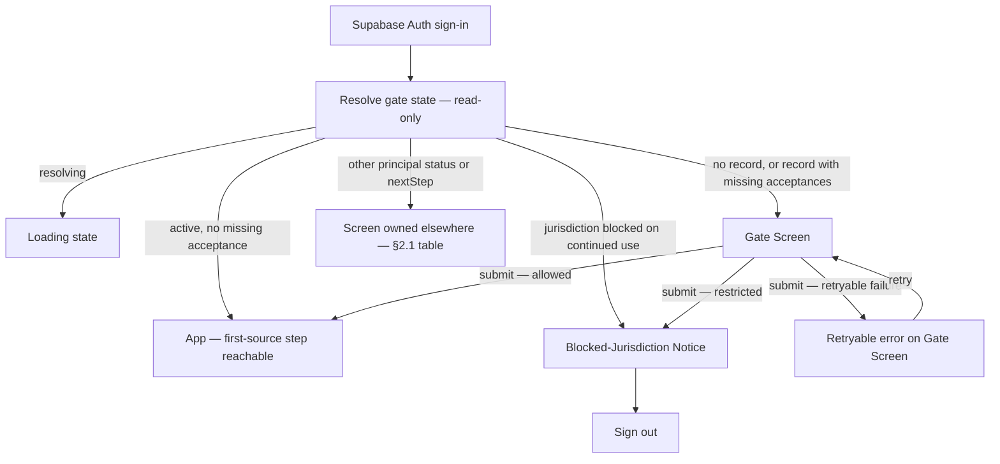

# Functional Spec — U8 Sign-up Gates UI (`u8-signup-gates-ui`)

**Stage:** Functional Design · **Unit kind:** ui (embedded in the SPA build, `web/`) · **Complexity:** S
**Stories:** US6.2, US6.3, US6.5 · **Requirements:** FR19.2, FR19.3, FR19.4, FR19.5, NFR25, NFR26
**Upstream:** `unit-of-work.md` (U8), `unit-of-work-story-map.md`, `stories.md`, `requirements.md`, `components.md` (`SignupGatesUI`), `contract-summary.md` (C1/C2, C3, C6, C8)
**Decisions on record:** Q1 — a dedicated gate screen after sign-in, before any other product screen; Q2 — the full ISO 3166-1 country list; Q3 — a single age-confirmation checkbox. (See `functional-design-questions.md`.)
**Revision:** 2 — revised after the advisory review (2 critical, 4 major, 5 minor); the review is a single terminal pass and was not repeated. The revision fixes the server seam (submit order, read-only entry lookup, idempotency and partial failure, the full principal-status routing table, IP derivation, and one source for server-named missing acceptances).

## 1. Purpose

U8 is the visitor-facing surface of the sign-up gates. It presents the terms, risk-disclosure,
and age acceptances and the country declaration, names any missing acceptance, shows the
blocked-jurisdiction notice, and never lets a visitor reach the first-source step until every
gate has passed **on the server**. This spec is self-contained: it is the authoritative
description of U8's interaction workflows and screen/state transitions.

### What this unit does not own

- **Recording and deciding.** Consent kinds (`terms`, `risk`, `age`) are recorded by U4
  (`u4-preferences-consent`, contract C6); the jurisdiction decision — restricted list, the
  stricter-signal rule over self-declared country plus IP, and the evidence id — is U6
  (`u6-jurisdiction-gate`, contract C8); provisioning the user record only after every gate
  passes is U1 (contract C3, whose 422 means the jurisdiction gate has not cleared). U8
  presents these decisions and their outcomes; it re-implements none of them. Per the U4
  design, the consent gate applies to **every** source connection server-side, so a visitor
  who bypasses the SPA's routing is still refused by the backend.
- **The restricted list.** U8 offers the full ISO 3166-1 list (Q2) and never holds a copy of
  the restricted list; a restricted choice is refused by the gate on submit. The selector can
  therefore not drift out of sync with U6.
- **The client IP.** The IP half of the jurisdiction signal is derived by the **API Gateway**
  from the trusted proxy chain (the edge's own view of the connection); it is never a
  client-supplied body field or header the SPA sets, so a visitor cannot defeat the IP
  restriction by editing a request (§6, open item 4).
- **Account-status screens.** The disabled, pending-deletion, and deleted states and their
  screens belong to U5's surface and U7 (`u7-settings-ui`); U8's routing hands those visitors
  to them (§2.1) and renders no gate screen for them.
- **Shared presentation components.** RoleBadge, StatusPill, and GrantBanner ship with U7 and
  are not part of U8.

## 2. Journey and screen flow

The SPA signs visitors in through Supabase Auth (existing shell, unchanged). Immediately after
sign-in, before any other product screen, the app resolves the visitor's gate state and routes
them (Q1-A):

Text fallback: sign-in → resolve gate state (read-only) → {app | gate screen | blocked notice |
screen owned elsewhere}; gate screen submit → {app | blocked notice | retryable error → gate
screen}; blocked notice → sign out.

### 2.1 Gate-state resolution (entry routing)

On every authenticated entry (first load and hard navigation), the SPA asks the gateway for a
**read-only** view of the visitor's principal and gate state (§6, endpoints G1/G2). G1 must not
provision anything: for a first-time visitor it returns "no record" and the SPA shows the Gate
Screen; a user record is created only by the submit path (§2.4), after the jurisdiction gate
clears — never by a read (§6, open item 1; FR19.4, and U1 writes only after the gate clears).

The entry decision covers **every** Principal status and `nextStep` value, so no visitor lands
on a screen this table does not name:

| Principal / gate state | SPA routes to | Owner |
|---|---|---|
| G1 read fails (network/5xx) | Full-page retryable error; no route into the app | U8 |
| No record exists (G1: `404`-equivalent "no principal") | **Gate Screen** | U8 |
| `nextStep: verify_email` | Existing verify-email screen | SPA shell (existing) |
| `nextStep: enrol_mfa` | Existing MFA enrolment screen | SPA shell (existing) |
| `nextStep: restore_account` | Restore-account screen | U7 (`u7-settings-ui`) |
| Status `disabled` | Blocked-account screen | U7 |
| Status `pending_deletion` or `deleted` | Blocked-account screen for pending deletion | U7 |
| Status `pending` (email verified, gates incomplete) or `active` with G2 `missing` non-empty | **Gate Screen** | U8 |
| `jurisdictionBlocked: true` (continued use, AC6.3.2) | **Blocked-Jurisdiction Notice** (§2.5) | U8 surface, U6 decision |
| Status `active`, `nextStep: none`, G2 `missing: []`, not blocked | The app; first-source step reachable | — |

Rows are evaluated top to bottom; the first match wins, so a disabled or pending-deletion
visitor is never routed into the gate screen. `jurisdictionBlocked` is a boolean field on G2
set by Identity from U6's continued-use decision; which service field carries it is U6's
contract decision and is pinned as an open item that must be settled before Code Generation
(§6, open item 3).

A route guard wraps every post-sign-in product route U8 owns routing for: while the gate state
is unresolved or the visitor is on the Gate Screen row, deep links to any product screen
(including the first-source step) render the Gate Screen instead, with the missing-acceptance
summary naming what is outstanding (AC6.2.2, AC6.5.2). The guard is a UX affordance only — the
server-side consent gate (U4) and the gateway route table remain the enforcement.

### 2.2 Gate Screen

One dedicated screen, one submit. Fields, in reading order:

1. **Country of residence** — a single-select combobox over the full ISO 3166-1 list (Q2),
   searchable by country name, storing the two-letter code. The list is a static data module
   bundled with the gate route's own chunk (§6, open item 5): English names from the ISO
   3166-1 table, Vietnamese names from the Unicode CLDR locale data, both generated at build
   time into the repo — no runtime fetch, no third-party call from the browser.
2. **Terms of service acceptance** — a checkbox beside a link to the full terms document;
   label: "I accept the Terms of Service." The document opens in a new tab; the checkbox is
   never pre-checked.
3. **Risk disclosure acceptance** — a checkbox beside a link to the risk disclosure; label:
   "I have read and accept the risk disclosure."
4. **Age confirmation** — a single checkbox (Q3): "I confirm I meet the minimum age for this
   service." No date-of-birth entry, no document upload (FR19.5, AC6.5.1).
5. **Continue** — the submit control.

The screen states: `loading` (gate state resolving), `ready`, `submitting` (Continue disabled,
progress announced), `blocked` (transitions to the Blocked-Jurisdiction Notice), `error`
(retryable, stays on the screen). The screen never pre-fills an acceptance from local state;
what is already recorded arrives only from G2 (§2.4).

### 2.3 Missing-acceptance validation (AC6.2.1, AC6.2.2, AC6.5.2)

Continue is enabled at all times in the `ready` state; validation runs **on submit**, so the
missing items can be named rather than silently disabled:

- Client-side, the submit handler checks the four fields. Every missing item is listed by name
  in a validation summary rendered **above the form fields in DOM order** ("To continue, you
  must: select your country of residence; accept the Terms of Service; accept the risk
  disclosure; confirm your age"), each entry linked to its field, with the same message inline
  beside each field. Focus moves to the summary when it appears; the summary is announced as an
  alert (NFR25).
- Server-side is authoritative, and the **single source of server-named missing items is G2's
  `missing` list**: if a submission reaches the gateway without a recorded acceptance, G3
  answers `422` with no structured field list, and the SPA responds by **re-fetching G2** and
  re-rendering the Gate Screen from its `missing` consent kinds (the visitor cannot reach the
  first-source step — AC6.2.2, AC6.5.2). ProblemDetails `detail` text is never rendered (§5);
  the correlation id is. "Country" can only be missing client-side: G2's `missing` carries the
  three consent kinds only, because the country is an input to the jurisdiction decision, not a
  stored acceptance.

### 2.4 Submit outcome — allowed

G3 carries an **idempotency key** (generated per screen visit, reused by every retry of the
same submission). On `allowed`, the server has run, in this executable order:

1. **C8 jurisdiction check** — `{ countryCode, ip }`, the IP derived by the gateway (§1). On
   `allowed: false` nothing after this runs and nothing is stored (FR19.4) → §2.5.
2. **C3 provisioning** — `PUT /internal/users/by-subject/{subjectHash}` creates the user record
   (or refreshes an existing one) now that the gate has cleared; a C3 `422` here means the
   jurisdiction gate has not cleared and is treated as §2.5.
3. **C6 consent recording** — the three consent kinds (`terms`, `risk`, `age`) are recorded
   **against the user id C3 returned**; C6's paths are keyed on that id, which is why
   provisioning precedes recording.

The submit is idempotent end to end: a retried request with the same key never records a
duplicate consent or a duplicate record, and a partially applied earlier attempt is completed,
not repeated (§2.6). On success the SPA invalidates its cached gate state, re-resolves it (now
complete), and routes into the app; the first-source step is reachable. Acceptances already
recorded arrive through G2's `missing` list, so a returning visitor sees only what is still
outstanding (U7 owns the settings/consent screens; U8 does not re-collect a recorded
acceptance).

### 2.5 Submit outcome — restricted jurisdiction (AC6.3.1)

On denial (C8 `allowed: false`, restricted by self-declared country, IP, or both — the denial
is decided **before** any provisioning or consent write, §2.4 step 1), the SPA replaces the
Gate Screen with the **Blocked-Jurisdiction Notice**:

- The written notice states that the service is not available in the visitor's jurisdiction,
  that **no personal data has been stored** (true on this path: C8 runs first and its denial
  stops the sequence; FR19.4), and how to contact support. No credentials, tokens, or internal
  reason codes are shown; `restrictedBy` is not surfaced verbatim (non-disclosure posture —
  the notice is the same whichever signal restricted).
- The notice is **terminal for the session**: it offers Sign out only. There is no resubmit
  form and no country re-selection, because the stricter signal wins server-side (U6) and an
  in-screen retry would only invite re-declaring against an IP restriction.
- **Continued use (AC6.3.2):** when an existing user's location becomes restricted, U6/gateway
  enforcement sets G2's `jurisdictionBlocked` flag (§2.1); U8's surface for that is the same
  notice, rendered by the entry routing instead of the app, with the audit recorded
  server-side. The notice text is identical apart from a line acknowledging the account is
  temporarily unavailable in the current location — on this path the account record exists, so
  the "no personal data stored" sentence is replaced by that line.

### 2.6 Submit outcome — retryable failure, and partial application

C8 503 (geolocation unavailable; nothing stored), a network failure, or any 5xx renders an
inline retryable error on the Gate Screen. Because the server sequence has three steps, a
failure can land **after** something committed, and the wording and behaviour differ by what
the failure can mean:

| Failure point | What is stored | SPA behaviour and wording |
|---|---|---|
| C8 503 / failure before any write | Nothing | "We couldn't check your details — nothing was saved. Try again." |
| Failure during/after C3 or C6 (5xx, network drop mid-submit) | Possibly the record and/or some consents | "We couldn't complete your sign-up. Try again — your progress is kept." **Never** claims nothing was saved. |
| Any retryable failure | — | On retry (same idempotency key) or on returning to the screen, the SPA **re-fetches G2**: whatever committed is reflected — recorded acceptances leave the `missing` list and render as already given, so the visitor completes only the remainder. |

Retries never auto-fire. Errors are surfaced, never swallowed; the ProblemDetails
`correlationId` is displayed for support. Duplicate-avoidance is the server's job via the
idempotency key (§2.4); the SPA's job is to always re-read G2 rather than trust its local
field state after a failure.

## 3. Form and field rules

| Field | Rule | Failure shown |
|---|---|---|
| Country | Required; one ISO 3166-1 alpha-2 code | "Select your country of residence." |
| Terms | Required; must be checked | "Accept the Terms of Service." |
| Risk disclosure | Required; must be checked | "Accept the risk disclosure." |
| Age | Required; must be checked | "Confirm you meet the minimum age." |

No other personal data is requested anywhere on the screen — no name, email, birth date, or
address fields exist before the gates pass (`components.md`: never requests personal data
before the gates pass). The submit payload carries exactly `{ countryCode, terms, risk, age }`
plus the idempotency-key header; the client IP is added by the gateway, not the SPA (§1).

## 4. Accessibility and localisation

- **WCAG 2.2 AA (NFR25):** every control has a visible label; the four fields sit in a
  labelled group; the validation summary sits above the fields in DOM order, uses an alert
  role, and receives focus when it appears; the tab order follows DOM order — summary links
  (when present) → country → terms → risk → age → continue; the blocked notice is announced as
  a page-level status; colour is never the only carrier of meaning (error states pair colour
  with an icon and text); all states meet contrast via Parchment Ledger tokens (no raw values).
- **English + Vietnamese (NFR26):** every string — field labels, validation summary, blocked
  notice, retryable error, country names — is localised; the gate state resolution runs before
  locale preference exists, so the screen uses the browser locale with English fallback. The
  terms and risk-disclosure documents themselves are linked per locale.

## 5. Security posture

- Tokens stay in memory only (existing SPA auth rule); the gate flow stores nothing in
  localStorage.
- The SPA calls only the API Gateway (§6); Supabase Auth is the sole other browser-external
  call. No business or compliance decision (restricted lists, consent sufficiency) is computed
  in the frontend — the client-side validation of §2.3 is presentation only, and the server
  re-checks everything.
- Entry routing reads only; provisioning happens exclusively on the submit path after the
  jurisdiction gate clears (§2.1, §2.4), so a restricted visitor's data is never stored
  (FR19.4).
- The client IP is gateway-derived and cannot be client-supplied (§1), so the IP half of
  AC6.3.1 cannot be spoofed from the browser.
- The blocked notice and error states never render ProblemDetails `detail` text that could
  carry internal state; only the correlation id is surfaced.

## 6. API integration points (gateway `/v1` surface)

All calls go through the single API-client module (`web/src/api/client.ts`) against the
gateway. C3/C6/C8 are internal contracts; U8 consumes their outcomes through these `/v1`
projections:

| Id | Call | Purpose |
|---|---|---|
| G1 | `GET /v1/principals/{authUserId}` — **must be read-only** | Principal (status, nextStep) or an explicit "no record" answer, for entry routing. C1/C2 today describes this route as "resolve or provision"; the read-only entry lookup this spec requires is recorded as open item 1. |
| G2 | `GET /v1/signup/gate-state` | Projects U4's consent state plus U6's continued-use flag: `{ missing: ("terms"\|"risk"\|"age")[], jurisdictionBlocked: boolean }`. Read-only. |
| G3 | `POST /v1/signup/gates` | Body `{ countryCode, terms, risk, age }` + `Idempotency-Key` header; the gateway adds the client IP and runs C8 → C3 → C6 (§2.4). `200` allowed · `403` restricted (ProblemDetails, non-disclosing) · `422` a required acceptance is not asserted (SPA re-fetches G2 for the named list) · `503` geolocation unavailable · 5xx possibly-partial (§2.6) |

**Open items for the gateway route table / contract-design** (recorded, not resolved here):

1. **G1 read-only semantics.** C1/C2 defines `GET /v1/principals/{authUserId}` as
   "resolve or provision". Entry routing must not provision (it runs before any gate), so the
   route needs a read-only mode — or a separate read-only lookup route — with a defined
   "no record exists" answer. This is a C1/C2 contract change owned by contract-design/U1.
2. G2 and G3 are new `/v1` routes that must be added to the gateway's deny-by-default table;
   the contract summary's open question on who confirms the ordered route list still stands.
   G2's shape assumes U4's `GET /internal/users/{id}/consent/state` is projected through the
   gateway; if Identity instead extends the read-only principal answer with the missing list,
   G2 folds into G1 and this spec's routing table is unchanged.
3. AC6.3.2's continued-use blocking needs `jurisdictionBlocked` (on G2, or on the principal if
   G2 folds into G1) to be set by Identity from U6's decision; which field carries it and when
   U6 evaluates continued use is U6's contract decision, and it must be pinned before U8's
   Code Generation.
4. **Gateway IP derivation.** The trusted proxy chain / forwarded-header policy the gateway
   uses to derive the client IP for C8 belongs to the gateway route design; it must be
   edge-controlled so no client-supplied value can reach C8's `ip` field.
5. **Country data module.** The build-time generation of the ISO 3166-1 EN/VI list (source
   dataset, who regenerates it when CLDR changes) is a Code Generation detail; the list ships
   in the gate route's chunk, inside the existing 150 kB route-chunk budget (~250 entries,
   two short names each), not in the 300 kB initial entry chunk.

## 7. Story coverage

| Story AC | Where satisfied in this spec |
|---|---|
| AC6.2.1 — terms not accepted → connection refused, missing acceptance named | §2.3 (client naming + G2 re-fetch after server refusal), §6 G3 422 |
| AC6.2.2 — age confirmation not recorded → first-source step unreachable | §2.1 route guard + §2.3 server-authoritative refusal |
| AC6.3.1 — restricted jurisdiction (country or IP) → denied before any personal data stored | §2.4 step order (C8 first), §2.5 notice ("no personal data stored"), §1/§6 gateway-derived IP, §3 no data collected pre-gate, FR19.4 |
| AC6.3.2 — existing user's location becomes restricted → continued use blocked | §2.1 routing row (`jurisdictionBlocked`) + §2.5 continued-use notice (enforcement/audit server-side, U6; flag pinned by open item 3) |
| AC6.5.1 — age confirmation recorded, no document upload | §2.2 field 4 (single checkbox, no upload), §2.4 recording via C6 |
| AC6.5.2 — confirmation missing → first-source step unavailable | §2.1 route guard + §2.3, same mechanism as AC6.2.2 |

## 8. Error handling summary

| Failure | Classification | Surface |
|---|---|---|
| Gate-state resolution fails (G1/G2) | Recoverable | Full-page retry; never routes into the app |
| G3 422 (acceptance not asserted) | Recoverable | Re-fetch G2 → Gate Screen with the server-named `missing` consent kinds |
| G3 403 (restricted) | Fatal for the session | Blocked-Jurisdiction Notice (§2.5); nothing was stored |
| G3 503 (geolocation unavailable) | Recoverable | Inline retryable error, values kept, "nothing was saved" (§2.6 row 1) |
| G3 network/5xx mid-sequence | Recoverable, possibly partial | Inline retryable error, "couldn't complete" wording; G2 re-fetch on retry shows what committed (§2.6) |
| Unexpected ProblemDetails | Recoverable | Inline error + correlation id; logged, never swallowed |
