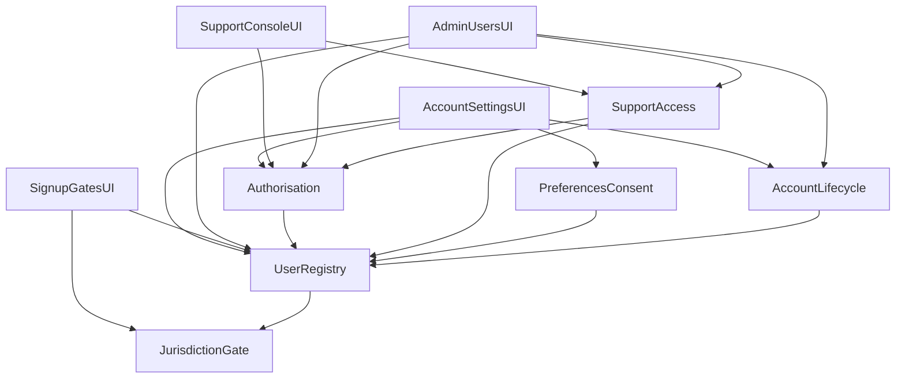

# Domain Design — Users, Roles & Permissions

The logical building blocks for BRD-002. Six domain components carry the business logic inside the Identity bounded context; four UI components present the four surfaces. Databases, Vault, Supabase Auth, and the Audit service are dependencies, not components.

**Upstream:** `requirements.md` (FR14–FR20 and NFR21–NFR26) and `stories.md` (US1.1–US8.1); the component-to-story mapping is recorded in `traceability.json`.

## Part A — Component catalogue

```yaml
components:
  - name: UserRegistry
    summary: Owns the internal user record and its link to the provider subject.
    behaviour: >
      Creates exactly one internal user record on first successful authentication, keyed by the
      hashed provider subject; keeps the internal id stable across provider claim changes; holds
      display name, email, email verification, and the account status; refuses to create a record
      when the jurisdiction gate has not passed; never stores passwords, MFA factors, or tokens.
    responsibilities:
      - Internal user identity and stable id
      - Subject-hash lookup index and claim refresh
      - Display name, email, and email-verification status
      - Account status field (mutated only through Account Lifecycle)
    depends_on:
      - component: JurisdictionGate
        interaction: asks the gate to clear the provider before any personal data is written
        style: sync
    dependents:
      - component: Authorisation
        interaction: reads status and ownership key for every decision
      - component: SupportAccess
        interaction: resolves the target user and the requester/approver
      - component: PreferencesConsent
        interaction: checks the owning user exists
      - component: AccountLifecycle
        interaction: reads and mutates the account status
      - component: AccountSettingsUI
        interaction: profile read and write
      - component: SignupGatesUI
        interaction: provisioning after the gates pass
      - component: SupportConsoleUI
        interaction: target identifiers for a grant request
      - component: AdminUsersUI
        interaction: user lookup and record view
    external_dependencies:
      - name: PostgreSQL (identity schema)
        kind: database
        purpose: user record and subject-hash index
      - name: Supabase Auth
        kind: third-party-api
        purpose: source of validated claims; never stores user data here
    entities:
      - name: User
        identifier: id
        attributes: [id, providerSubjectHash, displayName, email, emailVerified, status, createdAt]
        references: []

  - name: Authorisation
    summary: Owns role, status, and ownership decisions.
    behaviour: >
      Deny-by-default; maps the role from app_metadata.role to owner, admin, or support; treats a
      missing or unrecognised role as owner; denies disabled and deleted statuses; evaluates
      ownership on every read and write; returns not-found or forbidden without disclosing
      existence; every denial is surfaced for audit.
    responsibilities:
      - Role mapping and decision
      - Status denial rules
      - Ownership evaluation contract used by services
      - Denial reasons for audit
    depends_on:
      - component: UserRegistry
        interaction: reads account status for the denial rule
        style: sync
    dependents:
      - component: SupportAccess
        interaction: checks the support role and grant scope
      - component: AccountSettingsUI
        interaction: gates screens and renders the role badge
      - component: AdminUsersUI
        interaction: gates administrative screens and actions
      - component: SupportConsoleUI
        interaction: gates grants and metadata panels
    external_dependencies:
      - name: Supabase JWKS
        kind: third-party-api
        purpose: token validation inputs for the decision
    entities: []

  - name: SupportAccess
    summary: Owns support grants and the metadata projection.
    behaviour: >
      A support agent requests a grant for one user record with a reason of 1–500 characters; a
      different admin approves it; the grant expires no later than 60 minutes after approval; a
      grant exposes only account and portfolio identifiers, labels, source type, sync status and
      timestamps, display name, and email-verification status; never holdings, balances, values,
      transactions, orders, credentials, or secrets; expired, revoked, or unapproved grants are
      refused at the next request.
    responsibilities:
      - Grant lifecycle (request, approve, deny, revoke, expire)
      - Requester/approver distinctness
      - Metadata projection boundary
      - Grant audit events
    depends_on:
      - component: UserRegistry
        interaction: resolves target, requester, and approver
        style: sync
      - component: Authorisation
        interaction: confirms the support role and that the caller is not an owner
        style: sync
    dependents:
      - component: SupportConsoleUI
        interaction: request, approve, and read metadata
      - component: AdminUsersUI
        interaction: list and approve pending grants
    external_dependencies:
      - name: PostgreSQL (identity schema)
        kind: database
        purpose: grant records
      - name: Audit service
        kind: other
        purpose: every request, approval, access, and refusal
    entities:
      - name: SupportGrant
        identifier: id
        attributes: [id, userId, requestedBy, approvedBy, reason, status, expiresAt, createdAt]
        references:
          - entity: User
            owned_by: UserRegistry
            relationship: each grant is for one user record and names a requester and an approver

  - name: PreferencesConsent
    summary: Owns user preferences and consent records.
    behaviour: >
      Locale, base currency, timezone, and notification preferences are user-controlled and never
      overwritten by provider defaults once set; consent kinds are recorded with grant and
      withdrawal timestamps; a withdrawal is visible to later stages; preference and consent
      reads and writes verify ownership.
    responsibilities:
      - Preference values and defaults
      - Consent grant and withdrawal history
      - Ownership check inputs
    depends_on:
      - component: UserRegistry
        interaction: checks the owning user exists
        style: sync
    dependents:
      - component: AccountSettingsUI
        interaction: preference and consent editing
    external_dependencies:
      - name: PostgreSQL (identity schema)
        kind: database
        purpose: preferences and consent records
    entities:
      - name: UserPreferences
        identifier: userId
        attributes: [userId, locale, baseCurrency, timezone, notifications]
        references:
          - entity: User
            owned_by: UserRegistry
            relationship: each preferences row belongs to one user
      - name: ConsentRecord
        identifier: id
        attributes: [id, userId, kind, grantedAt, withdrawnAt]
        references:
          - entity: User
            owned_by: UserRegistry
            relationship: each consent record belongs to one user

  - name: AccountLifecycle
    summary: Owns the status machine, deletion requests, and recovery.
    behaviour: >
      Statuses are active, disabled, pending_deletion, and deleted; an admin disables without
      erasing history and only an admin restores; a user requests deletion in-app and the account
      stays restorable for 30 days, then becomes deleted; erasure runs subject to legal holds and
      statutory retention per BRD-017; a deleted user is denied with a valid token; erasure is
      idempotent.
    responsibilities:
      - Status transition rules
      - Deletion request and 30-day recovery window
      - Erasure orchestration and idempotency
      - Legal-hold override inputs
    depends_on:
      - component: UserRegistry
        interaction: reads and mutates the account status
        style: sync
    dependents:
      - component: AccountSettingsUI
        interaction: deletion page and recovery banner
      - component: AdminUsersUI
        interaction: disable and restore actions
    external_dependencies:
      - name: PostgreSQL (identity schema)
        kind: database
        purpose: deletion request records and status transitions
      - name: Audit service
        kind: other
        purpose: status and deletion audit events
    entities:
      - name: DeletionRequest
        identifier: id
        attributes: [id, userId, requestedAt, recoveryEndsAt, status, reason]
        references:
          - entity: User
            owned_by: UserRegistry
            relationship: each deletion request concerns one user

  - name: JurisdictionGate
    summary: Owns the sanctions/regulatory list and the sign-up and continued-use check.
    behaviour: >
      Maintains the restricted-jurisdiction list; evaluates the self-declared country plus IP
      geolocation; the stricter signal wins; a restricted sign-up is denied before any personal
      data is stored; an existing user whose location becomes restricted is blocked on continued
      use and the block is audited; a failed check stores nothing.
    responsibilities:
      - Restricted-jurisdiction list
      - Sign-up and continued-use evaluation
      - Decision evidence for audit
    depends_on: []
    dependents:
      - component: UserRegistry
        interaction: gate must clear before a user record is created
      - component: SignupGatesUI
        interaction: country selection and the gate result
    external_dependencies:
      - name: PostgreSQL (identity schema)
        kind: database
        purpose: jurisdiction rules
      - name: IP geolocation provider
        kind: third-party-api
        purpose: continued-use signal
    entities:
      - name: JurisdictionRule
        identifier: countryCode
        attributes: [countryCode, status, source, updatedAt]
        references: []

  - name: AccountSettingsUI
    summary: Presents profile, preferences, consent, sessions, and deletion for the owner.
    behaviour: >
      Renders the owner's own record only; sections save independently with a dirty state;
      destructive deletion goes through a dedicated page and an explicit confirm; a
      pending-deletion account sees the blocked-account screen, not the normal shell; the role
      badge and status pill are display-only.
    responsibilities:
      - Settings screens and states
      - Deletion page and recovery entry
      - Display of role and status
    depends_on:
      - component: UserRegistry
        interaction: profile read and write
        style: sync
      - component: PreferencesConsent
        interaction: preference and consent editing
        style: sync
      - component: AccountLifecycle
        interaction: deletion request and recovery
        style: sync
      - component: Authorisation
        interaction: role badge and screen gating
        style: sync
    dependents: []
    external_dependencies:
      - name: API Gateway
        kind: other
        purpose: single entry for the SPA
    entities: []

  - name: SignupGatesUI
    summary: Presents terms, risk disclosure, age, and jurisdiction gates to a visitor.
    behaviour: >
      Collects the self-declared country, age confirmation, terms, and risk disclosure; submits
      only after all acceptances; names any missing acceptance; on a blocked jurisdiction shows the
      written notice and stores nothing; never requests personal data before the gates pass.
    responsibilities:
      - Gate form and validation states
      - Blocked-jurisdiction notice
    depends_on:
      - component: JurisdictionGate
        interaction: evaluates the selected country
        style: sync
      - component: UserRegistry
        interaction: provisioning only after every gate passes
        style: sync
    dependents: []
    external_dependencies:
      - name: API Gateway
        kind: other
        purpose: single entry for the SPA
    entities: []

  - name: SupportConsoleUI
    summary: Presents support grant request, approval, and the metadata panel.
    behaviour: >
      A support agent searches by identifier, requests a grant with a reason, and reads only the
      metadata projection under an active grant; the grant banner shows time remaining, reason,
      and the metadata-only reminder; approval controls are disabled for the requester; no
      screen or export contains credentials, holdings, balances, or valuations.
    responsibilities:
      - Grant request and banner
      - Metadata panel
      - Least-privilege presentation
    depends_on:
      - component: SupportAccess
        interaction: grant lifecycle and metadata projection
        style: sync
      - component: Authorisation
        interaction: role and grant gating
        style: sync
    dependents: []
    external_dependencies:
      - name: API Gateway
        kind: other
        purpose: single entry for the console
    entities: []

  - name: AdminUsersUI
    summary: Presents user lookup, role and status changes, and grant approval.
    behaviour: >
      Searches users, opens a record, changes role or status with a required reason, and approves
      or denies pending grants; shows the same metadata boundary as support and never portfolio
      contents; presents no entitlement controls; every change states that it is audited.
    responsibilities:
      - User search and record view
      - Role and status change with reason
      - Grant approval
    depends_on:
      - component: UserRegistry
        interaction: user lookup and record
        style: sync
      - component: Authorisation
        interaction: admin gating
        style: sync
      - component: SupportAccess
        interaction: pending grants and approval
        style: sync
      - component: AccountLifecycle
        interaction: disable and restore
        style: sync
    dependents: []
    external_dependencies:
      - name: API Gateway
        kind: other
        purpose: single entry for the console
    entities: []
```

## Part B — Human-readable view

### Component diagram



Text fallback: the four UI components call the domain components through the gateway. UserRegistry asks JurisdictionGate to clear a provider before writing a record. Authorisation reads UserRegistry status. SupportAccess reads UserRegistry and Authorisation. PreferencesConsent and AccountLifecycle both depend on UserRegistry. No cycles.

### Component summary

| Component | Purpose | Depends On | Dependents | Entities Owned |
|---|---|---|---|---|
| UserRegistry | Internal user record and subject link | JurisdictionGate | Authorisation, SupportAccess, PreferencesConsent, AccountLifecycle, all four UI | User |
| Authorisation | Role, status, and ownership decisions | UserRegistry | SupportAccess, three UI | — |
| SupportAccess | Grants and metadata projection | UserRegistry, Authorisation | SupportConsoleUI, AdminUsersUI | SupportGrant |
| PreferencesConsent | Preferences and consent history | UserRegistry | AccountSettingsUI | UserPreferences, ConsentRecord |
| AccountLifecycle | Status machine, deletion, recovery | UserRegistry | AccountSettingsUI, AdminUsersUI | DeletionRequest |
| JurisdictionGate | Restricted list and gate checks | — | UserRegistry, SignupGatesUI | JurisdictionRule |
| AccountSettingsUI | Owner settings, deletion, recovery | UserRegistry, PreferencesConsent, AccountLifecycle, Authorisation | — | — |
| SignupGatesUI | Terms, age, jurisdiction gates | JurisdictionGate, UserRegistry | — | — |
| SupportConsoleUI | Grant request and metadata panel | SupportAccess, Authorisation | — | — |
| AdminUsersUI | User administration and grant approval | UserRegistry, Authorisation, SupportAccess, AccountLifecycle | — | — |

### Entity ownership

| Entity | Owning Component | Identifier | Attributes | References |
|---|---|---|---|---|
| User | UserRegistry | id | id, providerSubjectHash, displayName, email, emailVerified, status, createdAt | — |
| SupportGrant | SupportAccess | id | id, userId, requestedBy, approvedBy, reason, status, expiresAt, createdAt | User (UserRegistry) |
| UserPreferences | PreferencesConsent | userId | userId, locale, baseCurrency, timezone, notifications | User (UserRegistry) |
| ConsentRecord | PreferencesConsent | id | id, userId, kind, grantedAt, withdrawnAt | User (UserRegistry) |
| DeletionRequest | AccountLifecycle | id | id, userId, requestedAt, recoveryEndsAt, status, reason | User (UserRegistry) |
| JurisdictionRule | JurisdictionGate | countryCode | countryCode, status, source, updatedAt | — |

### External dependencies

| Component | Dependency | Kind | Purpose |
|---|---|---|---|
| UserRegistry | PostgreSQL (identity schema) | database | user record and subject-hash index |
| UserRegistry | Supabase Auth | third-party-api | validated claims |
| Authorisation | Supabase JWKS | third-party-api | token validation inputs |
| SupportAccess | PostgreSQL (identity schema) | database | grant records |
| SupportAccess | Audit service | other | grant audit events |
| PreferencesConsent | PostgreSQL (identity schema) | database | preferences and consent |
| AccountLifecycle | PostgreSQL (identity schema) | database | deletion requests |
| AccountLifecycle | Audit service | other | status and deletion events |
| JurisdictionGate | PostgreSQL (identity schema) | database | jurisdiction rules |
| JurisdictionGate | IP geolocation provider | third-party-api | continued-use signal |
| All UI | API Gateway | other | single entry point |

### Rationale

| Component | Why it is a separate building block |
|---|---|
| UserRegistry | The record and its identity lifecycle change for different reasons than authorisation or deletion; it is the single owner of `User` |
| Authorisation | A cross-cutting decision with its own rules and a single place to audit denials; it must be callable by every service and every screen |
| SupportAccess | A distinct lifecycle (request → distinct-admin approval → 60-minute window → revocation) and a narrow projection that must not leak into user or portfolio data |
| PreferencesConsent | User-controlled data with its own ownership and history; withdrawal has downstream meaning (analytics, notifications) |
| AccountLifecycle | The status machine and the 30-day recovery window are a distinct concern with legal-hold rules; keeping it separate stops status changes leaking into the registry's write paths |
| JurisdictionGate | A policy list plus a check that must run *before* any personal data is stored; isolating it makes the gate ordering explicit |
| Four UI components | Each surface has a different actor and its own states; they share only presentation primitives (RoleBadge, StatusPill, GrantBanner) |

### Alternatives rejected

- **One Identity component with modules** — simpler to build, but authorisation, support access, and the lifecycle would share one change surface, and the gate ordering ("before any personal data") would stop being explicit.
- **Three components (User Registry / Access Control / Account Lifecycle)** — fewer pieces, but it would merge authorisation, support grants, and jurisdiction, which have different lifecycles and different failure modes.
- **Authorisation inside the gateway** — the gateway has no knowledge of account status or ownership, and every service already re-validates the token; a gateway-only decision would either centralise data it should not hold or duplicate rules.
- **All authorisation inline per service (current pattern)** — no single decision point, and status denial would be re-implemented in each service.
- **A single Account UI component** — it would collapse four actors, four sets of states, and two privilege levels into one change surface.
