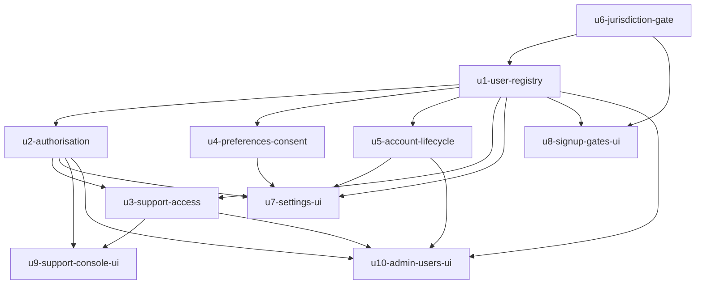

# Unit Dependency Topology — Users, Roles & Permissions

This is the dependency graph only. It describes what can depend on what; it does not pick a build order or a critical path — Delivery Planning decides that.

## Machine-readable edges

```yaml
units:
  - name: u1-user-registry
    kind: service
    depends_on: [u6-jurisdiction-gate]
  - name: u2-authorisation
    kind: service
    depends_on: [u1-user-registry]
  - name: u3-support-access
    kind: service
    depends_on: [u1-user-registry, u2-authorisation]
  - name: u4-preferences-consent
    kind: service
    depends_on: [u1-user-registry]
  - name: u5-account-lifecycle
    kind: service
    depends_on: [u1-user-registry]
  - name: u6-jurisdiction-gate
    kind: service
    depends_on: []
  - name: u7-settings-ui
    kind: ui
    depends_on: [u1-user-registry, u2-authorisation, u4-preferences-consent, u5-account-lifecycle]
  - name: u8-signup-gates-ui
    kind: ui
    depends_on: [u6-jurisdiction-gate, u1-user-registry]
  - name: u9-support-console-ui
    kind: ui
    depends_on: [u3-support-access, u2-authorisation]
  - name: u10-admin-users-ui
    kind: ui
    depends_on: [u1-user-registry, u2-authorisation, u3-support-access, u5-account-lifecycle]
```

## Dependency diagram



Text fallback: `u6` has no dependencies. `u1` depends on `u6`. `u2`, `u4`, and `u5` each depend on `u1`. `u3` depends on `u1` and `u2`. The four UI units depend on the service units they call. The graph is cycle-free.

## Integration points

| Boundary | Mechanism | Contract |
|---|---|---|
| UI unit → service unit | Synchronous HTTP through the API Gateway | `/v1` routes declared in the gateway's deny-by-default table by the owning service unit |
| Service unit → service unit | Synchronous internal HTTP with bounded retries and idempotency keys | Existing internal endpoints; no queue |
| Service units → Audit | HTTP event write | Actor (or system), action, target, timestamp, context, outcome |
| UI units → Supabase Auth | Direct (allowed exception) | Sign-in and token refresh only |

No unit introduces an event bus, a shared crate, or cross-schema access.

## Parallel sets (topology, not order)

Units with no edge between them may be built at the same time, each in its own copy of the project with none of the others' work in it:

- `u6-jurisdiction-gate` has no dependencies.
- After `u1-user-registry`: `u2-authorisation`, `u4-preferences-consent`, and `u5-account-lifecycle` are mutually independent.
- After `u3-support-access`: `u9-support-console-ui` and `u10-admin-users-ui` are independent of each other.
- `u7-settings-ui` and `u8-signup-gates-ui` are independent of each other once their service units exist.

## Walking skeleton

The team's walking-skeleton stance is on, and the product's thin slice is already built and proven (`u1-walking-skeleton` in the BRD-001 intent: SPA → gateway → Asset Registry). For this work, the smallest integrated slice the DAG admits is **`u6-jurisdiction-gate` → `u1-user-registry` → `u2-authorisation` → `u7-settings-ui`**, which exercises a real principal read through the gateway into the SPA settings surface. This is a topology fact, not a build-order recommendation.
