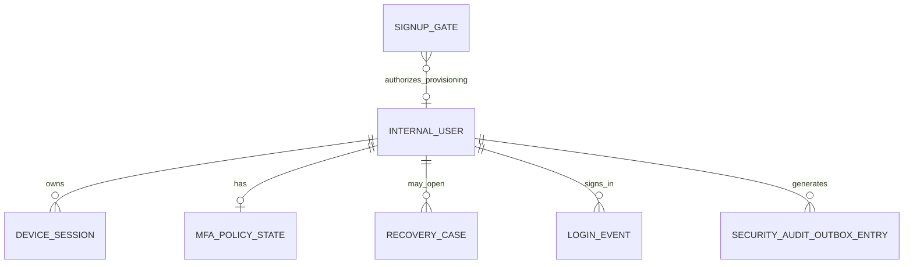
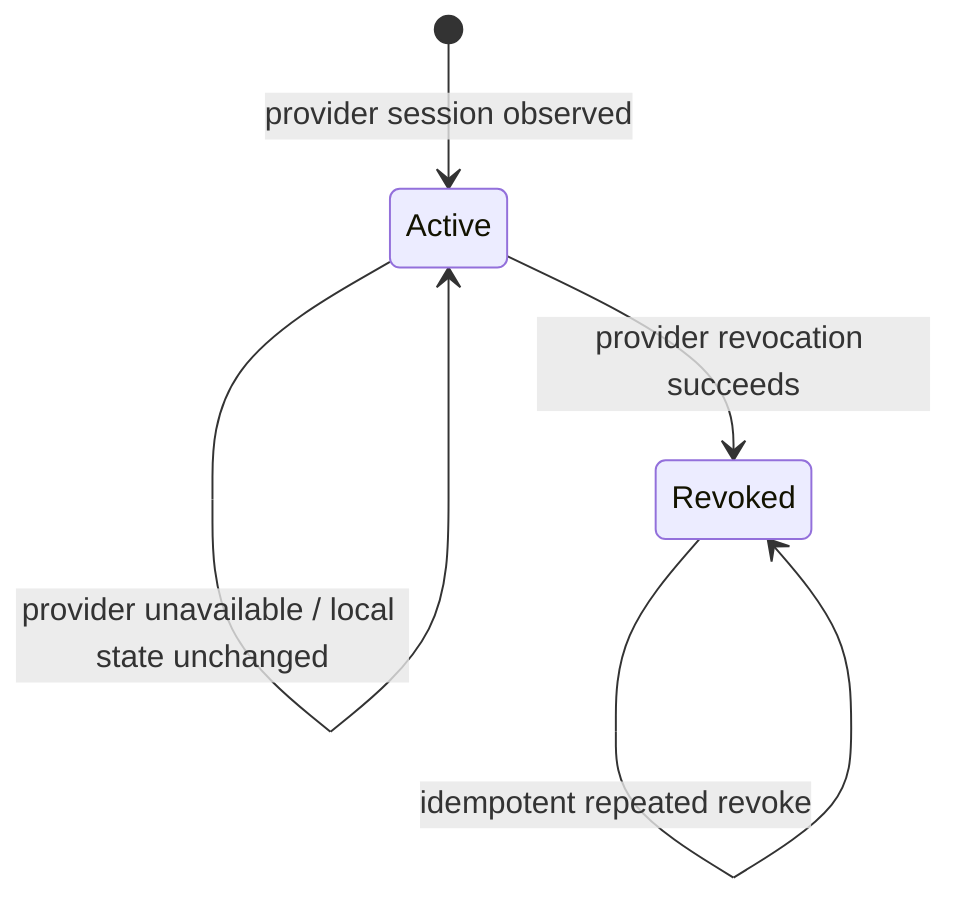
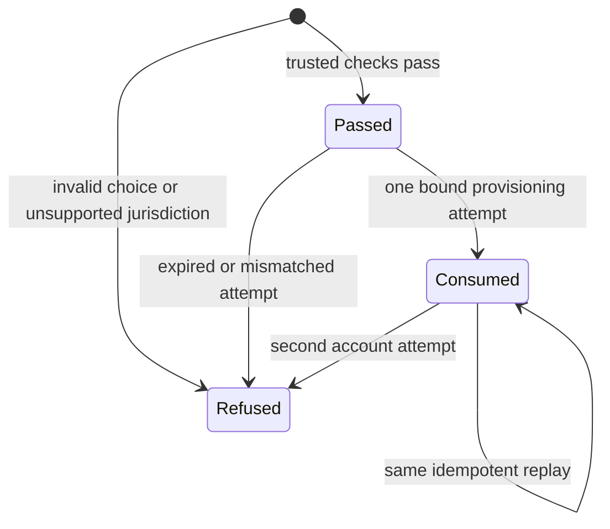
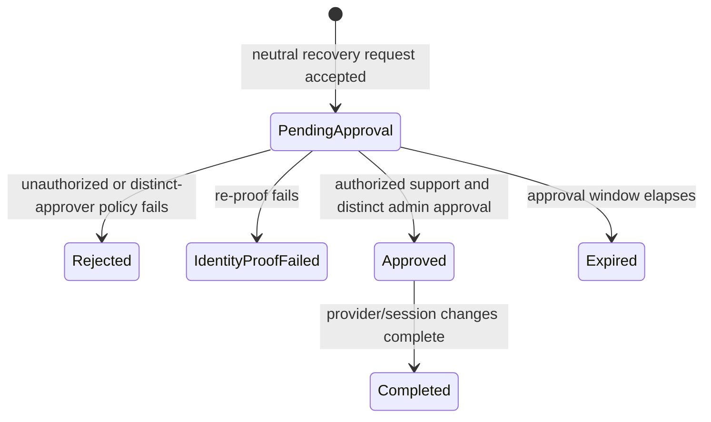

# U1 Identity Auth Domain — Functional Specification

**Unit:** U1 `u1-identity-auth-domain`  
**Stories:** US2.1, US2.4, US3.1–US3.3, US4.1–US4.3, US5.1–US5.4, US6.1, US7.1–US7.3, US9.2–US9.3  
**Boundary:** Identity domain/application policy and use cases; U2 implements provider/HTTP/gateway adapters, U3 presents the SPA, and U4 proves integrated behavior. This is a behavioral design, not implementation code.

## Decisions and boundaries

- Supabase Auth owns passwords, email verification, TOTP secrets/factor operations, token issuance/rotation and provider-session validity. Identity does not store credentials or become an alternate identity provider.
- Identity owns the internal user/principal projection, signup-gate outcome, MFA policy, application device-session view, recovery-case lifecycle, first-seen-device decision and local audit intent.
- The absolute 30-day session cap is anchored to immutable first sign-in. Refresh rotates provider tokens but never resets that anchor (FR2.1; AC2.1.3).
- A support-assisted recovery is approved by a distinct authorized administrator under the existing support-grant approval policy. The requester/actor and approver must differ.
- U1's alert eligibility is first-seen device only. Unusual-location detection is not included until a measurable rule is specified.
- Revocation remains stateless at service JWT validation: browser-held tokens are discarded after a successful revoke; the accepted residual access-token window is up to one hour. This design does not introduce a shared deny-list.
- Each security-sensitive mutation writes a sanitized Identity outbox intent in the same local transaction. Existing outbox delivery and bounded retries deliver to the append-only Audit service; notification delivery remains synchronous, bounded and idempotent through its port.

## Domain entities and relationships

The authoritative entity/attribute definitions are in `entities.md`. The compact relationship view below is derived from its YAML block.

<!-- Text fallback: An InternalUser owns zero or more DeviceSessions, RecoveryCases, LoginEvents and audit outbox entries, and has zero or one MFA policy state. A SignupGate can authorize one provisioning attempt for the resulting InternalUser. -->

## Workflows

### Principal resolution and account policy

1. A service validates the Supabase JWT independently; Identity receives the validated subject and caller context, never a caller-supplied role or subject as authority.
2. Identity finds the unique internal-user projection. If absent, it creates or retrieves the row atomically so concurrent first requests converge.
3. Identity refuses disabled or deleted users. For an existing eligible user it returns the principal, including trusted email-verification and MFA-policy state.
4. If the user has an exchange credential and lacks a verified factor/AAL2, the principal is limited to MFA and settings capabilities. A user without an exchange credential is not restricted solely for lacking MFA.
5. Any refusal uses the existing safe problem mapping; the existence of another user's identity is not disclosed.

### Session refresh and absolute expiry

1. The SPA requests refresh from Supabase Auth when its access token has expired and a refresh token remains.
2. Identity's policy permits the session only while the immutable first-sign-in time is younger than 30 days and provider state permits refresh.
3. A successful refresh uses the provider's rotated token pair; the old refresh token is no longer accepted. `first_signed_in_at` remains unchanged.
4. If the absolute cap is reached or the refresh token is invalid/revoked, the session ends and the SPA returns to sign-in. Provider outage is recoverable and does not partially update Identity state.
5. Concurrent refresh in multiple tabs must converge on the provider-issued current token state; no tab may silently resurrect a rotated-away token. The session layer serializes/coalesces provider refresh as required by the adapter design; U1's use case returns an explicit recoverable result rather than persisting a partial refresh.

### Sign-out

1. The user initiates sign-out.
2. The application clears its in-memory session first.
3. It then requests provider session termination.
4. Identity records the sign-out outcome using a sanitized audit intent. Provider failure is surfaced, but the local browser stays signed out and does not restore a stale token.

### TOTP enrolment and MFA step-up

1. An authenticated user starts enrolment; the provider creates a pending TOTP factor. The secret/otpauth material is returned once through the boundary and is not persisted by Identity.
2. The user submits a six-digit code for the pending factor. Identity delegates verification to the provider.
3. Invalid or expired codes leave the factor unverified and allow retry against the pending enrolment. Provider outage returns a safe recoverable failure.
4. Successful verification changes trusted MFA policy to enrolled/AAL2, records a sanitized audit intent, and returns one-time recovery codes for display; neither the codes nor factor secrets are stored or audited.
5. An exchange-credential user without verified MFA remains limited. On verified AAL2, the policy restriction lifts on the next trusted request without requiring a new sign-in.
6. Password, MFA-method and recovery-code changes require current second-factor proof. After success, every other session is revoked and the initiating session remains; failed proof changes nothing.

### Signup gate and provisioning authorization

1. The browser gathers explicit jurisdiction, terms, risk and age choices; it submits those choices, never defaults, through the gateway.
2. Identity obtains jurisdiction from a trusted source or verifies the submitted jurisdiction using the trusted-side jurisdiction policy; browser values alone cannot override the check.
3. Missing/negative consent, unsupported or undetermined jurisdiction, or unavailable trusted gate evaluation refuses before provisioning.
4. A successful evaluation creates an opaque gate authorization bound to the subject and signup attempt. It is single-use and idempotent for the same operation key; reuse for a different attempt is refused.
5. Provisioning consumes the authorization atomically with the gate state. The signup response and errors do not expose whether an unrelated account exists.

### Email verification eligibility

1. Identity reads email-verification state from trusted provider-backed state, not a browser claim.
2. Adding an exchange credential is refused while email remains unverified, with a safe path to request verification.
3. A resend request is rate-limited and returns a neutral accepted response that does not reveal account existence. A rate refusal includes a retry hint without exposing identity details.
4. Once the provider verifies the email, the next trusted request observes the change; no new sign-in is required.

### Device-session list and revocation

1. Identity lists only the caller's sessions by default, with a device label, last-seen timestamp, state and current-session marker. Empty and single-session results are valid.
2. Cross-user access is available only through the separately authorized admin/support path. An unauthorized owner mismatch returns a non-disclosing not-found result.
3. Revoking a non-current session first requests provider revocation. Only after provider success (or provider-confirmed absence) does Identity mark the local row revoked and commit the audit intent.
4. Revoking the current session requires explicit confirmation. After provider success the SPA clears its in-memory token and returns to sign-in.
5. Replaying the same idempotency key and body returns the original outcome without a second provider action. Reusing a key with a different body is a conflict.
6. Revoke-others preserves the current session and returns per-session results. Partial provider failures remain explicit and retryable; no aggregate success is reported while sessions remain.
7. A successful revoke does not make a stateless JWT immediately invalid at every service: the residual window can last until its one-hour access-token expiry. The SPA drops its token, and Identity refuses the principal where its current local session policy permits.
8. A successful password/MFA change revokes every other session. Completed account recovery revokes all existing sessions and issues no new application session before completion.

### First-seen-device login alert

1. After a successful sign-in, Identity derives a privacy-preserving device key and compares it with that user's known device history.
2. For a first-seen device, Identity creates one idempotent in-app alert request containing only the device label, optional coarse location, event time and opaque user reference.
3. A previously seen device does not create another alert. An unusual-location-only alert is not produced by U1.
4. Notification delivery uses bounded retries and an idempotency key. Delivery failure is visible to operations and does not roll back or fail sign-in.

### Support-assisted recovery

1. A requester submits contact and reason to the public, rate-limited recovery entry point; the response is neutral and equivalent for known/unknown accounts.
2. Identity creates a pending recovery case and a sanitized audit intent. It does not ask the requester for a password, provider secret, factor seed or recovery code.
3. An authorized support actor performs the existing support-grant checks and records the reason/context. A distinct authorized administrator approves; self-approval is refused.
4. Identity records the re-proof result. Failed proof closes/refuses the case without changing the account or sessions and without naming which check failed.
5. On approval and successful proof, Identity coordinates the provider-owned credential/session change. It revokes all existing sessions, then marks the case completed and records the outcome. A replacement session is issued only after the support flow completes the separate credential setup step.
6. Partial revocation is reported per session and remains actionable; the case is not reported fully complete while the required revocations are unresolved.

## State transitions

### DeviceSession

<!-- Text fallback: A newly observed session is Active. It becomes Revoked only after provider revocation succeeds; provider failure leaves it Active. Repeated revocation of a Revoked session is an idempotent success. -->

### SignupGate

<!-- Text fallback: The trusted gate either refuses or passes. A passed authorization is consumed by one bound signup attempt; it cannot authorize another account. -->

### RecoveryCase

<!-- Text fallback: Recovery starts pending approval and ends rejected, identity-proof-failed, expired, or approved. Approved cases become completed only after the provider/session actions succeed. -->

### MfaPolicyState

- `not_enrolled, aal1` → `enrolment_pending, aal1` when provider enrolment begins.
- `enrolment_pending, aal1` → unchanged on invalid/expired code; user may retry.
- `enrolment_pending, aal1` → `enrolled, aal2` on provider-verified code.
- `enrolled, aal2` → `enrolled, aal1` only when provider reports factor removal/reset; if an exchange credential remains, sensitive/portfolio access is restricted until step-up succeeds.
- Provider outage does not fabricate a state transition. Identity returns a recoverable dependency failure.

## Failure and consistency behavior

- **Provider unavailable:** Existing tokens continue to work only until their validated expiry. Sign-in, refresh, MFA and provider-revocation operations return a safe recoverable service-unavailable result; bounded retries are only for transient failures. No fallback authentication path exists.
- **Provider revocation fails:** Do not mark the Identity session revoked and do not record an audit success. Return a recoverable error; preserve the current local row.
- **Notification unavailable:** Preserve successful sign-in, surface delivery failure to operations, and retry within the established bound using the same idempotency key.
- **Audit intent cannot commit:** Roll back the corresponding security-sensitive Identity mutation so the system never claims an unaudited success. Outbox delivery failure after commit remains pending/retryable and dead-lettered work is surfaced.
- **Concurrent first-user creation:** Unique subject mapping and atomic create-or-get behavior yield one internal user.
- **Concurrent or repeated side effects:** Stable idempotency keys prevent duplicate revocations, recovery completion and login alerts. Partial bulk revocation reports the remaining sessions and permits retry.
- **Disclosure:** RFC 7807 errors use stable safe types and correlation identifiers; they do not echo rejected values, secrets, tokens, provider text, full fingerprints or another user's data.

## Derived rules summary

Business-rule source of truth is `rules.md`; this summary is derived.

| Rule IDs | Behavioral constraint |
|---|---|
| BR1.1–BR1.2 | Identity projection is unique/idempotent; disabled/deleted accounts are denied |
| BR1.3–BR1.5 | The 30-day cap starts at first sign-in; refresh rotates; sign-out clears the app session first |
| BR1.6–BR1.8 | Security transitions create atomic audit intent; MFA and sensitive changes use trusted AAL2 policy |
| BR1.9–BR1.10 | Signup and exchange eligibility are enforced from trusted-side state |
| BR1.11–BR1.12 | Session ownership and provider-first revocation; recovery/credential changes invalidate other sessions |
| BR1.13–BR1.14 | First-seen devices trigger alerts; recovery uses a distinct authorized approver |
| BR1.15–BR1.16 | Provider outage has no fallback auth; sensitive data is excluded from records |

## Open items not decided by U1

- Exact provider Admin API support for listing/revoking sessions and factor state is an adapter verification item for U2; Identity keeps its own device-session view.
- Exact route spellings and the mapping from all SPA paths to one gateway declaration and handler are U2/U3 contract work.
- The measurable unusual-location detector remains out of scope for U1; only first-seen-device alerts are specified.
- Provider-initiated single logout remains outside the intent's accepted scope.
- The recovery identity re-proof procedure and support-grant eligibility evidence must be supplied by the existing support workflow; the policy here fixes only the distinct-admin approval rule.
