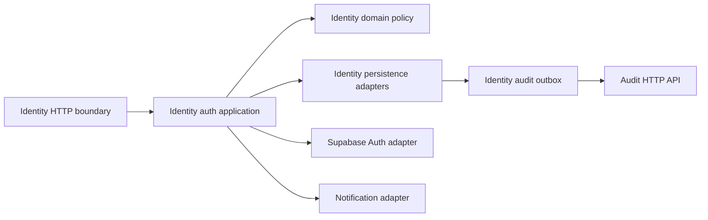

# U1 Identity Auth Domain — Logical Components

**Unit:** U1 `u1-identity-auth-domain`  
**Inputs:** `nfr-requirements/tech-stack-decisions.md`, `security-requirements.md`, `reliability-requirements.md`, `functional-design/functional-spec.md`, `inception/domain-design/components.md`, `inception/contract-design/contract-summary.md`.

## Component inventory

| Logical component | Responsibility | Failure domain and boundary |
|---|---|---|
| Identity Auth Application | Orchestrates principal policy, signup gates, MFA policy, session operations, recovery and login-alert eligibility through inward ports. | One existing Identity service boundary; use cases remain testable with hand-written port fakes. |
| Identity Domain Policy | Enforces ownership, user status, absolute session lifetime, AAL2 requirements, single-use gates and recovery transitions. | Pure business rules; no framework, network or persistence imports. |
| Identity Persistence Adapters | Persist Identity-owned users, session view, gates, MFA policy, recovery cases and transactional audit outbox. | Identity schema and role only. Database failure is surfaced; state and required audit intent commit atomically. |
| Supabase Auth Adapter | Maps Identity ports to provider-owned factor/session operations and typed external outcomes. | Dependency-specific timeout and bounded concurrency; provider text/secrets do not escape. Required decisions fail closed during outage. |
| Notification Adapter | Sends idempotent in-app login-alert requests to Notification after Identity classifies a first-seen device. | Separate bounded dependency capacity; failures are observable but never undo sign-in. |
| Audit Outbox Drainer | Sends committed sanitized Identity outbox entries to the append-only Audit API with idempotency. | Delivery is retried within existing bounds; dead letters are surfaced. No direct cross-schema access or message queue. |
| Identity HTTP Boundary | Maps public/internal request DTOs to application commands and typed results to safe RFC 7807 problems. | Caller identity and ownership are derived from validated tokens and trusted state; no provider details or rejected values disclosed. |

## Dependency view

<!-- Text fallback: Identity HTTP maps requests to the Identity application; the application uses framework-free domain policy and ports implemented by Identity persistence, Supabase Auth and Notification adapters. A transactional Identity outbox is drained to the Audit HTTP API. -->

## Isolation and blast radius

- Supabase Auth slowness is bounded to provider-dependent operations and does not consume the full Identity request capacity.
- Notification failure affects alert delivery only; successful sign-in remains successful.
- Audit HTTP outage leaves committed outbox rows pending/retryable; local state changes and their audit intent remain atomic.
- Identity database outage affects Identity-owned auth policy and session reads; errors are surfaced as safe service-unavailable problems.
- No new deployable component, cache, shared deny-list, schema grant, queue or environment is introduced.
