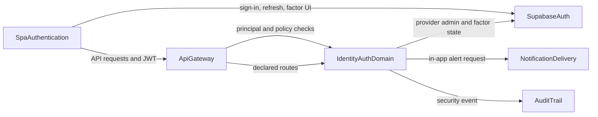

# Domain Design — Component Catalogue

**Intent:** authentication and session management (BRD-003 v1.1)
**Scope:** logical code components, responsibilities, ownership and dependencies only. Deployment
placement, schema columns, API methods, token lifetime detail, and infrastructure choices belong to
later stages.

**Decision basis:** the six boundary questions in `domain-design-questions.md` were answered and
recorded. This catalogue extends the existing SPA, gateway and Identity components; Supabase Auth
continues as the external identity authority; Identity owns the app's session view, sign-up gate,
MFA policy, recovery case and login-alert decision; the Notification service delivers in-app alerts.

## Machine-readable catalogue

```yaml
components:
  - name: SpaAuthentication
    summary: Sign-in, sign-up gate input, MFA screens, session management and recovery entry for the user.
    behaviour: >
      Uses Supabase Auth directly for email/password and magic-link authentication and holds tokens
      in memory. Collects consent and jurisdiction choices, displays the limited-session state,
      shows the user's device sessions, and initiates recovery. It never decides authoritative
      jurisdiction, MFA, ownership, or session validity; those decisions come from Identity and the
      gateway. Every SPA-called API path must have a declared gateway route and owning handler.
    responsibilities:
      - Collect sign-in credentials and start password or magic-link authentication.
      - Keep access and refresh tokens in memory and use the PKCE verifier only for redirect completion.
      - Present sign-up gates as real, unselected user choices; submit them to Identity through the gateway.
      - Present MFA enrolment and verification, recovery codes, limited-session messaging, session list/revoke, and recovery request entry.
      - Show clear, non-revealing provider failures and avoid exposing secrets in errors, URLs, analytics, or logs.
    depends_on:
      - component: ApiGateway
        interaction: Send API requests with the user's bearer token; only declared routes are reachable.
        style: sync
      - component: SupabaseAuth
        interaction: Perform sign-in, refresh, sign-out, magic-link callback, MFA factor operations, and provider session revocation through the SDK.
        style: sync
      - component: IdentityAuthDomain
        interaction: Obtain account-gate status and drive the user session/MFA/recovery experience through gateway-owned routes.
        style: sync
    dependents: []
    external_dependencies:
      - name: Browser runtime
        kind: other
        purpose: Render screens, hold the session in memory, and complete redirect callbacks.
      - name: Supabase Auth SDK
        kind: third-party-api
        purpose: Direct browser authentication exception and provider-managed factors.
    entities: []
  - name: ApiGateway
    summary: Public request boundary for browser-to-service traffic with token validation and declared route ownership.
    behaviour: >
      Validates each protected request's Supabase JWT, applies auth-specific rate budgets, refuses
      undeclared routes, forwards the user's JWT unchanged to the owning service, and propagates
      correlation metadata. It does not own user, gate, MFA-factor, recovery-case, or device-session
      business state.
    responsibilities:
      - Validate signature, issuer, audience, expiry, and configured clock-skew allowance on protected routes.
      - Maintain the deny-by-default route table, naming the owning service and stricter auth rate budgets.
      - Forward the user's JWT unchanged to Identity and other owners; do not mint a replacement identity assertion.
      - Return non-revealing problem responses when validation or upstream auth fails.
    depends_on:
      - component: IdentityAuthDomain
        interaction: Resolve the internal principal and apply account/MFA policy for protected user routes.
        style: sync
    dependents:
      - component: SpaAuthentication
        interaction: Receives every SPA API call except direct Supabase Auth calls.
        style: sync
      - component: IdentityAuthDomain
        interaction: Routes user requests and invokes Identity-owned handlers.
        style: sync
    external_dependencies:
      - name: Supabase JWKS
        kind: third-party-api
        purpose: Verify Supabase access-token signatures and claims.
    entities: []
  - name: IdentityAuthDomain
    summary: Internal identity, sign-up gates, MFA policy, device sessions, support-assisted recovery and audit decisions.
    behaviour: >
      Owns internal user and principal projection and the app's auth-related business state. It
      evaluates consent and jurisdiction before provisioning, determines when AAL2 is required,
      owns the device-session view and revocation workflow, owns the recovery case lifecycle, and
      decides when a sign-in warrants an in-app alert. Supabase Auth remains the source of provider
      credentials, factors, and provider session validity. All user-owned records enforce ownership;
      sensitive transitions are audited. A revoked token may pass stateless validation until access
      token expiry, as explicitly accepted in requirements FR3.8.
    responsibilities:
      - Create and project the internal user on first authenticated request.
      - Evaluate sign-up consent and jurisdiction gates before account provisioning.
      - Own MFA policy, factor-enrolment status, limited-session policy, and AAL2 checks; delegate factor operations to Supabase Auth.
      - Own the application device/session view and coordinate provider revocation before local state change.
      - Own support-assisted recovery cases, authorization, re-proof orchestration, session invalidation, and audit trail.
      - Decide whether a successful sign-in is a new device/unusual location and request an in-app notification.
      - Enforce ownership and role checks without disclosing another user's existence.
    depends_on:
      - component: SupabaseAuth
        interaction: Validate provider subject, manage factors, revoke provider sessions, and complete provider-owned identity lifecycle operations.
        style: sync
      - component: NotificationDelivery
        interaction: Request an in-app alert after the sign-in event; use bounded retries and idempotency.
        style: sync
      - component: AuditTrail
        interaction: Record security-sensitive actions and outcomes in the append-only audit trail.
        style: sync
      - component: ApiGateway
        interaction: Receive public user traffic and provide the gateway-facing principal and policy interface.
        style: sync
    dependents:
      - component: SpaAuthentication
        interaction: Supplies gate, profile, MFA-policy, device-session, and recovery outcomes through the gateway.
        style: sync
      - component: ApiGateway
        interaction: Supplies principal and account/MFA authorization decisions to the edge.
        style: sync
    external_dependencies:
      - name: Identity Postgres schema
        kind: database
        purpose: Store internal users, consent and gate state, device-session view, recovery cases, and outbox state under the Identity role.
      - name: Supabase Auth Admin API
        kind: third-party-api
        purpose: Revoke provider sessions and manage provider-owned factors without handling passwords in the application.
    entities:
      - name: InternalUser
        identifier: user_id
        attributes: [auth_subject, role, status, email_verified, locale, consent_state, jurisdiction]
      - name: DeviceSession
        identifier: session_id
        attributes: [user_id, device_label, last_seen_at, revoked_at, is_current]
      - name: SignupGate
        identifier: gate_id
        attributes: [user_id, jurisdiction, terms_accepted, risk_acknowledged, age_confirmed, outcome, created_at]
      - name: RecoveryCase
        identifier: recovery_case_id
        attributes: [user_id, requester_contact, reason, status, requested_at, verified_by, completed_at]
      - name: MfaPolicyState
        identifier: user_id
        attributes: [mfa_required, mfa_enrolled, aal, exchange_credential_present]
  - name: SupabaseAuth
    summary: External identity provider for credentials, magic links, token issuance/refresh, factors, and provider sessions.
    behaviour: >
      Owns passwords, email verification, provider-side token minting and refresh, TOTP factors,
      and provider session revocation. The application never stores or processes passwords. Provider
      availability is a dependency; already-issued JWTs remain usable until expiry when the provider
      is unavailable, under the accepted outage policy.
    responsibilities:
      - Authenticate email/password and issue magic-link callbacks.
      - Issue, rotate, and expire access and refresh tokens per the policy settled in requirements.
      - Manage TOTP factor enrollment and verification.
      - Revoke provider sessions when Identity requests it.
      - Provide configured JWKS for gateway and service token validation.
    depends_on: []
    dependents:
      - component: SpaAuthentication
        interaction: Browser SDK sign-in, refresh, sign-out, callback and MFA factor operations.
        style: sync
      - component: ApiGateway
        interaction: JWKS used to verify tokens.
        style: sync
      - component: IdentityAuthDomain
        interaction: Admin operations for session revocation and factor status.
        style: sync
    external_dependencies:
      - name: Supabase Auth service
        kind: third-party-api
        purpose: Provider-owned identity, session and factor operations.
    entities: []
  - name: NotificationDelivery
    summary: Existing Notification owner for delivery of in-app user alerts.
    behaviour: >
      Accepts an idempotent request from Identity and presents an in-app notification. Login-alert
      content contains no token, credential, or full device fingerprint. It does not decide whether
      a sign-in is unusual.
    responsibilities:
      - Deliver in-app notification records to the user.
      - Deduplicate retries using the supplied idempotency key.
    depends_on: []
    dependents:
      - component: IdentityAuthDomain
        interaction: Identity requests an in-app notification after its sign-in decision.
        style: sync
    external_dependencies:
      - name: Notification Postgres schema
        kind: database
        purpose: Persist notification records under the Notification role.
    entities:
      - name: LoginAlert
        identifier: notification_id
        attributes: [user_id, device_label, coarse_location, occurred_at, read_at]
  - name: AuditTrail
    summary: Existing append-only Audit owner receiving Identity security events.
    behaviour: >
      Stores security event records without credentials, tokens, recovery codes, factor seeds, or
      full device fingerprints. Identity writes its local outbox in the same transaction as its
      state change; the existing outbox drainer delivers to Audit.
    responsibilities:
      - Accept append-only security events and preserve actor, action, target, time, context and outcome.
      - Reject updates and deletion through the insert-only role.
    depends_on: []
    dependents:
      - component: IdentityAuthDomain
        interaction: Identity records gate, MFA, recovery, session and alert-decision events.
        style: sync
    external_dependencies:
      - name: Audit Postgres schema
        kind: database
        purpose: Append-only audit record storage.
    entities:
      - name: SecurityAuditEvent
        identifier: event_id
        attributes: [actor, action, target, occurred_at, context, outcome]
```

## Component Diagram



<!-- Text fallback: The SPA sends API calls through the gateway and authenticates directly with Supabase Auth. The gateway routes declared requests to Identity. Identity uses Supabase Auth for provider-owned sessions and factors, sends login alerts to Notification, and records security events through Audit. -->

## Component Summary

| Component | Purpose | Depends On | Dependents | Entities Owned |
|---|---|---|---|---|
| SpaAuthentication | User-facing sign-in, gates, MFA, sessions, recovery entry | ApiGateway, SupabaseAuth, IdentityAuthDomain | — | — |
| ApiGateway | Public auth boundary, JWT validation, route ownership and rate budgets | IdentityAuthDomain, Supabase JWKS | SpaAuthentication, IdentityAuthDomain | — |
| IdentityAuthDomain | Internal identity, gates, MFA policy, sessions, recovery, alert decisions | SupabaseAuth, NotificationDelivery, AuditTrail, ApiGateway | SpaAuthentication, ApiGateway | InternalUser, DeviceSession, SignupGate, RecoveryCase, MfaPolicyState |
| SupabaseAuth | Provider-owned credentials, tokens, factors, sessions | — | SpaAuthentication, ApiGateway, IdentityAuthDomain | — (external) |
| NotificationDelivery | In-app notification delivery | Notification Postgres | IdentityAuthDomain | LoginAlert |
| AuditTrail | Append-only security event ownership | Audit Postgres | IdentityAuthDomain | SecurityAuditEvent |

## Entity Ownership

| Entity | Owning Component | Identifier | Attributes | References |
|---|---|---|---|---|
| InternalUser | IdentityAuthDomain | user_id | auth_subject, role, status, email_verified, locale, consent_state, jurisdiction | — |
| DeviceSession | IdentityAuthDomain | session_id | user_id, device_label, last_seen_at, revoked_at, is_current | user_id → InternalUser (IdentityAuthDomain) |
| SignupGate | IdentityAuthDomain | gate_id | user_id, jurisdiction, terms_accepted, risk_acknowledged, age_confirmed, outcome, created_at | user_id → InternalUser (IdentityAuthDomain) |
| RecoveryCase | IdentityAuthDomain | recovery_case_id | user_id, requester_contact, reason, status, requested_at, verified_by, completed_at | user_id → InternalUser (IdentityAuthDomain) |
| MfaPolicyState | IdentityAuthDomain | user_id | mfa_required, mfa_enrolled, aal, exchange_credential_present | user_id → InternalUser (IdentityAuthDomain) |
| LoginAlert | NotificationDelivery | notification_id | user_id, device_label, coarse_location, occurred_at, read_at | user_id → IdentityAuthDomain.InternalUser |
| SecurityAuditEvent | AuditTrail | event_id | actor, action, target, occurred_at, context, outcome | target may reference Identity-owned entities by opaque identifier |

## External Dependencies

| Component | Dependency | Kind | Purpose |
|---|---|---|---|
| SpaAuthentication | Browser runtime | other | UI, in-memory tokens, PKCE callback |
| SpaAuthentication | Supabase Auth SDK | third-party-api | Direct browser sign-in, refresh and factor operations |
| ApiGateway | Supabase JWKS | third-party-api | Verify access-token signatures and claims |
| IdentityAuthDomain | Identity Postgres schema | database | Persist internal user, gate, session, recovery and outbox state |
| IdentityAuthDomain | Supabase Auth Admin API | third-party-api | Provider session revocation and factor operations |
| NotificationDelivery | Notification Postgres schema | database | Persist in-app notifications under Notification role |
| AuditTrail | Audit Postgres schema | database | Append-only security event storage |

## Rationale

| Component | Why separate | Alternatives Rejected |
|---|---|---|
| SpaAuthentication | User interaction and browser-only session handling have a distinct runtime and lifecycle from server-side policy. | Put sign-in in Identity pages — rejected because the SPA owns the browser experience and Supabase Auth is the one allowed direct external call. |
| ApiGateway | One public boundary owns JWT validation, rate limits and deny-by-default routing for all SPA calls. | Let the SPA call Identity or other services directly — rejected by the project boundary rule and route-table practice. |
| IdentityAuthDomain | User identity, sessions, gates, MFA policy and recovery all share the same principal, ownership rules and audit lifecycle, and extend existing Identity capabilities. | New Auth, MFA, Session, Recovery or Compliance services — rejected by interview Q1–Q4/Q6 to avoid splitting one identity lifecycle across new boundaries. |
| SupabaseAuth | Provider owns password handling, token minting and provider factors; it remains outside the application's trust boundary. | Store passwords or factors in Identity — rejected by BR-AUTH-01 and the BRD delegation to Supabase Auth. |
| NotificationDelivery | Existing Notification component owns delivery and persistence; Identity owns the decision that a sign-in is alert-worthy. | Have the SPA or gateway decide new-device policy — rejected by interview Q5 because they lack the authoritative device history and policy. |
| AuditTrail | Existing append-only Audit component owns immutable records and retention. | Write audit records into Identity or Notification schema — rejected by the one-schema-per-service rule and append-only audit ownership. |

## Dependency and ownership invariants

1. Every SPA API call has exactly one declared gateway route and one owning service handler.
2. Supabase Auth is authoritative for credentials, tokens, provider factors and provider session validity; Identity owns only the app-facing projection and policy.
3. Identity Device Sessions is the source for the app's device list; provider revocation occurs before local state is marked revoked.
4. Identity owns sign-up gate, MFA policy and recovery-case state; the SPA only collects choices and displays outcomes.
5. Identity decides whether a sign-in merits an alert and calls Notification synchronously through a port with bounded retry and idempotency; no message queue is introduced.
6. Security events contain no secret or token and flow to the append-only Audit owner.
7. A revoked session's residual access window remains the explicitly accepted limit in requirements FR3.8; this component catalogue does not silently introduce a server-side deny-list.
