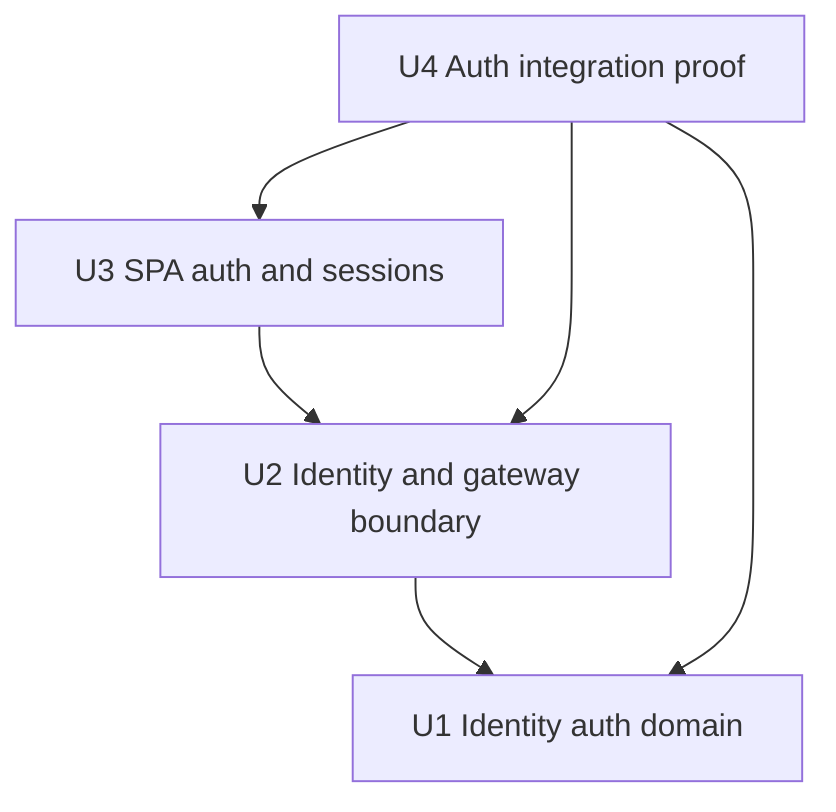

# Units Generation — Plan

The approved design keeps the existing SPA, gateway, Identity and provider boundaries. The plan makes
four bounded units, in a strict dependency chain; it does not introduce a new deployable service.
Unit ids and directories are stable construction keys.

## Unit plan

| Unit ID | Directory | Kind | Responsibility | Scope | Depends on |
|---|---|---|---|---|---|
| U1 | `u1-identity-auth-domain` | service | Extend Identity's domain/application policy for signup gates, MFA/AAL2 limited-session rules, device sessions, support-assisted recovery cases, audit events and the Notification port. | Identity-owned business rules and use cases. Existing service, not a new service boundary. | none |
| U2 | `u2-identity-gateway` | service | Implement the Identity HTTP/infrastructure edges and declare the auth/session routes at the gateway with rate budgets, trusted-side checks and provider adapters. | Signup gate, email-verification status, session list/revoke, TOTP operations, recovery and principal/MFA policy routes. | U1 |
| U3 | `u3-spa-auth-sessions` | ui | Implement the sign-in/magic-link, sign-up gates, MFA, limited-session, session-management, recovery-entry and in-app alert experiences in the SPA, using existing Parchment Ledger components/tokens. | Browser UI and API-client calls only; no direct service calls. | U2 |
| U4 | `u4-auth-integration-proof` | spec | Close the auth slice by verifying every SPA-called auth path has a declared gateway route and owning handler; add the end-to-end/browser-journey and cross-boundary acceptance proof, including in-app alert delivery and failure behaviour. | Tests, route coverage and integration verification; no separate runtime. | U1, U2, U3 |

## Boundary notes

- U1 extends Identity's existing application/domain boundary; it does not create a new Auth, MFA, Recovery,
  or Session service.
- U2 owns adapters and HTTP/routing. Identity and the gateway remain separate components, despite
  sharing one Unit, because they are changed together for this bounded auth route surface and are in
  the same deployment-facing integration step.
- U3 is a user-facing `ui` Unit in the existing `web` package. The support console remains unchanged;
  recovery operates through its existing support-grant interface.
- U4 is a `spec` Unit with tests and route-completeness evidence, not a service or deployable package.
- No separate walking-skeleton Unit: the existing Asset Registry slice is already built. This intent
  grows that slice and must prove the new auth paths end-to-end at U4.
- The 30-day token cap's anchor (first sign-in vs last refresh) remains an open question in Requirements
  Analysis; Units do not choose it. It must be resolved before implementation instructions are locked.
- US4.3 administrator session access was not covered as a UI story after the product review noted the
  gap; the existing requirements still require an admin path. U2 and U4 include a bounded admin route
  and its authorization/integration proof, with admin UI work deferred to the existing support-console
  surface unless delivery planning adds it explicitly.

## Implementation notes per Unit

### U1 — Identity auth domain

- Preserve Clean Architecture: policy and use cases inward; ports defined inward; adapters outward.
- Own exactly one Identity representation for `InternalUser`, `DeviceSession`, `SignupGate`,
  `RecoveryCase`, and MFA policy state. Supabase Auth owns password credentials, provider factors,
  token issuance and provider session validity.
- Preserve the accepted revocation window: stateless JWTs may be accepted until expiry; the SPA drops
  its token after revocation, and Identity refuses the principal where the local session/policy permits.
- Login-alert detection belongs here; Notification delivery is invoked through a port using bounded
  synchronous HTTP and an idempotency key, never a queue.
- Every security-sensitive transition creates a sanitized audit intent in the same transaction.

### U2 — Identity and gateway boundary

- Add only declared gateway routes with exactly one owning handler. Keep JWT forwarding unchanged.
- Auth paths use stricter route budgets than ordinary reads; malformed and unauthorized calls return
  RFC 7807 problem bodies without secrets or upstream details.
- Preserve provider-first revocation, then local row update, then audit; on provider failure, local
  state remains unchanged.
- Expose and test the Identity Admin route for another user's session list/revoke; check role and
  avoid disclosing whether an inaccessible user exists.
- Email verification and signup gate decisions are trusted-side. A browser-only state is not authority.

### U3 — SPA auth and sessions

- Use Parchment Ledger tokens only; reuse `ConfirmDialog`, `ErrorPanel`, `EmptyState`, `Loading`,
  `StatusRegion`, settings navigation and signup-gate components where they fit.
- Keep access/refresh tokens in memory; PKCE verifier is the only sessionStorage exception and is
  removed at callback completion.
- Magic link is in scope. Google/Apple OAuth and passkeys are explicitly deferred; do not render dead
  controls.
- Sessions is a fifth settings destination. Confirm current-session revoke and revoke-all; show the
  accepted up-to-one-hour residual window in plain copy.
- Limited session uses a persistent banner and explained redirect to MFA; client restrictions do not
  replace trusted-side authorization.

### U4 — Auth integration proof

- The set of SPA-called auth paths must be a subset of declared gateway routes and each declared route
  must resolve to exactly one owning handler.
- `yarn e2e` is required for any change touching the auth/sign-in surface, per team practice.
- Cover sign-in, magic-link callback, session refresh/expiry, sign-out, gate refusal, MFA AAL2,
  session revoke and provider outage at end-to-end boundaries; use mocked Supabase Auth and gateway
  responses in browser journeys.
- Verify alert delivery does not fail sign-in, retries are bounded/idempotent, and audit payloads
  contain no token, credential, factor seed, recovery code or full fingerprint.
- Cross-service end-to-end API and route-table coverage are the unit's deliverables; this is not a
  deployment or smoke-test release job.

## In-scope stories

Stories are assigned to the Unit that implements their acceptance criteria. Cross-cutting tests in U4
verify the integrated outcomes; they do not duplicate story ownership.

| Story | Primary Unit | Supporting Unit(s) | Notes |
|---|---|---|---|
| US1.1 password sign-in | U3 | U2 | U4 validates end-to-end |
| US1.2 magic-link sign-in | U3 | U2 | U4 validates callback |
| US1.3 protected-page return | U3 | U2 | |
| US2.1 silent refresh | U1 | U2, U3 | Token policy must respect remaining open anchor |
| US2.2 dead refresh redirect | U3 | U2 | |
| US2.3 memory-only token storage | U3 | U4 | |
| US2.4 sign-out both sessions | U1 | U2, U3 | |
| US3.1 TOTP enrolment | U1 | U2, U3 | Supabase factor adapter in U2 |
| US3.2 limited session | U1 | U2, U3 | |
| US3.3 sensitive-change step-up | U1 | U2, U3 | |
| US4.1 consent gates | U1 | U2, U3 | |
| US4.2 jurisdiction gate | U1 | U2, U3 | |
| US4.3 email verification | U1 | U2, U3 | Admin/session gap finding remains for Human approval disposition |
| US5.1 session list | U1 | U2, U3 | |
| US5.2 revoke one | U1 | U2, U3 | |
| US5.3 revoke all | U1 | U2, U3 | |
| US5.4 revoke after credential change | U1 | U2, U3 | |
| US6.1 new-device alert | U1 | U2, U4 | Notification port/delivery |
| US7.1 recovery request | U1 | U2, U3 | |
| US7.2 recovery completion | U1 | U2, U3 | |
| US7.3 non-revealing recovery response | U1 | U2, U3 | |
| US8.1 gateway reachability | U2 | U4 | |
| US9.1 JWT trust | U2 | U4 | |
| US9.2 disabled user | U1 | U2 | |
| US9.3 provider outage | U1 | U2, U3, U4 | |
| US10.1 Google/Apple OAuth | — | — | Deferred; Won't Have for this intent |
| US10.2 passkey sign-in | — | — | Deferred; Won't Have for this intent |

## Topology-only DAG

This graph is not a recommended build order or critical path; it records only which Units require code
from other Units to build and pass their own tests.

<!-- Text fallback: U1 has no prerequisites. U2 depends on U1. U3 depends on U2. U4 depends on U1, U2 and U3. The graph is acyclic. -->

## Parallel development opportunities

The approved strict dependency chain has one currently ready Unit at a time: U1, then U2, then U3,
then U4. There are no independent Units in this plan, so none can be built in parallel without changing
the agreed boundaries or introducing mock contracts that the person did not approve.

## Traceability and coverage

`traceability.json` covers all 27 story IDs (25 active stories and 2 explicitly deferred stories). The
story map assigns all active stories to U1–U4; US10.1 and US10.2 are `Deferred` with their Won't Have
reason. Each active Unit has at least one mapped story. The gateway route invariant is owned by U2
and proven by U4.
